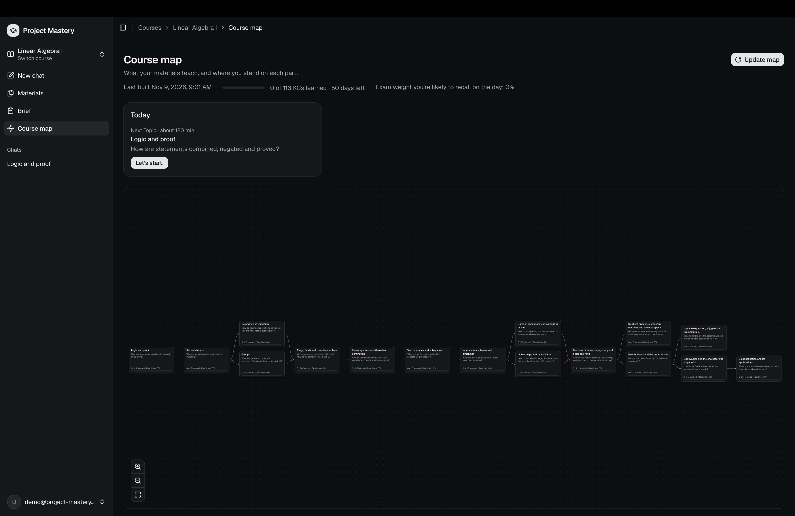
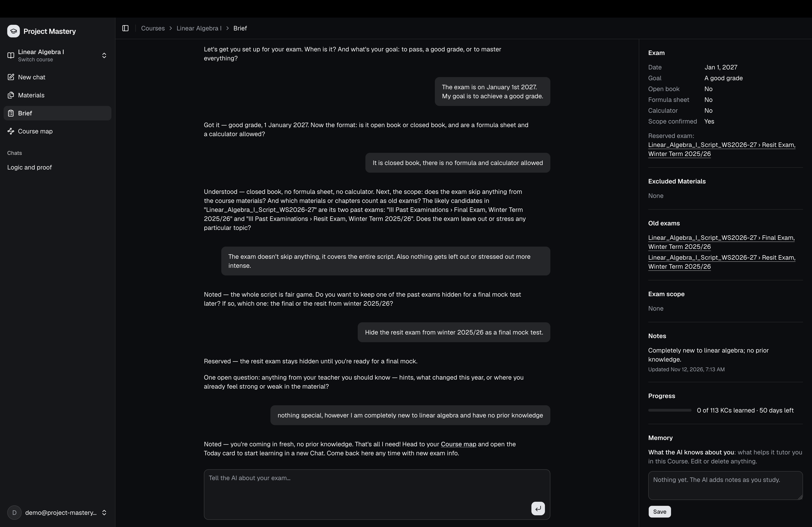
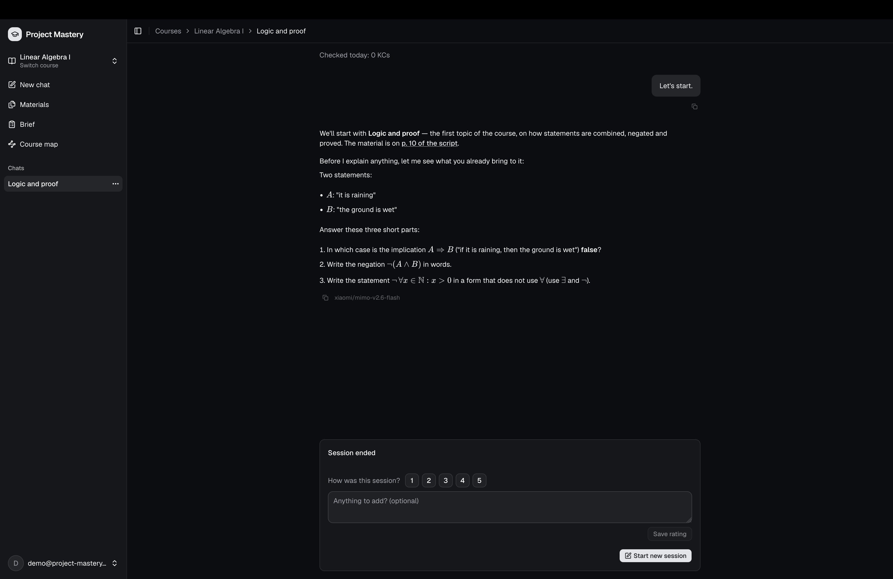

# Project Mastery

**An AI tutor for university exams, grounded in the student's own course.** Upload the slides, scripts and old exams, tell it about the exam and your learning goals, and it tutors you through it, following learning science for reasonable llm api prices.

> _The AI handles everything about learning except the learning itself._

**[Try the live demo →](https://project-mastery-dun.vercel.app/demo)**

Built by **Florian Portscher**: I own the product, the architecture and the review of what every change does; Claude Code agents write the code in a workflow I designed ([how it was built](#how-it-was-built-one-developer-a-team-of-agents)).

_The Course map: what the course teaches, in prerequisite order, with the student's Progress, Readiness and what to do today._

## What it does

1. **Upload.** Slides, scripts, exercise sheets and old exams are parsed into searchable chunks by a durable background workflow.
2. **Brief.** A conversation captures the exam. What else the student says is kept as notes the tutor reads in every Chat.
3. **Knowledge map.** The AI builds a graph of what the Materials teach: nested Topics, Knowledge components (KCs), the Prerequisites between them and the Exercises that test them.
4. **Plan.** Plain code, not a model, ranks what is worth doing next from the exam date, the goal, the student's recall and pace. A Today card shows it next to Progress and Readiness.
5. **Tutor.** One Study session at a time: the Chat answers from the course, checks the student's answers against answer keys with a math engine, and schedules reviews with the [FSRS](docs/adr/0027-per-day-scheduling-and-one-ranking.md) spaced-repetition algorithm.
6. **Practice.** Verified generated problems and mock exams, graded against the same answer keys.

### Words you will see

The app, the code and the issues share one vocabulary, so a capitalized word such as Brief or Topic is a term of the product, defined in full in [GLOSSARY.md](GLOSSARY.md). The ones on this page:

| Term                             | Meaning                                                                                                                                      |
| -------------------------------- | -------------------------------------------------------------------------------------------------------------------------------------------- |
| **Course**, **Material**         | One exam's course, and a file uploaded to it: slides, a script, an exercise sheet or an old exam.                                            |
| **Brief**                        | What the student told the AI about the exam: date, goal, allowed aids, which Materials and Topics count, and short notes.                    |
| **Knowledge component (KC)**     | One thing an exam task could test on its own and a student could learn in one sitting, such as "Group homomorphisms and kernel".             |
| **Topic**                        | A named group of KCs that the student learns and sees as one, such as "Groups". Topics nest and are ordered by their Prerequisites.          |
| **Prerequisite**                 | A link saying one KC must be learned before another.                                                                                         |
| **Course map**                   | The Course's home: its Topics as a graph in Prerequisite order, with the student's numbers on each.                                          |
| **Today card**                   | What the ranking proposes now: the Reviews that are due, then the next Topic, each with its minutes.                                         |
| **Progress**                     | How many KCs of the study plan the student has learned, with days in and days left.                                                          |
| **Readiness**                    | How much of the exam's weight the student is likely to recall on the exam day, from their spaced-repetition model. An estimate, not a grade. |
| **Study session**, **Chat**      | One sitting of study. A Chat is a tutoring session; it closes with notes the tutor reads next time.                                          |
| **Mock exam**, **Reserved exam** | A timed exam without help, graded afterwards. A reserved exam is an old exam the student keeps unseen for their final mock exam.             |

Below each AI reply the app shows the model, the tokens and what the reply cost. That line is there on purpose: running cost is part of the product's design ([ADR 0006](docs/adr/0006-ai-cost.md)).

_The Brief: the student describes the exam in their own words, and the AI fills in the facts on the right._

_A Study session: answers are graded, and when the student is stuck the tutor teaches from the script and cites the page it draws on._

[VISION.md](VISION.md) sets out the product and its principles: the student does the thinking, everything is grounded in the course, and the AI recommends while the student stays in control.

## Status and roadmap

Project Mastery is a working prototype, not a finished product. The whole loop runs end to end on real course material, but it has not yet been tested with students. Known limitations:

- **Speed.** The app runs on free-credit models, which are slow. Parsing, the map build and Chat replies can take a long time, and a model call sometimes times out with no answer.
- **Knowledge map quality.** The map build works, but the Topics and KCs it extracts still need tuning.
- **Tutor behavior.** The tutor's teaching (when to ask, when to explain, how to grade and when to move on) needs substantial tuning. So far its quality is judged by hand on [gold course materials](evals/gold/), because automated evals are paused until a paid model and a strong judge are affordable.
- **Polish.** There are smaller bugs and rough edges throughout, and a first-time user needs a lot of steps to reach their first Study session.

Roadmap:

1. **Paid models.** Move parsing, the map build and the tutor to faster, stronger paid models. Every call goes through one gateway and each task's model is set in [one file](src/lib/ai/models.ts), so switching takes a small change, not a redesign.
2. **Evals.** Bring back automated evals of the map build and the tutor, with a frontier model as judge, and tune both against them.
3. **Tests with students.** Have real students prepare for a real exam with the app, and use their sessions to fix what gets in their way.
4. **Polish.** Fix the remaining bugs and shorten the path from the first upload to the first Study session.

Open work is tracked on the [project board](https://github.com/users/florianportscher/projects/5).

## Engineering highlights

- **Security in the database.** The app talks to Postgres as the signed-in student, and Row Level Security does the access control. Every table's policies are covered by pgTAP tests ([ADR 0003](docs/adr/0003-supabase-js-with-rls.md), [`supabase/tests/`](supabase/tests/)).
- **Architecture the build enforces.** Code is organized in feature modules whose layers depend in one direction only. Custom ESLint rules fail the build on a file in the wrong place or an import across a boundary, and the message says where the code belongs ([ADR 0014](docs/adr/0014-feature-modules-with-lint-boundaries.md), [`eslint/architecture.mjs`](eslint/architecture.mjs)).
- **Durable AI pipelines.** Parsing and the map build are Vercel Workflows that survive restarts and retry per step. Every model call is sized to fit a serverless function's time limit, and a weak build shows on the map instead of passing silently ([`build-knowledge-map.ts`](src/features/knowledge-map/workflows/build-knowledge-map.ts), [ADR 0009](docs/adr/0009-durable-background-jobs.md)).
- **Deterministic where it counts.** What to study next is a pure ranking function, not a prompt ([`ranking.ts`](src/features/study/domain/ranking.ts)), and answers are checked by a math engine that handles units, vectors, matrices and symbolic expressions ([`answer-keys.ts`](src/features/knowledge-map/domain/answer-keys.ts)). The model teaches; code decides and grades.
- **AI cost under control.** Every model call goes through one metered path with a per-student daily limit and is traced in Langfuse. Each upload is processed once and reused, and each task uses the smallest model that does it well ([ADR 0006](docs/adr/0006-ai-cost.md)).
- **Tests that need no API keys.** A deterministic mock AI provider lets unit tests, the Playwright suite and CI run the whole app offline. Live smoke checks against a real model run before each feature PR.
- **Decisions on record.** [docs/ARCHITECTURE.md](docs/ARCHITECTURE.md) shows how the parts fit, and the [ADRs](docs/adr/) explain why each choice was made, including the ones later superseded.

| Area           | Choice                                                                         |
| -------------- | ------------------------------------------------------------------------------ |
| App            | Next.js (App Router, React Server Components, Server Actions), TypeScript, Zod |
| UI             | Tailwind CSS, shadcn/ui, AI Elements, KaTeX, React Flow with ELK, react-pdf    |
| Data           | Supabase: Postgres with pgvector, Auth, Storage, Row Level Security            |
| AI             | Vercel AI SDK through Vercel AI Gateway, Langfuse tracing, mathjs              |
| Background     | Vercel Workflow                                                                |
| Tests          | Vitest and React Testing Library, Playwright, pgTAP, Stryker                   |
| Quality and CI | ESLint, Prettier, Husky, GitHub Actions, CodeQL, Dependabot, release-please    |
| Hosting        | Vercel and Supabase, both in the EU                                            |

## How it was built: one developer, a team of agents

I make the product and architecture decisions; Claude Code agents write the code, in a workflow I designed. Almost every commit comes from the `agent-florianportscher` account, and agents reach `main` only through pull requests that auto-merge once I approve them on GitHub.

Review is split by what each reviewer does best:

- **I review behavior against the spec.** I settle every decision of a spec in a `/grilling` interview and approve the spec, then check that the PR does what it says: in the running app, on the gold course and staging data, and in the PR's own account of its decisions and what it could not verify. When the behavior is wrong, it goes back to the agents as a bug or a new spec.
- **LLMs review the code.** In every `/build`, two `reviewer` agents read the diff, one against the spec and one against the repo's standards, and a `builder` agent confirms or rejects each finding before the PR opens.
- **Automated checks enforce the rest.** Type checks, very strict ESLint rules for the architecture's boundaries, unit, end-to-end and pgTAP tests, and CodeQL gate every PR, and a feature PR also passes a live smoke check against a real model.

The workflow:

1. **Decide.** `/grilling` interviews me about a plan until every decision is made, and `/to-spec` turns the answers into a one-page spec issue.
2. **Build.** `/build` works through a queue of specs, each in its own git worktree: a fresh `builder` agent per slice, a `reviewer` pass against the spec and the repo's standards, a live smoke check against a real model, then a PR set to auto-merge on my approval.
3. **Verify.** Agents check their own work. `pnpm -s agent` drives the running app in a real browser and database, hooks lint every edit, and an agent cannot stop until the full `pnpm check` passes.
4. **Accept.** In a `/sitting` one local preview holds every PR waiting for review. I try each one against its spec and approve it on GitHub, which merges it; the same session sorts the inbox and shapes the next queue.
5. **Clean up.** From time to time, `/sweep` audits the codebase with parallel auditor agents and opens one issue of ranked changes; `/sweep-apply` builds the ones I tick, and `/retro` reviews what recent runs cost and where they went wrong.

The harness follows a few rules: fix a failure in the environment (a lint rule, a script, a hook) before adding a sentence to a prompt, keep always-loaded instructions short, and use the cheapest model that does a role well. They are written down in [docs/agents/harness.md](docs/agents/harness.md), with the skills and agents in [`.claude/`](.claude/), run reports in [docs/retros/](docs/retros/) and audits in [docs/sweeps/](docs/sweeps/).

## Run it locally

The live demo needs no setup. To run the app yourself or change it, see [CONTRIBUTING.md](CONTRIBUTING.md): local Supabase in Docker, AI keys, scripts and the agent CLI.

## License

Source-available under the [PolyForm Noncommercial License 1.0.0](LICENSE): you may read, run and modify the code for noncommercial use such as study, research and hobby projects. This is not an open source license. Third-party agent skills in `.claude/skills/` keep their own licenses; see [THIRD_PARTY_NOTICES.md](THIRD_PARTY_NOTICES.md).
