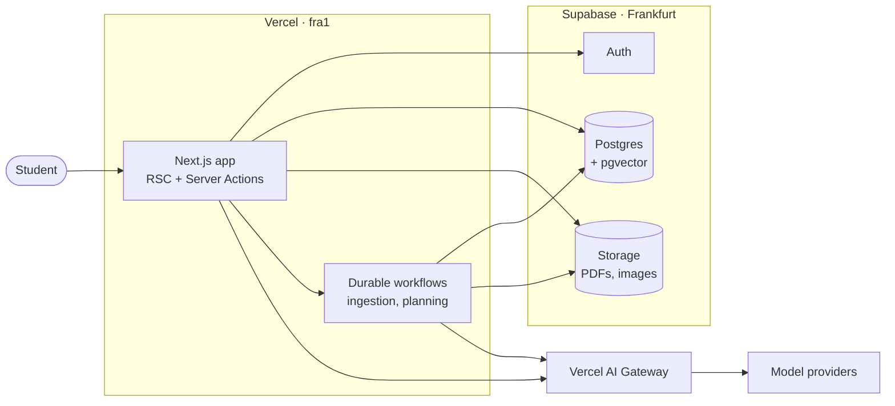

# Architecture

How Project Mastery is built and why. [VISION.md](../VISION.md) defines what the product is; this document defines the technical choices that serve it. Everything in the stack below is in place except error tracking, analytics and email (Sentry, PostHog, Resend), which land with the features that need them.

## Overview



## Stack

| Area                     | Choice                                                                                        |
| ------------------------ | --------------------------------------------------------------------------------------------- |
| Framework                | Next.js (App Router, React Server Components, Server Actions), TypeScript                     |
| Validation               | Zod (inputs, environment variables, structured AI output)                                     |
| UI                       | Tailwind CSS, shadcn/ui, AI Elements, own design tokens                                       |
| Math and documents       | KaTeX, Streamdown (streaming markdown with math), react-pdf                                   |
| Graphs                   | React Flow (`@xyflow/react`) laid out by ELK (`elkjs`) in a web worker                        |
| Database, auth, storage  | Supabase: Postgres with pgvector, Auth, Storage, Row Level Security                           |
| Data access              | supabase-js with generated types, SQL migrations through the Supabase CLI                     |
| AI                       | Vercel AI SDK through Vercel AI Gateway                                                       |
| Background jobs          | Durable workflows: Vercel Workflow                                                            |
| PDF pages to images      | unpdf with @napi-rs/canvas                                                                    |
| Spaced repetition        | FSRS (`ts-fsrs`) replayed from the attempts log on every read                                 |
| Numeric answer check     | mathjs: final values with units, in process                                                   |
| Problem verification     | mathjs programs, each in its own `node -e` process ([0021](adr/0021-problem-verification.md)) |
| LLM tracing              | Langfuse                                                                                      |
| Errors, analytics, email | Sentry, PostHog, Resend                                                                       |
| Hosting                  | Vercel (functions in `fra1`), Supabase (Frankfurt)                                            |

## Environments

| Environment | App                         | Supabase               | AI                                                       |
| ----------- | --------------------------- | ---------------------- | -------------------------------------------------------- |
| Local       | `pnpm dev`                  | Supabase CLI in Docker | Gemini API free tier for text, AI Gateway for embeddings |
| Tests / CI  | Vitest, Playwright          | Supabase CLI in Docker | AI SDK mock models, no real calls                        |
| Preview     | Vercel preview per PR       | Staging project        | AI Gateway, card on file                                 |
| Production  | Vercel production on `main` | Production project     | AI Gateway, purchased credits                            |

Preview deployments never touch production data.

## Project structure

The code is organized by feature, in layers that depend in one direction only ([ADR 0014](adr/0014-feature-modules-with-lint-boundaries.md)). ESLint enforces everything in this section: a file in the wrong place or an import across a forbidden boundary fails `pnpm lint`, with a message that says where the code belongs.

```
src/
├── app/                   Routing only: Next.js special files
│   ├── (marketing)/       Public pages
│   ├── (auth)/            Sign-in pages and the email link route
│   ├── (app)/             Signed-in pages
│   └── api/               Route handlers that need raw HTTP (streaming, webhooks)
├── features/<feature>/    One folder per product capability
├── components/            Shared UI without domain knowledge
│   ├── ui/                shadcn/ui, generated
│   └── ai-elements/       AI Elements, generated
├── hooks/                 Shared client hooks (use-*.ts)
├── lib/                   Platform: Supabase clients, auth session, AI, tracing, env
├── proxy.ts               Session refresh on every request
└── instrumentation.ts     Tracing setup
```

### Layers

```
app ──► features ──► components ──► hooks ──► lib
           │ ▲
           └─┘  other features only through index.ts / server.ts
```

- **`app/`** contains only Next.js files: `page`, `layout`, `loading`, `error`, `not-found`, `route` and metadata files. Pages fetch data through feature server code and compose feature components. Route handlers delegate to a feature in one line. Signed-in pages go in the `(app)` route group, and each page calls `requireUser` with its own path; its layouts only read the user for the shell (`components/app-shell.tsx`), since layouts do not re-render on navigation.
- **`features/<feature>/`** holds everything one product capability needs. A feature imports another feature only through that feature's public entry files, and import cycles are errors. For example, `chat` depends on `courses`: a Chat belongs to a Course and attaches its Materials. `courses` never imports `chat`. Likewise `courses` depends on `ingestion`, which parses its Materials, and `ingestion` never imports `courses`.
- **`components/`, `hooks/`, `lib/`** are shared and know nothing about features or routes, so they never import from `features/` or `app/`.
- Root files (`proxy.ts`, `instrumentation.ts`) and `evals/` use `lib/` and features' `server.ts`. Smoke checks in `evals/smoke/` (`pnpm smoke`, [docs/agents/live-ai.md](agents/live-ai.md)) may also use the admin client, to set up and remove a throwaway Student on the local stack, as may `evals/metrics-cli.ts` (`pnpm -s metrics`), which reads every Student's Chats to score them in Langfuse.
- `tools/agent/` is development tooling outside the app ([ADR 0015](adr/0015-agent-cli-for-running-app.md)). It drives the running app through HTTP, a browser and SQL, and imports nothing from `src/`. `tools/retro/` digests Claude Code transcripts for `/retro` (`pnpm -s retro`). `tools/sweep/` runs the deterministic checks for `/sweep` (`pnpm -s sweep`, `pnpm -s sweep mutate`): knip, jscpd, coverage, Stryker and metrics per unit, written to `.sweep/<date>/`; it defines the units.

### Anatomy of a feature

```
features/<feature>/
├── index.ts         Public API, safe for any code: components, Server Actions, schemas, types
├── server.ts        Public API for server code only: queries, services, route handlers
├── components/      React components (Server Components by default)
├── hooks/           Client hooks (use-*.ts)
├── server/          Server-only code, every module imports "server-only"
│   ├── actions.ts   Server Actions ("use server"), the only place they may live
│   └── *.ts         Queries (the Data Access Layer), services, route handler logic
├── ai/              Prompts, tools and agents, calling models through aiTask (ADR 0005)
├── workflows/       Durable workflows and their steps (ADR 0009)
├── domain/          Pure logic without I/O, such as scheduling or scoring
├── schemas.ts       Zod schemas shared by forms and Server Actions
└── types.ts         Shared types
```

Only the folders a feature needs exist. Inside a feature, files import each other freely; imports from other folders use the `@/` alias, never `../`. Entry files list their exports by name (no `export *`), so the public API stays deliberate. Unit tests sit next to the file they test as `*.test.ts(x)`.

### How data moves

- **Reads:** a page (Server Component) calls a query in the feature's `server/`. The query checks the user (`requireUser`), reads with the Supabase server client, so Row Level Security applies, and returns only the fields the UI needs.
- **Writes:** a form calls a Server Action in `server/actions.ts`, which validates the input with Zod, checks the user, writes, revalidates and returns an `ActionResult`.
- **AI streaming:** `useChat` posts to a route handler in `app/api/`, which delegates to a handler exported from the feature's `server.ts`, which calls models through `aiTask`.
- **File uploads:** Materials live in the private Storage bucket `course-files`, at `<owner id>/<course id>/<material id>`. The browser uploads the file straight to Storage, which its policies allow only under the Student's own id, then calls the `registerMaterial` Server Action in the `courses` feature, which checks the upload and stores the Material row. Files never pass through a server function, so their size is not bound by its request limit.
- **Background jobs:** server code starts a workflow from the feature's `workflows/`. Steps that run without a user use the admin client and report progress to the database, where the UI reads it. A page may start a stalled workflow again: the Mock exam page calls `restart_mock_grading`, which marks a submitted mock's grading started when it never started or started over an hour ago, and then starts `gradeMock`, whose steps are idempotent.
- **Knowledge map:** the `knowledge-map` feature builds a Course's map from the chunks of its parsed Materials, which it reads through `ingestion`'s `server.ts`. The `startKnowledgeMapBuild` Server Action (Build, then Update map) queues the build through `queue_knowledge_map_build`, a conditional upsert, and starts the `buildKnowledgeMap` workflow, which updates the stored map; a first build updates an empty one. It maps only the chunks not yet in `knowledge_map_chunks`, one step per model call (task `map`, and task `exercise` once per new exercise subtask with its pair from `exercise_solutions`), and drops what deleted chunks taught. When the Course has `accepted` map Findings (`map_findings`), one more step after Dedup, `correctMap` (task `map`, one call, run even without new chunks), applies them: code keeps only link changes between each Finding's two KCs and a new description of its own KC, the whole-map check then breaks cycles, and right after Store the Findings become `applied` with the model's one-line `outcome`; a failed call fails the build and leaves them `accepted`. `apply_knowledge_map_update` stores the result in one transaction: rows of the stored map keep their ids, so KCs, Exercises and Findings keep their identity, and the new chunks are recorded as processed. The build's last stage (2b, [ADR 0020](adr/0020-topics.md)) then groups the KCs no Topic holds into Topics, one call of task `topic` per Big idea that has such a KC, and `replace_topics` stores them. Stage 2c (Reading) then cuts each Topic's Reading sections from the chunks its KCs cite and `replace_reading_sections` stores them, keeping stored sections with the same chunks, and marks the build `built`. The Course map (`/courses/[courseId]/map`, where the Course's home redirects) polls while the build is `building`; it no longer lists Findings, which the Brief page shows. It draws the stored Topics as a graph ([ADR 0017](adr/0017-react-flow-and-elk-for-the-knowledge-map-graph.md)): `knowledge-map/domain` turns the Topics and the map into Big idea groups of Topic cards with arrows between Topics (a Prerequisite between their KCs, transitively reduced), and ELK lays them out in a web worker only when they change. Each card shows its Topic state and recall today from `study`'s `getTopicStates`, which the page passes in. A card opens the Topic page (`map/[topicId]`): its detail, anchors, KCs, Reading sections and neighbours in Course order, above the KC graph restricted by `knowledge-map/domain` to the Topic's KCs, its anchors and the Exercises that test them. There `knowledge-map/domain` also computes which nodes a selection focuses over the shown edges, and clicking a KC opens a panel with every stat about it, including what `study`'s `getKcLearning` and `priorities`' `getPriorities` give, which the page passes in.
- **Brief:** the `brief` feature stores what a Student told the AI about a Course's exam, reading the Course's Materials from `courses` and enforcing the Daily limit through `usage`. Its page creates the Brief and a static opening message on first open; `useChat` posts to `/api/brief`, whose handler streams task `brief` with three tools, `saveBrief`, `addNote` and `answerFinding`. The first two write as the Student through the `save_brief` and `add_brief_note` database functions, each one transaction, so a failed call changes nothing and concurrent calls of one reply keep each other's writes. Once intake is done, the Brief asks the Course's open Findings one at a time, which it reads and answers through `knowledge-map`'s `server.ts`: opening the page posts the next one as a static message when none is asked, and `answerFinding` stores the answer and marks the next one asked. Beside the conversation (in a Sheet below `lg`), `BriefPanel` shows the exam facts, excluded Materials and notes from `getBrief`, every Finding from `knowledge-map`'s `getFindings`, and the study plan and Memory card, which the page passes in because `study` depends on `brief`. After each finished reply the page calls `router.refresh()`, and the conversation appends any static message the refresh posted.
- **Priorities:** the `priorities` feature gives each KC of a Course a Priority for the Student's exam, reading the stored map, its answered Findings and its build time through `knowledge-map`'s `server.ts`, the chunks' points and Materials through `ingestion`'s, and the Brief's notes and excluded Materials through `brief`'s. App pages show the Priorities, and `study` weighs the study plan's Topics and the due reviews by them. Opening the map page calls `ensurePriorities`, which queues a run through `queue_priority_run`, a conditional upsert that succeeds only for a built map with no run running and a change (the map's `finished_at`, the Brief's `updated_at` or a Finding's `answered_at`) newer than the last run's `computed_at`, and starts the `updatePriorities` workflow. Code computes each KC's base from exam points, Exercises and dependents, times a multiplier: 0 for KCs taught only by excluded Materials, times the model's adjustment (task `priority`, one call from the Brief's notes and the answered Findings, made only when they or the map changed after the run's `adjusted_at` and otherwise reused from `priority_runs.adjustments`), and `replace_kc_priorities` replaces the Course's `kc_priorities` in one transaction. The page passes the priorities into the map component, so `knowledge-map` never imports `priorities`, and polls while the run is `running`.
- **Tutoring:** every Chat is a Study session: the database starts a `learn` row in `study_sessions` with each new Chat, which the Chat's first request can switch to `review` or `practice` (the Today card's buttons open `?mode=`) through `start_study_session_mode`, a security-definer function that writes only the caller's running session while it has no Topic and no question, and the AI's graded Questions (`questions`, KCs in `question_kcs`) and their graded attempts belong to it ([ADR 0018](adr/0018-questions-as-first-class-objects.md)). The `study` feature holds what the AI needs to tutor, and `chat` imports its `server.ts`. On every reply, `startTutoring` reads, as the Student, the stored map through `knowledge-map`'s `server.ts`, the Priorities through `priorities`', the exam date, weekly hours and goal through `brief`'s, the Course's attempts and its Memory, and builds the tutor context: today, the exam date, the study plan (the Phase and the goal, derived by code over the stored Topics; the instructions add guidance per Phase), up to 8 due reviews ranked by Priority × (1 − today's recall) with a count of the rest, and the Today card's work (`planToday`): the next Topic with its KCs in teaching order and its anchors, the Phase's hint and the map page's fit line. The same Today card shows at the top of the Course map and in a new Chat's empty state. The context goes into the Chat's instructions, written by code like the Brief's, with the Memory in full when it isn't empty. The reply streams task `chat`, on one model, with at most 5 steps and its tools. `getTopic` reads a Topic of the Course (its central question, KCs with their states, anchors and Reading sections with done marks) and the source chunks, up to 3 per KC, of the KCs asked for, or of all when none, through `ingestion`'s `server.ts`, each linked to the chunk on its Material's page; the due reviews carry each KC's Topic id. Given KC ids alone, without a Topic id, it reads only those KCs of the Course with their sources, for a Course whose KCs have no Topic, and each KC lists its `open` and `accepted` map Findings. `searchMaterials` embeds a one-line query (task `embed`, metered, no input type, like the chunks) and returns up to 4 chunks of the whole Course in `getTopic`'s source shape, ranked by `match_chunks`, a security-invoker function that scans the Course's embeddings by cosine distance without an index. `flagMap` files a map Finding in `map_findings` as the Student, stamped with the Chat's Study session: a `missing_link`, `wrong_link` or `wrong_description` on KCs of the Course, with a quote that code checks is in the cited chunk's Markdown (case and whitespace aside), refused with a `TutorToolError` otherwise. The Student reads and files their own map Findings and may only move `status` from `open` to `accepted` or `dismissed`, which the Map findings card under the Today card on the Course map does through the `answerMapFinding` Server Action; only the service role sets `applied` and `outcome`, and the Brief and Priorities never read them. The instructions give the order of trust and the disagreement table: check the sources first, `flagMap` with a cited confirmation when the map is wrong, a cited correction when the Student is. A learn session teaches one Topic in Stages ([ADR 0018](adr/0018-questions-as-first-class-objects.md)): its first reply fixes `study_sessions.topic_id` to the plan's next Topic and its start stage through `start_study_session_topic`, a security-definer function that writes only the caller's running session, once. The start stage is `review` when reviews are due (the context then names the stage to go to next, lists the Topic's anchors first among the due reviews and gives the minutes since the start), else the stage the Topic's last earlier session stopped at before `close`, else `orient`, computed by `study/domain/stages`. The tool `setStage` moves the stage through `set_study_session_stage`; code in `study/domain` refuses a move backwards (except `work` → `read` while a Reading section has no Done), out of `close`, or a skip without a reason, with a `TutorToolError`. The instructions give one block per stage, and a Course without Topics gets sessions without a Topic or stage, tutored as before. The Chat reads the stage from the stored tutor context and the `setStage` results and shows it in `study`'s stage bar above the messages. Only learn sessions get a Topic and stages. A review session's context has the `reviewQueue` instead, rebuilt by `planReviewQueue` on every reply and never stored: the KCs due at the session's start, ranked by Priority × (1 − recall) and cut to 20 minutes, grouped by Topic or link (at most 3 KCs a group), interleaved by Topic, each group `open`, `done` or `retry` from the session's questions and attempts; only a KC's first attempt in it schedules. A practice session's context has the `practiceKcs`: the top 8 taught KCs of learned Topics by the same rank. The session bar shows the review's groups done or the practice's Problems answered. A graded `rebuild` question is followed by a Knowledge map card that opens the Topic's part of the Knowledge map with its KC states in the source pane (`getTopicKnowledgeMap`). At `close` or once the session has ended, `study`'s close card replaces the composer: `getSessionSummary` computes the Topic's state and each practised KC's state and next review as if the session had ended, and `rateStudySession` saves the Session rating (`rating`, 1 to 5, and `rating_note`, at most 300 characters, the only columns besides `ended_at` a Student may update on their own session) and ends a running session. `findProblems` returns up to 3 Problems that test given KCs, merged in code from the Exercises the Student has not been asked as a question and the ready, unflagged generated Problems not yet asked in the Course (in a review session, after these, those last asked more than 14 days ago), ranked by `rankProblems` (KCs tested, source in the order old exam, Exercise, variant, new, a task type unlike the last Problem's, difficulty near one above the last unassisted success, map order), each with its source, and `ask` takes a `problemId` that resolves to either, stored in `questions.exercise_id` or `questions.problem_id` (at most one is set). An Exercise has its question, a page link and its paired solution (from `exercise_solutions`, labelled with its status); a generated Problem has its stored statement, solution, program and final answers, its solution labelled as computed by code, or to be checked when it has no program ([ADR 0021](adr/0021-problem-verification.md)), and its question card lets the Student flag it once, which takes it out of the pool. Each `attempts` row grades one question on one of its KCs `full`, `partial` or `wrong`, with how much the AI helped, which the replay maps to an FSRS rating. When the question poses an Exercise or a generated Problem with `final_answers` (for an Exercise the numeric results the map build's `exercise` call gave, null for Exercises built before; for a generated Problem its program's values) and `grade` gets the Student's final value, code in `study/domain` parses both with their units through mathjs and compares them at 1% relative tolerance: a mismatch turns every `full` into `partial`, and each attempt stores the outcome in `check`. `remember` appends one dated line to the Course's Memory (`memories`, one text of at most 4,000 characters per Course) with `append_memory`, as the Student; the Student edits the whole text on the Brief page, and the Brief's own AI doesn't read it. The attempts log is the only stored state of a Student's learning ([ADR 0019](adr/0019-fsrs-replay.md)): on every read, code replays a KC's attempts into an FSRS card (`ts-fsrs`) with the scheduling rules, the exam cap and the final-week sweep, and `getKcStates` gives each KC's state (new, learning, due or known), next review and today's recall. Tool calls are stored with the reply, and the Chat shows each as a collapsed step card in reply order, its one-line summary written by code in `chat/domain`; a call that never returned shows as stopped once the reply is done. Each AI reply also stores the tutor context it was given (`chat_messages.tutor_context`, sent as message metadata on the `start` part), which the reply's Context sheet shows with the instructions re-rendered by today's code. The stored context has `study`'s `TutorContext` shape and is checked only as an object, so a change to that type must keep older rows readable: its `reviewQueue` and `practiceKcs` are optional. The reply's usage is sent on the `finish` part and its `ai_usage` row carries the reply's id (`reply_id`, no foreign key, since usage is recorded before the reply is saved), so a reopened Chat shows each reply's model, tokens and cost. Topics are stored by the build's last stage ([ADR 0020](adr/0020-topics.md)) and read with `knowledge-map`'s `loadCourseTopics`; the study plan reads them with `loadStoredTopics`, with the Student's pins and skips from `topic_choices`, which the Topic page's `setTopicChoice` Server Action writes as the Student (a skip's reason goes into the Memory through `append_memory`). The plan's fit uses the Student's measured pace, computed on every read: active time from the gaps between a teaching session's `chat_messages`, and minutes per review from its Questions' `asked_at` and `answered_at`. `getTopicStates` replays the same cards to give each Topic its Topic state and recall today, which the Course map and Topic pages pass into `knowledge-map`, since it can't import `study`. A graded mock's result page shows its score per Topic, the calibration on sure answers and each task's points ordered by points lost, without the reference solution; from there the Chat's first request can switch the session to `results` with that mock (`start_study_session_mode` sets `study_sessions.mock_id`), whose instructions go through the tasks from the biggest loss down, and every attempt in it is a `retry`, which never schedules. Readiness (`getReadiness`, `study/domain/readiness`) is the Priority-weighted mean of each KC's projected recall on the exam date (0.9 for a prior-knowledge KC without a card, 0 for an untaught one), shown in the map header and on Topic cards. After the exam date the map asks "How did the exam go?" and `exam_results` stores the grade, once per exam date, insert-only. Notes carry a session on to later ones. `endSession`, which also queues problem generation, starts the `closeStudySession` workflow for the ended session. The workflow's first step claims the session (`study_sessions.close_started_at`, set once where the session has ended), so a duplicate start stops there; one `close` call (task `close`, metered, `dailyLimit: "ignore"`) then reads the session's text messages, Questions with their attempts, the Topic's current note and the Memory, and writes a two-line Session note (`study_sessions.session_note`), a new Topic note (`topic_notes`, at most 1,500 characters, replaced each time, learn sessions with a Topic only) and up to 3 Memory lines, and, once the Memory passes 3,000 characters, a condensed Memory. A session without a Chat or a Student message gets no call and stays claimed with no note. `store_session_close`, called as the service role, writes it all in one transaction, and does nothing for a session that has a note. A condensed Memory replaces the Memory only if code in `study/domain` finds every pinned line (a Memory line starting with `!`) in it word for word and `memories.updated_at` is still what the workflow read; otherwise it is dropped and the lines are still appended. The idle sweep is part of a session's first reply: the Chat handler ends the Course's other running sessions that `sessionEnd` finds idle, at their newest message, through `endSession`, so they close too. A reply's tutor context carries the Course's 3 newest Session notes of other sessions and, in a learn session with a Topic, that Topic's note and the notes of the Topics holding its anchors (`sessionNotes` and `topicNotes`, both optional); the instructions call them hints that never set KC states and give way to the Student's answers. `pnpm smoke close` checks the call on a model.
- **Problem generation:** `study`'s `generateProblems` workflow writes generated Problems (`problems`, KCs in `problem_kcs`), which `findProblems` offers beside the unseen Exercises (#183). Two triggers queue a run through `queue_problem_run`, a conditional upsert of `problem_runs` that lets one run per Course through, so a trigger during a run is dropped: the first reply of a Learn session, once `start_study_session_topic` set its Topic (Topic stock), and the end of a Study session, by the Student or as idle (review stock). The workflow plans in code (`study/domain/problem-stock`): each Topic KC with fewer than 2 unseen Problems (unseen Exercises, ready unflagged unasked Problems and queued ones) gets up to 2, at most 4 per Topic; each KC due within 3 days without one gets one, at most 6. A queued Problem is a variant of an Exercise testing the KC that has no variant yet, seen ones first, or else a new Problem at the KC's target difficulty. It then writes the Course's queued Problems one by one, one call of task `generate` each: the model writes the statement and solution with every number as a `{{variable}}` of a mathjs program, the math runner runs it, and code fills in the values at 4 significant figures and stores the program's final answers. A failing draft goes back once with its error; a second failure or a model error marks the Problem `failed`, and a reached Daily limit leaves the rest `queued` for the next run. `study`'s `gradeMock` workflow (#186), started by `submit_mock_exam`'s caller, grades a submitted Mock exam one step per item: a blank answer scores 0 with every KC `wrong` and no call, an answer one call of task `grade_exam` (metered with `dailyLimit: "ignore"`, so it runs past the Daily limit), whose final value the numeric check compares with the key (a mismatch turns `full` into `partial` and caps the points one below full). Each item stores `points_awarded`, `steps`, `check` and `graded_at` on `mock_items` and a `mock` attempt per KC; an item that still fails after its step's retries gets `graded_at` without points and is left out of the score. The last step stores the mock's `score` and its Brier score (`brier`, the mean squared gap between each item's predicted success and its share of points) and makes it `graded`.
- **Parsing:** the `ingestion` feature parses every Material once, as [ADR 0007](adr/0007-ingest-each-upload-once.md) describes. `registerMaterial` in `courses` starts its workflow; the Material moves from `queued` through `parsing` to `parsed` or `failed`, and the Materials page polls while any Material is waiting or parsing. Its delete warning counts the Chats that attach a Material with `chat`'s `countMaterialChats`, which the page passes in, so `courses` never reads `chat_messages`. Parse and Retry share the `startMaterialParse` Server Action, which queues the Material through the `queue_material_parse` database function, a conditional update, so two presses start one workflow. A chunk's figure is a description in words, shown as text in the chunk view; the chunk view also lists the Findings about each chunk, which the materials page reads from `knowledge-map` and passes in.

### What the lint rules enforce

| Rule                                 | Enforces                                                                                     |
| ------------------------------------ | -------------------------------------------------------------------------------------------- |
| `project/file-structure`             | Every source file matches the structure above                                                |
| `boundaries/dependencies`            | Layer directions, feature public APIs, and where restricted modules may be used (below)      |
| `import-x/no-cycle`                  | No import cycles, including between features                                                 |
| `project/require-server-only`        | Feature server modules import `server-only`                                                  |
| `project/use-server-location`        | `"use server"` only in `server/actions.ts`, no inline Server Actions                         |
| `project/no-server-import-in-client` | Client Components do not import server modules (Server Actions excepted)                     |
| `project/server-action-auth`         | Every Server Action's first `await` is `getUser()` or `requireUser()` (auth forms excepted)  |
| `project/server-action-validation`   | A Server Action that takes input calls `parseActionInput`                                    |
| `max-lines`                          | At most 500 lines of code per file (generated code excepted): split by behaviour             |
| `check-file/*`                       | Kebab-case file and folder names (route folders may use Next.js conventions)                 |
| `no-restricted-imports`              | `@/` alias instead of `../` paths                                                            |
| `no-restricted-syntax`               | No `export *`: modules list their exports by name                                            |
| `no-restricted-properties`           | `process.env` only in env modules (`env.ts`, `*-env.ts`), tests and `src/instrumentation.ts` |

Restricted modules: `@supabase/*` only in `lib/supabase/` (type imports are allowed anywhere); the admin client only in `workflows/` and `evals/smoke/`; Supabase clients never directly in `app/`; `workflow` only in features' `workflows/` and `server/`; AI provider packages only in `lib/ai/`; Langfuse and OpenTelemetry only in `lib/tracing/` and `evals/`.

The configuration lives in `eslint/architecture.mjs`, with project-specific rules in `eslint/plugin/`. `eslint/architecture.test.mjs` lints sample files against the real configuration to show each rule fires where it should and stays quiet where it should not. Changing the structure means changing the configuration, its tests and this section in the same PR.

### Adding a feature

1. Create `src/features/<feature>/` with the folders it needs, following the anatomy above.
2. Export what pages and other features use from `index.ts` (anything client-safe) or `server.ts` (anything server-only). A constant or schema that server code needs may be re-exported from `server.ts` too, with a comment saying why: `index.ts` loads React components, which fail to import outside Next.js (evals, scripts). `evals/next-aliases.ts` aliases `@/features/courses` to its `server.ts` for the same reason, so chat code must not import a `courses` component or Server Action.
3. Add the routes in `src/app/` as thin files that import only from those entry files.

## Decisions

Each technical decision is an ADR in [adr/](adr/), with its context, the choice and its consequences. A decision changes through a PR that updates its ADR, or adds a new ADR that supersedes it.

- [0001](adr/0001-hosted-only.md): Hosted only, no self-hosted version
- [0002](adr/0002-supabase-backend.md): Supabase as the backend platform
- [0003](adr/0003-supabase-js-with-rls.md): supabase-js with Row Level Security instead of an ORM
- [0004](adr/0004-eu-region.md): EU region
- [0005](adr/0005-ai-sdk-through-gateway.md): Vercel AI SDK through Vercel AI Gateway
- [0006](adr/0006-ai-cost.md): AI cost: the Gateway's free credit in development, metered in production
- [0007](adr/0007-ingest-each-upload-once.md): Ingestion: process every upload once
- [0008](adr/0008-workflows-by-default.md): Workflows by default, agents where they pay off
- [0009](adr/0009-durable-background-jobs.md): Durable background jobs
- [0010](adr/0010-fsrs-for-spaced-repetition.md): Spaced repetition: a review ladder now, FSRS later (superseded by 0019)
- [0011](adr/0011-shadcn-ui-with-own-design.md): UI built on shadcn/ui with its own design
- [0012](adr/0012-ai-observability-and-evals.md): Observability and quality of AI behavior
- [0013](adr/0013-hosting-plans.md): Hosting plans
- [0014](adr/0014-feature-modules-with-lint-boundaries.md): Feature modules with lint-enforced boundaries
- [0015](adr/0015-agent-cli-for-running-app.md): Agents verify changes in the running app through one CLI
- [0016](adr/0016-gemini-api-for-local-development.md): Local development on the Gemini API free tier
- [0017](adr/0017-react-flow-and-elk-for-the-knowledge-map-graph.md): React Flow and ELK for the Knowledge map graph
- [0018](adr/0018-questions-as-first-class-objects.md): Questions as first-class objects
- [0019](adr/0019-fsrs-replay.md): FSRS replay, superseding 0010
- [0020](adr/0020-topics.md): Topics: stored with code-locked placement, anchors derived on read, Reading sections stored
- [0021](adr/0021-problem-verification.md): Problem verification: a math runner in its own process, `{{variable}}` placeholders, no second model

## Open questions

- Models for ingestion, the Chat and embeddings, chosen by testing on real course materials.
- Design direction: typography, color and motion.
