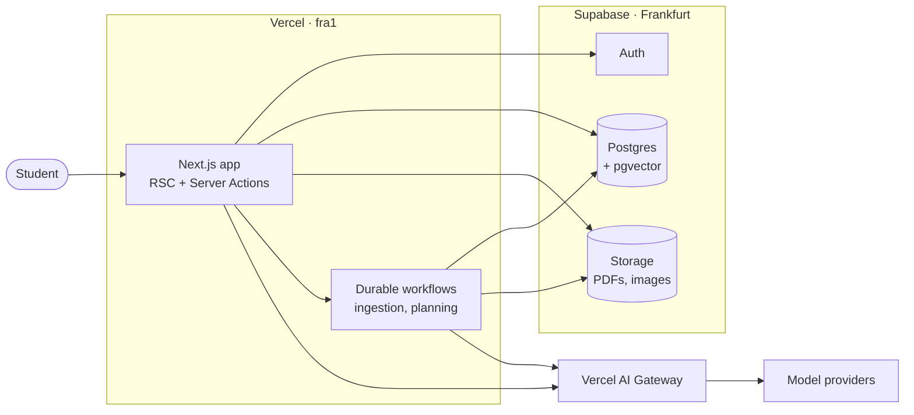

# Architecture

How Project Mastery is built and why. [VISION.md](../VISION.md) defines what the product is; this document defines the technical choices that serve it. Everything in the stack below is in place except error tracking, analytics and email (Sentry, PostHog, Resend), which land with the features that need them.

## Overview



## Stack

| Area                     | Choice                                                                                        |
| ------------------------ | --------------------------------------------------------------------------------------------- |
| Framework                | Next.js (App Router, React Server Components, Server Actions), TypeScript                     |
| Validation               | Zod (inputs, environment variables, structured AI output)                                     |
| UI                       | Tailwind CSS, shadcn/ui, AI Elements, own design tokens                                       |
| Math and documents       | KaTeX, Streamdown (streaming markdown with math), react-pdf                                   |
| Graphs                   | React Flow (`@xyflow/react`) laid out by ELK (`elkjs`) in a web worker                        |
| Database, auth, storage  | Supabase: Postgres with pgvector, Auth, Storage, Row Level Security                           |
| Data access              | supabase-js with generated types, SQL migrations through the Supabase CLI                     |
| AI                       | Vercel AI SDK through Vercel AI Gateway                                                       |
| Background jobs          | Durable workflows: Vercel Workflow                                                            |
| PDF pages to images      | unpdf with @napi-rs/canvas                                                                    |
| Spaced repetition        | FSRS (`ts-fsrs`) replayed from the attempts log on every read                                 |
| Numeric answer check     | mathjs: final values with units, in process                                                   |
| Problem verification     | mathjs programs, each in its own `node -e` process ([0021](adr/0021-problem-verification.md)) |
| LLM tracing              | Langfuse                                                                                      |
| Errors, analytics, email | Sentry, PostHog, Resend                                                                       |
| Hosting                  | Vercel (functions in `fra1`), Supabase (Frankfurt)                                            |

## Environments

| Environment | App                         | Supabase               | AI                                                       |
| ----------- | --------------------------- | ---------------------- | -------------------------------------------------------- |
| Local       | `pnpm dev`                  | Supabase CLI in Docker | Gemini API free tier for text, AI Gateway for embeddings |
| Tests / CI  | Vitest, Playwright          | Supabase CLI in Docker | AI SDK mock models, no real calls                        |
| Preview     | Vercel preview per PR       | Staging project        | AI Gateway, card on file                                 |
| Production  | Vercel production on `main` | Production project     | AI Gateway, purchased credits                            |

Preview deployments never touch production data.

Staging is the Supabase project of previews. Agents read its rows with `pnpm -s agent staging`, and every merge to `main` that changes `supabase/migrations/` applies them to it (the `migrate-staging` workflow). Agents never write to it ([ADR 0025](adr/0025-staging-for-agent-review-and-migrations.md)).

## Project structure

The code is organized by feature, in layers that depend in one direction only ([ADR 0014](adr/0014-feature-modules-with-lint-boundaries.md)). ESLint enforces everything in this section: a file in the wrong place or an import across a forbidden boundary fails `pnpm lint`, with a message that says where the code belongs.

```
src/
├── app/                   Routing only: Next.js special files
│   ├── (marketing)/       Public pages
│   ├── (auth)/            Sign-in pages and the email link route
│   ├── (app)/             Signed-in pages
│   └── api/               Route handlers that need raw HTTP (streaming, webhooks)
├── features/<feature>/    One folder per product capability
├── components/            Shared UI without domain knowledge
│   ├── ui/                shadcn/ui, generated
│   └── ai-elements/       AI Elements, generated
├── hooks/                 Shared client hooks (use-*.ts)
├── lib/                   Platform: Supabase clients, auth session, AI, tracing, env
├── proxy.ts               Session refresh on every request
└── instrumentation.ts     Tracing setup
```

### Layers

```
app ──► features ──► components ──► hooks ──► lib
           │ ▲
           └─┘  other features only through index.ts / server.ts
```

- **`app/`** contains only Next.js files: `page`, `layout`, `loading`, `error`, `not-found`, `route` and metadata files. Pages fetch data through feature server code and compose feature components. Route handlers delegate to a feature in one line. Signed-in pages go in the `(app)` route group, and each page calls `requireUser` with its own path; its layouts only read the user for the shell (`components/app-shell.tsx`), since layouts do not re-render on navigation.
- **`features/<feature>/`** holds everything one product capability needs. A feature imports another feature only through that feature's public entry files, and import cycles are errors. For example, `chat` depends on `courses`: a Chat belongs to a Course and attaches its Materials. `courses` never imports `chat`. Likewise `courses` depends on `ingestion`, which parses its Materials, and `ingestion` never imports `courses`.
- **`components/`, `hooks/`, `lib/`** are shared and know nothing about features or routes, so they never import from `features/` or `app/`.
- Root files (`proxy.ts`, `instrumentation.ts`) and `evals/` use `lib/` and features' `server.ts`. Smoke checks in `evals/smoke/` (`pnpm smoke`, [docs/agents/live-ai.md](agents/live-ai.md)) may also use the admin client, to set up and remove a throwaway Student on the local stack, as may `evals/metrics-cli.ts` (`pnpm -s metrics`), which reads every Student's Chats to score them in Langfuse.
- `tools/agent/` is development tooling outside the app ([ADR 0015](adr/0015-agent-cli-for-running-app.md)). It drives the running app through HTTP, a browser and SQL, and imports nothing from `src/`. Its `staging` command reads rows of the staging project, GET requests only ([ADR 0025](adr/0025-staging-for-agent-review-and-migrations.md)). `tools/retro/` digests Claude Code transcripts for `/retro` (`pnpm -s retro`). `tools/sweep/` runs the deterministic checks for `/sweep` (`pnpm -s sweep`, `pnpm -s sweep mutate`): knip, jscpd, coverage, Stryker and metrics per unit, written to `.sweep/<date>/`; it defines the units.

### Anatomy of a feature

```
features/<feature>/
├── index.ts         Public API, safe for any code: components, Server Actions, schemas, types
├── server.ts        Public API for server code only: queries, services, route handlers
├── components/      React components (Server Components by default)
├── hooks/           Client hooks (use-*.ts)
├── server/          Server-only code, every module imports "server-only"
│   ├── actions.ts   Server Actions ("use server"), the only place they may live
│   └── *.ts         Queries (the Data Access Layer), services, route handler logic
├── ai/              Prompts, tools and agents, calling models through aiTask (ADR 0005)
├── workflows/       Durable workflows and their steps (ADR 0009)
├── domain/          Pure logic without I/O, such as scheduling or scoring
├── schemas.ts       Zod schemas shared by forms and Server Actions
└── types.ts         Shared types
```

Only the folders a feature needs exist. Inside a feature, files import each other freely; imports from other folders use the `@/` alias, never `../`. Entry files list their exports by name (no `export *`), so the public API stays deliberate. Unit tests sit next to the file they test as `*.test.ts(x)`.

### How data moves

- **Reads:** a page (Server Component) calls a query in the feature's `server/`. The query checks the user (`requireUser`), reads with the Supabase server client, so Row Level Security applies, and returns only the fields the UI needs.
- **Writes:** a form calls a Server Action in `server/actions.ts`, which validates the input with Zod, checks the user, writes, revalidates and returns an `ActionResult`.
- **AI streaming:** `useChat` posts to a route handler in `app/api/`, which delegates to a handler exported from the feature's `server.ts`, which calls models through `aiTask`.
- **File uploads:** Materials live in the private Storage bucket `course-files`, at `<owner id>/<course id>/<material id>`. The browser uploads the file straight to Storage, which its policies allow only under the Student's own id, then calls the `registerMaterial` Server Action in the `courses` feature, which checks the upload and stores the Material row. Files never pass through a server function, so their size is not bound by its request limit.
- **Background jobs:** server code starts a workflow from the feature's `workflows/`. Steps that run without a user use the admin client and report progress to the database, where the UI reads it. A page may start a stalled workflow again: the Mock exam page calls `restart_mock_grading`, which marks a submitted mock's grading started when it never started or started over an hour ago, and then starts `gradeMock`, whose steps are idempotent.
- **Knowledge map:** the `knowledge-map` feature builds a Course's map from the chunks of its parsed Materials, which it reads through `ingestion`'s `server.ts` ([ADR 0023](adr/0023-knowledge-map-from-chapters.md), [ADR 0024](adr/0024-kcs-without-sources.md)). The `startKnowledgeMapBuild` Server Action queues the build through `queue_knowledge_map_build`, a conditional upsert, and starts the `buildKnowledgeMap` workflow. Each step stores its results through a `service_role` database function before it ends, so a stopped build resumes where it stopped, and KCs, Exercises and Topics keep their ids. The Course map's pages pass in what `study` and `priorities` give, so `knowledge-map` imports neither. [The Knowledge map](features/knowledge-map.md) describes all of it.
- **Brief:** the `brief` feature stores what a Student told the AI about a Course's exam, reading the Course's Materials from `courses` and enforcing the Daily limit through `usage`. Its page creates the Brief and a static opening message on first open; `useChat` posts to `/api/brief`, whose handler streams task `brief` with three tools, `saveBrief`, `addNote` and `setExamScope`. They write as the Student through the `save_brief`, `add_brief_note` and `set_exam_scope` database functions, each one transaction, so a failed call changes nothing and concurrent calls of one reply keep each other's writes. `saveBrief` also sets which Chapters are old exams (`chapters.is_exam`) and the Course language (`courses.language`); `setExamScope` stores an exam scope on one Topic only when its words quote a Student message. The AI's context holds the Course's Materials with their Chapters to depth 2, marking proposed old exams, its nested Topics with their ids, the Course language and its distinct admin texts, read through `ingestion`'s `loadAdminChunks`. The AI asks in five batches, each once (exam date and goal, format, scope, the Reserved exam, one open question), then closes with a link to the Course map; that close is judged from the history and not stored. Intake is done once the scope step was asked (`scope_confirmed`), even with other answers left as "don't know". Once intake is done, opening the page posts one static message that asks whether the proposed Chapters not asked yet (`chapters.exam_asked`) are old exams. Beside the conversation (in a Sheet below `lg`), `BriefPanel` shows the exam facts, excluded Materials, old exams, exam scopes and notes from `getBrief`, and the Progress line and Memory card, which the page passes in because `study` depends on `brief`. After each finished reply the page calls `router.refresh()`, and the conversation appends any static message the refresh posted.
- **Priorities:** the `priorities` feature computes each KC's Priority for the Student's exam on every read, with no model call and nothing stored. It reads the stored map and Topics through `knowledge-map`'s `server.ts`, the chunks' Materials through `ingestion`'s and the excluded Materials through `brief`'s. [The tutoring process](features/tutoring.md#everything-derived-on-every-read) has the formula.
- **Tutoring:** every Chat is a Study session ([ADR 0018](adr/0018-questions-as-first-class-objects.md)). The `study` feature holds what the AI needs to tutor, and `chat` imports its `server.ts`. On every reply, `startTutoring` reads the map, the Priorities, the Brief and the Course's attempts as the Student and builds the tutor context, which goes into the instructions and is stored with the reply. The attempts log is the only stored state of a Student's learning ([ADR 0019](adr/0019-fsrs-replay.md)): FSRS cards, states and the study plan are replayed from it on every read. Changing `TutorContext` must keep older stored rows readable. An ended session is closed by the `closeStudySession` workflow, one `close` call that writes the notes. [The tutoring process](features/tutoring.md) describes all of it.
- **Problem generation and Mock exams:** `study`'s `generateProblems`, `assembleMock` and `gradeMock` workflows run these in the background, with numbers computed by the math runner ([ADR 0021](adr/0021-problem-verification.md)). `queue_problem_run`, a conditional upsert, lets one generation run per Course through. [The tutoring process](features/tutoring.md#problems) describes them.
- **Parsing:** the `ingestion` feature parses every Material once, as [ADR 0007](adr/0007-ingest-each-upload-once.md) describes. `registerMaterial` in `courses` starts its workflow; the Material moves from `queued` through `parsing` to `parsed` or `failed`, and the Materials page polls while any Material is waiting or parsing. Its delete warning counts the Chats that attach a Material with `chat`'s `countMaterialChats`, which the page passes in, so `courses` never reads `chat_messages`. Parse and Retry share the `startMaterialParse` Server Action, which queues the Material through the `queue_material_parse` database function, a conditional update, so two presses start one workflow. A figure is a description in words inside its chunk's Markdown. [The Knowledge map](features/knowledge-map.md#step-by-step-the-parse) has the steps.

### What the lint rules enforce

| Rule                                 | Enforces                                                                                     |
| ------------------------------------ | -------------------------------------------------------------------------------------------- |
| `project/file-structure`             | Every source file matches the structure above                                                |
| `boundaries/dependencies`            | Layer directions, feature public APIs, and where restricted modules may be used (below)      |
| `import-x/no-cycle`                  | No import cycles, including between features                                                 |
| `project/require-server-only`        | Feature server modules import `server-only`                                                  |
| `project/use-server-location`        | `"use server"` only in `server/actions.ts`, no inline Server Actions                         |
| `project/no-server-import-in-client` | Client Components do not import server modules (Server Actions excepted)                     |
| `project/server-action-auth`         | Every Server Action's first `await` is `getUser()` or `requireUser()` (auth forms excepted)  |
| `project/server-action-validation`   | A Server Action that takes input calls `parseActionInput`                                    |
| `max-lines`                          | At most 500 lines of code per file (generated code excepted): split by behaviour             |
| `check-file/*`                       | Kebab-case file and folder names (route folders may use Next.js conventions)                 |
| `no-restricted-imports`              | `@/` alias instead of `../` paths                                                            |
| `no-restricted-syntax`               | No `export *`: modules list their exports by name                                            |
| `no-restricted-properties`           | `process.env` only in env modules (`env.ts`, `*-env.ts`), tests and `src/instrumentation.ts` |

Restricted modules: `@supabase/*` only in `lib/supabase/` (type imports are allowed anywhere); the admin client only in `workflows/` and `evals/smoke/`; Supabase clients never directly in `app/`; `workflow` only in features' `workflows/` and `server/`; AI provider packages only in `lib/ai/`; Langfuse and OpenTelemetry only in `lib/tracing/` and `evals/`.

The configuration lives in `eslint/architecture.mjs`, with project-specific rules in `eslint/plugin/`. `eslint/architecture.test.mjs` lints sample files against the real configuration to show each rule fires where it should and stays quiet where it should not. Changing the structure means changing the configuration, its tests and this section in the same PR.

### Adding a feature

1. Create `src/features/<feature>/` with the folders it needs, following the anatomy above.
2. Export what pages and other features use from `index.ts` (anything client-safe) or `server.ts` (anything server-only). A constant or schema that server code needs may be re-exported from `server.ts` too, with a comment saying why: `index.ts` loads React components, which fail to import outside Next.js (evals, scripts). `evals/next-aliases.ts` aliases `@/features/courses` to its `server.ts` for the same reason, so chat code must not import a `courses` component or Server Action.
3. Add the routes in `src/app/` as thin files that import only from those entry files.

## Decisions

Each technical decision is an ADR in [adr/](adr/), with its context, the choice and its consequences. A decision changes through a PR that updates its ADR, or adds a new ADR that supersedes it.

- [0001](adr/0001-hosted-only.md): Hosted only, no self-hosted version
- [0002](adr/0002-supabase-backend.md): Supabase as the backend platform
- [0003](adr/0003-supabase-js-with-rls.md): supabase-js with Row Level Security instead of an ORM
- [0004](adr/0004-eu-region.md): EU region
- [0005](adr/0005-ai-sdk-through-gateway.md): Vercel AI SDK through Vercel AI Gateway
- [0006](adr/0006-ai-cost.md): AI cost: the Gateway's free credit in development, metered in production
- [0007](adr/0007-ingest-each-upload-once.md): Ingestion: process every upload once
- [0008](adr/0008-workflows-by-default.md): Workflows by default, agents where they pay off
- [0009](adr/0009-durable-background-jobs.md): Durable background jobs
- [0010](adr/0010-fsrs-for-spaced-repetition.md): Spaced repetition: a review ladder now, FSRS later (superseded by 0019)
- [0011](adr/0011-shadcn-ui-with-own-design.md): UI built on shadcn/ui with its own design
- [0012](adr/0012-ai-observability-and-evals.md): Observability and quality of AI behavior
- [0013](adr/0013-hosting-plans.md): Hosting plans
- [0014](adr/0014-feature-modules-with-lint-boundaries.md): Feature modules with lint-enforced boundaries
- [0015](adr/0015-agent-cli-for-running-app.md): Agents verify changes in the running app through one CLI
- [0016](adr/0016-gemini-api-for-local-development.md): Local development on the Gemini API free tier
- [0017](adr/0017-react-flow-and-elk-for-the-knowledge-map-graph.md): React Flow and ELK for the Knowledge map graph
- [0018](adr/0018-questions-as-first-class-objects.md): Questions as first-class objects
- [0019](adr/0019-fsrs-replay.md): FSRS replay, superseding 0010
- [0020](adr/0020-topics.md): Topics: stored, anchors and Reading sections derived on read; how they are made superseded by 0023
- [0021](adr/0021-problem-verification.md): Problem verification: a math runner in its own process, `{{variable}}` placeholders, no second model
- [0022](adr/0022-knowledge-map-from-parts.md): Knowledge map from Parts: bounded calls, stored per step; Parts, Big ideas and the naming call superseded by 0023
- [0023](adr/0023-knowledge-map-from-chapters.md): Knowledge map from Chapters: page batches and an Outline per Material, extraction per Chapter unit with reasoning, one call for a nested Topic tree, old exams as Chapters; the Prerequisite check superseded by 0024
- [0024](adr/0024-kcs-without-sources.md): KCs without sources: what the Materials assume becomes KCs with no source chunks, kept while a live KC builds on them
- [0025](adr/0025-staging-for-agent-review-and-migrations.md): Staging for agent review and migrations, superseding the staging clause of 0015

## Open questions

- Models for ingestion, the Chat and embeddings, chosen by testing on real course materials.
- Design direction: typography, color and motion.
