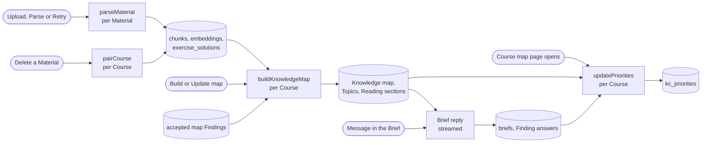

# Knowledge map pipeline

How a Course's Materials become its Knowledge map, with Topics and Reading sections, and how the Brief and the Priorities work on top of it: what starts each run, every model call it makes, and every row it writes. It was specified in #51 and built in #52–#59, #69–#70 and #83–#86, with final answers (#173), Topics (#175), Reading sections (#178) and map corrections (#181) added later. Terms follow [GLOSSARY.md](../../GLOSSARY.md). The decisions are in [ADR 0007](../adr/0007-ingest-each-upload-once.md) (parse every upload once), [0008](../adr/0008-workflows-by-default.md) and [0009](../adr/0009-durable-background-jobs.md) (durable workflows) and [0020](../adr/0020-topics.md) (Topics and Reading sections). What reads the map afterwards, tutoring, is in [tutoring-process.md](tutoring-process.md).

## Overview

| Run                                       | Started by                                                                              | Model calls (task)                                                          | Writes                                                                                                                    |
| ----------------------------------------- | --------------------------------------------------------------------------------------- | --------------------------------------------------------------------------- | ------------------------------------------------------------------------------------------------------------------------- |
| Parse (`parseMaterial`, workflow)         | Upload (`registerMaterial`), Parse or Retry (`startMaterialParse`)                      | `ingest`: 1 per page, 1 per Material, ≤ 1 pairing; `embed`: 1 per 20 chunks | `materials`, `material_pages`, `chunks`, `exercise_solutions`, `courses.pairing_requested`                                |
| Pairing (`pairCourse`, workflow)          | Deleting a Material (`deleteMaterial`)                                                  | ≤ 1 (`ingest`)                                                              | `exercise_solutions`, `courses.pairing_requested`                                                                         |
| Build (`buildKnowledgeMap`, workflow)     | Build or Update map on the Course map (`startKnowledgeMapBuild`)                        | `map`, `exercise`, `embed`, `topic`, `reading`                              | `knowledge_map_builds`, the map tables, `knowledge_map_chunks`, `map_findings`, `topics`, `topic_kcs`, `reading_sections` |
| Brief (route handler, streamed)           | The Student sends a message on the Brief page                                           | 1 streamed reply of ≤ 5 steps (`brief`)                                     | `briefs`, `brief_excluded_materials`, `brief_messages`, `findings` (answers)                                              |
| Priorities (`updatePriorities`, workflow) | The Course map page opens (`ensurePriorities`) and something changed since the last run | ≤ 1 (`priority`)                                                            | `priority_runs`, `kc_priorities`                                                                                          |

Every model call checks the Student's Daily limit first and records its tokens and cost in `ai_usage` under its task (see [Daily limit, retries and failures](#daily-limit-retries-and-failures)).

## Starting a run, once

Each run has a status (on the Material, or a row per Course), and a database function moves it to its running state only when no run is going, so a double click or two tabs start one workflow. The functions are `security definer`, check that the caller owns the Course or Material, and return whether they queued. The Server Action (or, for Priorities, the page's `ensurePriorities`) then calls `start()` of the workflow; if that throws, a second function records it, so the page offers the button again.

| Run        | Queue function and its condition                                                                                                                                                                                                                                                       | When `start()` fails                                                                                   |
| ---------- | -------------------------------------------------------------------------------------------------------------------------------------------------------------------------------------------------------------------------------------------------------------------------------------- | ------------------------------------------------------------------------------------------------------ |
| Parse      | A new Material is inserted `queued` (column default). `queue_material_parse` moves it to `queued` from `not_parsed`, `failed`, or `queued` with `parse_start_failed`, and clears `parse_failure` and `parse_start_failed`.                                                             | `record_parse_start_failure` sets `parse_start_failed`: the page shows "Not started" and offers Parse. |
| Build      | `queue_knowledge_map_build` upserts `knowledge_map_builds` to `building` (clearing `failure_reason`, setting `started_at`) when the Course has a `parsed` Material, none `queued` or `parsing`, and no build is `building`.                                                            | `record_knowledge_map_build_start_failure` sets `failed` with "The build could not start. Try again."  |
| Priorities | `queue_priority_run` upserts `priority_runs` to `running` with `computed_at = now()` when the map has a `finished_at`, no run is `running`, and the last `computed_at` is older than the newest of the build's `finished_at`, the Brief's `updated_at` and any `findings.answered_at`. | `record_priority_run_start_failure` sets `failed` with "The priorities could not be computed."         |

Pairing has no status row: its passes are ordered by `courses.pairing_requested` (see [Pairing](#pairing)).

Workflow steps run without a signed-in Student, on the admin client, and scope every query to the Course or Material and its owner themselves. Each step first checks its run is still current (the Material exists, the build is `building`, the run is `running`) and does nothing otherwise, so a deleted Course or Material stops a run quietly. The pages poll while a run is going: the Materials page while a Material is waiting or parsing, the Course map while the build is `building` or the priority run `running`.

## 1. Parse

`parseMaterial(materialId)` in `src/features/ingestion/workflows/parse-material.ts`. A Material is a PDF or an image in the private Storage bucket `course-files` at `<owner>/<course>/<material>`, uploaded by the browser before `registerMaterial` checks its size and type and inserts the row. The steps run in order; a retried parse resumes at the first unfinished one, because each step skips what is stored.

1. **Prepare pages** (`preparePages`). Sets `parse_status = 'parsing'`, `parse_failure = null`. Opens the PDF (unpdf with the installed pdfjs-dist, [notes](../agents/notes/pdf-page-rendering.md)) to count its pages; an image is one page. Writes `pages_total` and `pages_done` (pages already in `material_pages`), and returns the pages without a stored result. A missing file or one that is no PDF fails the parse with "The file could not be opened".
2. **Read each page** (`readPage`, one step per page, in order). Renders the page to PNG at scale 2 (a US Letter page is 1224×1584), afresh on every attempt and never stored. **Call:** task `ingest`, trace `parse-page`, structured output, no reasoning, the image as the only message. It returns the page's units in reading order, each with Markdown (LaTeX, Mermaid for diagrams), a label (`content`, `definition`, `example`, `exercise`, `solution`, `figure`, `admin`), the exercise number and points as printed, a figure with a description and a box, and whether it continues from the previous page or onto the next. Code pads each figure box by 2% and widens it to at least 25% of the page; an invalid box becomes null, meaning the whole page. **Writes** one `material_pages` row (`units` as JSON) and `materials.pages_done`. A call that still fails after its retries, or answers no units, fails the parse with "The AI could not read page N".
3. **Group into chunks** (`chunkMaterial`). Skipped when the Material already has chunks, so a parse restarted after a failed embedding keeps them and their vectors. Every unit gets an id such as `p2u1`; a page without units gets one `admin` unit "This page has no content.". **Call:** task `ingest`, trace `parse-file`, every unit as JSON. It returns chunks (unit ids as an enum, label, exercise number with subtask such as `7.2a`, points) and, for an old exam, its year and total points. A shared exercise statement is its own chunk with the exercise's number (`7.2`). Code checks that every chunk joins neighbouring units, every unit is in exactly one chunk and every page lies in a chunk; otherwise the step throws and retries. A chunk's Markdown is its units' Markdown joined, never rewritten; its pages and figure come from its units (the first figure's place, every figure's description). **Writes** through `replace_material_chunks`, one transaction: deletes the Material's chunks, inserts the new ones (`position`, `page_from`, `page_to`, `label`, `markdown`, `figure`, `exercise_number`, `points`) and sets `materials.is_exam`, `exam_year`, `exam_total_points`.
4. **Embed** (`embedChunks`). The chunks with no `embedding`, in batches of 20. **Call:** task `embed` (`embedMany`, no input type), trace `parse-embed`, each chunk's Markdown. The AI SDK does not retry (`maxRetries: 0`); the step does, after the delay the provider names or 60 seconds, and not at all for an error that cannot succeed later. **Writes** each batch through `set_chunk_embeddings` before its usage is recorded, so a retry never pays twice. The vectors serve `match_chunks` (the tutor's `searchMaterials`).
5. **Pair exercises** (`pairMaterialCourse`): the pairing pass below, for the Material's Course. At the Daily limit it stores nothing and the parse fails.
6. **Done** (`markParsed`): `parse_status = 'parsed'`.

A step that fails for good, or a reached Daily limit, runs `failParse`: `parse_status = 'failed'` and `parse_failure` = "Daily limit reached", "The file could not be opened", "The AI could not read page N" or, for anything else, "The material could not be parsed. Please try again.". Retry queues the Material again and the parse resumes. If the Material is deleted mid-parse, the page insert hits a foreign key and the parse stops quietly.

### Pairing

Every exercise subtask of the Course gets one `exercise_solutions` row: its solution chunk, possibly from another Material, or `no_solution`. It is recomputed for the whole Course at the end of every parse and, through the `pairCourse` workflow, after a Material is deleted, so upload order does not matter (`src/features/ingestion/workflows/pair-exercises.ts`).

A pass takes a number from `request_exercise_pairing` (increments `courses.pairing_requested`), then:

1. **Subtasks.** The Course's `exercise` chunks, without a shared statement (`7.2` when the same Material has `7.2a`).
2. **By number** (code). Numbers are normalized: text before the first digit goes, the rest splits into numbers and letters, so "Aufgabe 7.2 b)" and "7.2b" are both `7.2.b`. An exercise whose number is unique among exercises gets the only solution of that number, or else of its nearest whole exercise (`3a` takes the solution to `3`). Numbers several chunks share, such as "1" on every sheet, are left for the next step.
3. **By content.** With exercises and solutions left on both sides, and the pass still the latest request: **call** task `ingest`, trace `pair-exercises`, both lists as JSON with ids `e1…`, `s1…`. It returns pairs; code takes the first solution named per exercise.
4. **Write** through `replace_exercise_solutions`, which locks the Course row and writes only if the pass is still the latest request: it deletes all the Course's pairs and inserts one row per subtask, `paired` or `no_solution`.

A step runs passes until every subtask has a row, at most 3, then throws and retries, so overlapping parses store what running them one after the other would. At the Daily limit, a parse's pass fails the parse; `pairCourse` stores the number pairs and leaves the rest `no_solution` until the next pass.

## 2. Build

`buildKnowledgeMap(courseId)` in `src/features/knowledge-map/workflows/build-knowledge-map.ts`. Every build is an update of the stored map: a first build updates an empty one. It works on the **new chunks**, the chunks of `parsed` Materials not in `knowledge_map_chunks`, and a Material parsed during a build joins the next one. It runs three stages: the map (2a), Topics (2b) and Reading (2c). The build stays `building` until the last one marks it `built`.

Model calls never see row ids: KCs, big ideas, chunks, Exercises, Topics and Findings go out as short ids local to the call (`k1`, `b1`, `c1`, `t1`, `f1`), and outputs name them through enums where a wrong id should fail the call, or plain strings that code drops when unknown. Every map call is structured output with no reasoning, and every prompt but the scope and corrections calls carries the granularity rule: a KC is right-sized when one short question can test it and nothing else.

### 2a. Map

**Load** (`loadBuildInput`): the owner, the Course's chunks of `parsed` Materials in reading order (Materials by upload, chunks by position), `exercise_solutions`, the processed chunk ids and the stored map. The new exercises are the new `exercise` chunks with their paired solution's Markdown, named "Ex. 7.2b" or "Exercise on <Material> p. N" (with the place appended when two share a name).

**Nothing to map.** When no new chunk is a teaching chunk (`content`, `definition`, `example`, `figure`) and the stored map has no KC, the build fails with "The parsed materials have nothing to map".

**Drop what deleted chunks taught** (code, `withoutRemoved`). Deleting a Material cascades its chunks out of `kc_sources` and `finding_sources`. The update drops taught KCs with no source left, prior KCs no remaining KC needs, Findings with no source left, big ideas with no KC, and their links and Exercise KCs.

Then, one step per call, in this order:

| #   | Step                               | Runs                                                                 | Call (task, trace)                                                                                                    | Sent                                                                                                                                                          | Answered, and what code does with it                                                                                                                                                                                                                                                                                                                                                                                                                                                      |
| --- | ---------------------------------- | -------------------------------------------------------------------- | --------------------------------------------------------------------------------------------------------------------- | ------------------------------------------------------------------------------------------------------------------------------------------------------------- | ----------------------------------------------------------------------------------------------------------------------------------------------------------------------------------------------------------------------------------------------------------------------------------------------------------------------------------------------------------------------------------------------------------------------------------------------------------------------------------------- |
| 1   | Skeleton (`draftSkeleton`)         | With new teaching chunks                                             | `map`, `map-skeleton`                                                                                                 | The stored big ideas with their KC names; of the new chunks, the Material names, every Markdown heading and every `definition` chunk                          | Big ideas with candidate KCs. A big idea named like a stored one is that one; at most 15 big ideas; a KC named like one of the map is left out, so the stored map stays as it is.                                                                                                                                                                                                                                                                                                         |
| 2   | Assignment (`assignBatch`)         | Per batch of 10 new teaching chunks, in reading order                | `map`, `map-assignment`                                                                                               | The big ideas, every KC so far (stored, candidate, proposed by earlier batches), the batch's chunks with label and Markdown                                   | Per chunk, the KCs it teaches and new KCs it teaches. The chunk becomes a source of each; a new KC named like an existing one adds to it. After the last batch, candidates no chunk teaches go, and so do big ideas left empty.                                                                                                                                                                                                                                                           |
| 3   | Fill (`fillBigIdea`)               | Per big idea with new KCs                                            | `map`, `map-fill`                                                                                                     | The big idea and its new KCs, each with the Markdown of the chunks that teach it                                                                              | Each KC's type (`fact`, `concept`, `procedure`, `decision`), Bloom level and a sharper description. Stored KCs are not refilled.                                                                                                                                                                                                                                                                                                                                                          |
| 4   | Links (`linkNewKcs`)               | With new KCs                                                         | `map`, `map-links` when every KC is new, else `map-added-kc-links`                                                    | Every KC with name and description, and which are new                                                                                                         | Prerequisites with a confidence, Semantic links (`is_a`, `part_of`, `contrasts_with`, `causes`, `special_case_of`, `applies_in`, `other`) and prior knowledge with the KCs that need it. Only links touching a new KC are taken. A prior KC named like a KC is that KC; self-links and unknown ids go; a repeated Prerequisite keeps its highest confidence. Then, over the whole map, each cycle drops its lowest-confidence edge and redundant Prerequisites go (transitive reduction). |
| 5   | Exercises (`analyseExercise`)      | Per new `exercise` chunk, one after another                          | `exercise`, `map-exercise`                                                                                            | The subtask's Markdown, its paired solution if any, the big ideas, every KC, the task types earlier subtasks of this build got                                | The KCs it needs, new KCs it needs, a task type, the model's own worked solution, its final result, numeric final answers (value and mathjs unit, at most 10), its step count and, with a given solution, that one's final result and whether it matches. See below.                                                                                                                                                                                                                      |
| 5b  | Links again                        | When step 5 added KCs                                                | `map`, `map-added-kc-links`                                                                                           | As step 4                                                                                                                                                     | As step 4, for the added KCs.                                                                                                                                                                                                                                                                                                                                                                                                                                                             |
| 6   | Scope (`findScopeRemarks`)         | With new `admin` chunks                                              | `map`, `map-scope`                                                                                                    | Each `admin` chunk with its Material, page and Markdown                                                                                                       | Remarks that exclude or limit exam content, each with its chunks and a question for the Student. Each becomes a `scope` Finding; unknown chunk ids go, and a remark without any.                                                                                                                                                                                                                                                                                                          |
| 7   | Dedup (`embedKcs`, `decideMerges`) | With new KCs                                                         | `embed`, `map-dedup-embed` (every KC as "name: description", not stored); then `map`, `map-merge` when clusters exist | The clusters of similar KCs                                                                                                                                   | Pairs with cosine similarity ≥ 0.85 that include a new KC (prior only with prior, taught only with taught) form clusters. The call groups the KCs that are one KC. Code merges each group into its first stored KC (or its first new one); stored KCs are never merged away. Sources and Exercise KCs join, links move, cycles and redundant Prerequisites go again. Pairs left above the threshold go into the check report.                                                             |
| 8   | Corrections (`correctMap`)         | When the Course has `accepted` map Findings, even without new chunks | `map`, `map-corrections`                                                                                              | Each accepted map Finding whose KCs are on the map: its kind, KC, linked KC, the links between the two, the reason, the quote and the quoted chunk's Markdown | Per Finding a one-line outcome, links to add or remove and a new description. Code keeps only link changes between the Finding's two KCs and a description of its own KC (added Prerequisites get confidence 1), then breaks cycles and drops redundant Prerequisites again. A Finding without an answer gets "No change.".                                                                                                                                                               |
| 9   | Store (`storeMap`)                 | Always                                                               | None                                                                                                                  |                                                                                                                                                               | See below.                                                                                                                                                                                                                                                                                                                                                                                                                                                                                |

**Exercises in code** (`domain/exercises.ts`). A new KC that two or more subtasks propose (by name, ignoring case) joins the map with origin `exercise`, under the first proposal's big idea that exists, with the proposing question chunks as sources; one that names a KC of the map is that KC; the rest go. Each subtask becomes an Exercise with its KCs (unknown ids dropped), its task type, and:

- **Solution status:** `verified` when the given solution matches, `disputed` when it does not, `generated` without one. Only a `generated` Exercise stores the model's solution; the others are read from `exercise_solutions`.
- **Difficulty:** 3 with at least 4 KCs, a KC at Bloom `analyze` or above, or at least 5 steps; 1 with at most 2 KCs, all at `apply` or below, and at most 2 steps; 2 otherwise.
- **Final answers:** stored for the tutor's numeric check, or null when the subtask asks for no number.
- **Finding:** a `disputed` one adds a `solution_mismatch` Finding, "<name>: the given answer is X, our calculation gives Y.", sourced to the question and solution chunks.

**Store.** Code builds the check report (`checkMap`) over the whole map and all chunks: `content` and `definition` chunks no KC cites, non-prior KCs without a source, KCs without any link, the Prerequisites dropped to break cycles, Exercises without a KC, KCs no Exercise tests, and the remaining duplicates. `apply_knowledge_map_update` then writes in one transaction, while the build is `building`:

- Rows the map names keep their ids; every other id is new. Stored rows the map leaves out are deleted: Findings, Exercises, KCs (their `topic_kcs`, `kc_priorities` and map Findings cascade), then big ideas.
- `kc_sources`, `prerequisite_links`, `semantic_links`, `exercise_kcs` and `finding_sources` are deleted for the Course and rewritten from the map.
- Kept KCs take their big idea, name, description, type and Bloom level from the map; their origin and position stay. Kept Exercises and Findings are not changed, so a Finding keeps its answer. New big ideas, KCs, Exercises and Findings are inserted after the stored positions.
- The new chunks go into `knowledge_map_chunks`, and the report into `knowledge_map_builds.check_report`.

Right after, `markCorrectionsApplied` sets each corrected map Finding to `applied` with its `outcome`, if it is still `accepted`.

**Map Findings** come from tutoring: the tutor's `flagMap` tool files a `missing_link`, `wrong_link` or `wrong_description` in `map_findings` with a quote that code checks is in the cited chunk, and the Student accepts or dismisses it on the Course map (`answerMapFinding`). Only accepted ones reach step 8, and only the build sets `applied`.

### 2b. Topics

On the stored map, with its stored ids (`buildTopics`, `workflows/topic-steps.ts`, `domain/topics.ts`). Prior KCs belong to no Topic.

1. **Load** the stored map, the stored Topics and every chunk in reading order (for each KC's first source, "<Material> p. N").
2. **Leavers** (code). A KC removed from the map, made prior or moved to another big idea leaves its Topic; a Topic whose big idea is gone goes.
3. **Grouping.** For each big idea with a non-prior KC no Topic holds, one after another: **call** task `topic`, trace `map-topic`. Sent: the big idea, all its KCs (name, type, description, first source, `new` or `placed`), the Prerequisites and Semantic links among them, and its stored Topics with their KCs. Answered: Topics, each a stored id or a new one, with a name, central question, why it matters and its KCs in teaching order; the prompt asks for 3 to 10 KCs per Topic and, with stored Topics, to place only the new KCs. Code checks that every new KC appears exactly once and only sent KCs appear, else the step throws and retries. Code wins over the model: placed KCs stay in their Topic, stored Topics keep their name and question, and only the new KCs' placement (appended after a stored Topic's KCs) and new Topics holding a new KC are taken.
4. **Rules** (code, over all big ideas). Empty Topics go. A Topic under 2 KCs merges into the Topic of its big idea that shares the most Prerequisites and Semantic links with it (ties go to the nearest first source, then the earlier Topic); a big idea's only Topic stays. KCs take teaching order: the model's, stably re-sorted so Prerequisites come first. Topics take Course order: a Topic comes after the Topics holding Prerequisites of its KCs, ready Topics by earliest first source, and a cycle breaks at its Topic with the earliest first source.
5. **Store** through `replace_topics`, one transaction: stored Topics named by id keep it and take the new fields and position, the others are inserted, the rest deleted (their Reading sections cascade); `topic_kcs` is rewritten. The build stays `building`.

With every KC placed, the stage makes no call. **Read:** `loadCourseTopics(courseId)` returns the Topics in Course order with their KCs in teaching order, their anchors (Prerequisites of their KCs from outside, prior KCs included, in map order, derived on each read) and their stored Reading sections.

### 2c. Reading

On the stored Topics (`buildReading` in the workflow, `workflows/reading-steps.ts`, `domain/topic-reading.ts`, `domain/reading-checks.ts`).

1. **Cut** (code). Each Topic's sections come from the chunks its KCs cite, each once, in reading order: a new section starts when the Material changes or the section would span more than 3 pages; one longer chunk is a section of its own.
2. **Match** (code). A stored section of the same Topic with the same chunks keeps its row, mode and texts, and takes its new position. Every other cut section is new. Stored sections no cut matches are deleted on store.
3. **Judge each new section**, four at a time in parallel, each call its own step. Both calls are task `reading` (trace `map-reading`) and are sent the Topic's name and central question, the section's pages, the Topic's KCs that cite one of its chunks, and its chunks with pages, label, Markdown and figure description.
   - **Mode call:** `original`, `annotated` or `study_text` with a one-line reason, leaning to `original` because the exam is written from the course's pages.
   - **Writing call** for `annotated`: notes `[{ page, note }]`. Code checks each note is on a page of the section.
   - **Writing call** for `study_text`: Markdown of roughly 400 to 900 words. Code checks that every paragraph ends with a citation `[p. N]` or `[pp. N–M]` inside the section's pages, except a blockquote starting with `**Beyond the course:**`; headings, display math and rules are no paragraphs.
   - A failed check throws, so the step retries the call. A call that fails for good leaves the section `original` with the reason "The mode call failed." or "The writing call failed.". Such a section keeps its row on later builds like any stored one: failed calls are not retried (deferred in #178).
4. **Store** through `replace_reading_sections`, one transaction: kept sections take only their position and pages, new ones are inserted with their mode, reason, `annotations` or `study_text`, the rest are deleted. It marks the build `built`, sets `finished_at` and clears `failure_reason`.

An unchanged build cuts the same sections and makes no call. A re-parse leaves stored sections as they are until the next build; a deleted Material deletes its sections.

### When a build fails

A step that fails for good, or the Daily limit, calls `failBuild`: `status = 'failed'` with a `failure_reason` ("Daily limit reached", "The parsed materials have nothing to map", or "The knowledge map could not be built. Please try again." for any other error). `finished_at` keeps the last built map's time, and the Course map keeps showing what is stored.

| Fails in                 | What is stored                                                                                           | What the next Update map does                 |
| ------------------------ | -------------------------------------------------------------------------------------------------------- | --------------------------------------------- |
| 2a, before Store         | Nothing: the map, its processed chunks and the accepted map Findings stay as they were                   | Runs the whole update on the same new chunks  |
| 2b Topics                | The updated map and its processed chunks; the map Findings `applied`; the Topics as before               | Has no new chunks and places the unplaced KCs |
| 2c Reading (Daily limit) | The Topics, the kept sections and the sections judged so far; new sections not yet judged are not stored | Judges only the missing sections              |

## 3. Brief

The Brief is a conversation, not a workflow (`src/features/brief/`, route `/api/brief`).

- **Opening the page** (`openBrief`) creates the `briefs` row and a static opening message in `brief_messages` if needed, with no model call. Once intake is done (below) and no asked Finding waits, it posts the next open Finding as a static message (`model_id = 'static'`, id derived from the Finding's, so it is stored once) and sets its `asked_at`.
- **Each Student message** (`handleBriefRequest`): checks the Daily limit (429 at the limit), stores the message, and streams one reply, task `brief`, trace `brief-reply`, no reasoning, at most 5 steps. The instructions are written by code on every reply: the role, the intake order, every answer stored so far, the Course's Materials with their ids, the reserved-exam question, the Finding being asked and the next one, and today's date. On end, the reply's usage goes into `ai_usage` (estimated from the text when the provider reports none), and the reply is stored unless it failed, was cut off or is empty; the Findings it asked get `asked_at`.
- **Intake order:** exam date, goal (`pass`, `good_grade`, `master_everything`), hours per week, format (question style, open book, formula sheet, calculator), scope (excluded Materials, then `scope_confirmed`). Intake is done when every field is answered and the scope confirmed. Then, with an old exam in the Course, the reserved-exam question; then the open Findings, one at a time, in map order.
- **Tools**, each one transaction:

| Tool            | Writes                                                                                                                                                                                                                                                          |
| --------------- | --------------------------------------------------------------------------------------------------------------------------------------------------------------------------------------------------------------------------------------------------------------- |
| `saveBrief`     | The given fields of `briefs` through `save_brief`, and `brief_excluded_materials` when `excludedMaterialIds` is sent (unknown ids are dropped). `reserved_exam_material_id` and `reserved_exam_answered`, unless a submitted mock already used the reservation. |
| `addNote`       | Appends the Student's words to `briefs.notes` (at most 20,000 characters) through `add_brief_note`, which sets `notes_updated_at`.                                                                                                                              |
| `answerFinding` | Sets an open Finding of the Course to `answered` with the answer verbatim and `answered_at`; an answer is never replaced. The result names the next Finding to ask, which is marked asked once the reply is stored.                                             |

Any write to `briefs` bumps its `updated_at`, and every answer sets `answered_at`, so both make the next opening of the Course map queue a priority run.

## 4. Priorities

`updatePriorities(courseId)` in `src/features/priorities/workflows/update-priorities.ts`, queued by `ensurePriorities` when the Course map page opens (see [Starting a run, once](#starting-a-run-once)).

1. **Load** (`loadRunInput`): the stored map with its answered Findings and `finished_at`, every chunk's Material and points, the Materials' `is_exam`, the Brief's notes, `notes_updated_at` and excluded Materials, and the run's stored `adjustments` and `adjusted_at`.
2. **Plan the adjustment** (code). Without notes and without answered Findings: no call, every adjustment is 1. Otherwise the model is asked when it never adjusted, or the notes, a Finding answer or the map changed after `adjusted_at`; else the stored adjustment is reused.
3. **Adjust** (`adjustPriorities`, when planned): **call** task `priority`, trace `priority-adjust`, no reasoning. Sent: the notes, the answered Findings (text and answer), the big ideas and the KCs, by ids `B1…` and `K1…`. Answered: entries only for big ideas or KCs the Student said something about, each a multiplier from 0 to 2 with a one-line reason. A KC's entry overrides its big idea's; multipliers are clamped to 0–2. At the Daily limit the stored adjustment is reused and `adjusted_at` stays, so the next run asks again.
4. **Compute** (code, `domain/priority.ts`):
   - **Base** per KC: `0.5 × exam + 0.25 × exercises + 0.25 × dependents`, each normalized to the largest value. _Exam_ is the points of old-exam Exercises (question chunk with points in an `is_exam` Material) split equally across their KCs; _exercises_ counts the Exercises that test the KC; _dependents_ counts the KCs that need it, directly or through Prerequisites. Without any old-exam points, the base is `0.5 × exercises + 0.5 × dependents`.
   - **Multiplier:** 0 when every source chunk of a non-prior KC is in a Material the Brief excludes, with the reason "Excluded: you skip <Materials>"; otherwise the adjustment.
   - **Priority** = base × multiplier, with one reason per factor that counts ("4 points in old exams", "Tested by 2 Exercises", "3 KCs build on it") and the adjustment's reason.
5. **Store** through `replace_kc_priorities`, one transaction: replaces the Course's `kc_priorities` (`priority`, `multiplier`, `reasons`), marks the run `done` and, when the model answered or the plan skipped it, stores `adjustments` and sets `adjusted_at` to the run's `computed_at`. A failure marks the run `failed` with "The priorities could not be computed." and keeps the old priorities.

The Course map shows each KC's level: `excluded` with multiplier 0, otherwise `high`, `medium` or `low` by tertiles of the KCs above 0. The study plan and the due reviews weigh Topics and KCs by Priority ([tutoring-process.md](tutoring-process.md)). Not built: neither the Brief's goal nor a KC's attempts affect Priorities, and the diagnostic (#51, step 5) has no code yet.

## Daily limit, retries and failures

- **Daily limit.** `AI_DAILY_LIMIT_USD` per Student per UTC day; without it nothing is limited. Workflow calls go through `meteredGenerate` and `meteredEmbed` (`src/features/usage/server/metered-call.ts`): check the limit for the Material's or Course's owner, run the traced call, record the usage in `ai_usage` under its task with the answering model. A reached limit, or the provider's used-up daily quota, returns null, which each step turns into its outcome: a parse or build fails with "Daily limit reached", pairing after a delete leaves pairs `no_solution`, a priority run reuses its stored adjustment. The check comes before each call, so a build's parallel Reading calls can overshoot the limit by at most one batch.
- **Retries.** The AI SDK retries a call up to 3 times on retryable errors (embeddings in a parse excepted), and Vercel Workflow retries a failed step up to 3 times. A step whose output fails its schema or a code check throws, so the whole call is made again.
- **Tracing.** Every call carries the Student as user and its trace name (`parse-page`, `map-skeleton`, …) for Langfuse ([ADR 0012](../adr/0012-ai-observability-and-evals.md)).

## Tables

Every table has an `owner` and Row Level Security; Students read their own rows, and workflows write through the admin client and the `service_role`-only functions named above.

| Table                                                                    | Written by                                                                               | Holds                                                                                                                                 |
| ------------------------------------------------------------------------ | ---------------------------------------------------------------------------------------- | ------------------------------------------------------------------------------------------------------------------------------------- |
| `materials`                                                              | `registerMaterial`, the queue functions, the parse                                       | File, `parse_status`, `parse_failure`, `parse_start_failed`, `pages_total`, `pages_done`, `is_exam`, `exam_year`, `exam_total_points` |
| `material_pages`                                                         | Parse step 2                                                                             | One page call's units; internal, never shown                                                                                          |
| `chunks`                                                                 | Parse steps 3 and 4                                                                      | The Material's chunks with label, pages, Markdown, figure, exercise number, points and `embedding`                                    |
| `exercise_solutions`                                                     | Pairing                                                                                  | One row per exercise subtask: `paired` with its solution chunk, or `no_solution`                                                      |
| `courses.pairing_requested`                                              | Pairing                                                                                  | The latest pairing pass's number                                                                                                      |
| `knowledge_map_builds`                                                   | The queue functions, the build                                                           | One row per Course: `status`, `failure_reason`, `check_report`, `started_at`, `finished_at`                                           |
| `knowledge_map_chunks`                                                   | Build 2a Store                                                                           | The chunks the map has processed                                                                                                      |
| `big_ideas`, `kcs`, `kc_sources`, `prerequisite_links`, `semantic_links` | Build 2a Store                                                                           | The map                                                                                                                               |
| `exercises`, `exercise_kcs`                                              | Build 2a Store                                                                           | Exercises with task type, solution status, generated solution, difficulty, `final_answers`, and their KCs                             |
| `findings`, `finding_sources`                                            | Build 2a Store; the Brief sets `asked_at`, `status`, `answer`, `answered_at`             | `solution_mismatch` and `scope` Findings and their chunks                                                                             |
| `map_findings`                                                           | The tutor (`flagMap`), the Student (`answerMapFinding`), build 2a (`applied`, `outcome`) | The tutor's map Findings                                                                                                              |
| `topics`, `topic_kcs`                                                    | Build 2b                                                                                 | Topics in Course order with central question and why it matters, their KCs in teaching order                                          |
| `reading_sections`                                                       | Build 2c                                                                                 | Each Topic's sections: Material, pages, chunks, mode, reason, `annotations` or `study_text`                                           |
| `briefs`, `brief_excluded_materials`, `brief_messages`                   | The Brief                                                                                | Exam facts, notes, reservation, excluded Materials, the conversation                                                                  |
| `priority_runs`, `kc_priorities`                                         | The queue function, the priority run                                                     | The run's status, `computed_at`, stored `adjustments` and `adjusted_at`; each KC's Priority, multiplier and reasons                   |
| `ai_usage`                                                               | Every model call                                                                         | Task, model, tokens and cost per call                                                                                                 |

Deleting a Material cascades its pages, chunks, their pairs, sources and processed marks, and its Reading sections; the map itself changes only at the next Update map. Deleting a Course cascades everything.

## Where to change things

- **Code:** the workflows and their steps in `src/features/ingestion/workflows/`, `knowledge-map/workflows/` and `priorities/workflows/`; the Brief handler and tools in `brief/server/`. Prompts and output schemas sit in each feature's `ai/`, pure rules in `domain/` with tests beside them.
- **Models:** each task's model is in `AI_TASKS` in `src/lib/ai/models.ts`, overridable with its `AI_MODEL_*` variable; every model needs a price in `src/lib/ai/prices.ts`.
- **Database:** the functions named here are in `supabase/migrations/`; the newest definition of each wins.

## Checks

- `pnpm test:run` runs the workflows in-process against `fakeSupabase` and mock models, with the helpers in `parse-testing.ts`, `build-testing.ts` and `handler-testing.ts`: the parse (`parse-material*.test.ts`, `chunk-material`, `embed-chunks`, `pair-exercises`), the build (`build-knowledge-map`, `update-knowledge-map`, `build-edge-cases`, `scope-findings`, `correct-map`, `topics-stage`, `reading-stage`), `update-priorities` and the Brief handler (`handler*.test.ts`). The pure rules have tests beside them in each `domain/`.
- `pnpm db:test` covers the policies and database functions in `supabase/tests/database/`: `material_parsing`, `queue_material_parse`, `replace_material_chunks`, `set_chunk_embeddings`, `exercise_solutions`, `knowledge_map`, `exercises`, `topics`, `reading_sections`, `map_findings`, `finding_review`, `brief_writes`, `kc_priorities` and others.
- `pnpm smoke <name>` runs a stage on a live model, so [live-ai.md](../agents/live-ai.md) applies. All but `parse` use the jet-engines gold course (`evals/gold/jet-engines/`):
  - `parse`: a PDF or image through the real parse; can write the chunks to a file.
  - `map`: a build from half the gold chunks, then an update with the rest, the exercise pairs and one `admin` chunk that must become the one `scope` Finding; prints merges, KCs per big idea, Exercises, Findings and the check report.
  - `topics`: the Topics stage on the gold map three times (first, unchanged with no call and the same ids, one new KC).
  - `reading`: the gold map with its real chunks, built twice; prints each section's mode, reason and text, and the second build makes no `reading` call.
  - `map-findings`: the gold map with a reversed Prerequisite; the Student disputes it in a Chat, accepts the Finding, and Update map applies it.
  - `brief`: scripted messages in a Brief, then the reserved exam and a seeded Finding.
  - `priority`: the gold map and a Brief with notes, then one priority run.
