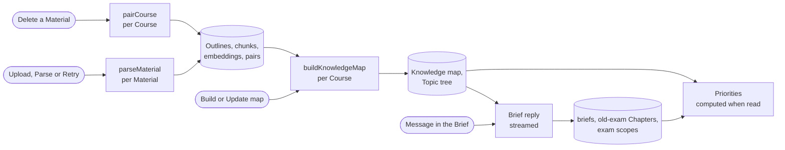

# Knowledge map pipeline

How a Course's Materials become its Knowledge map, with Topics and Reading sections, and how the Brief and the Priorities work on top of it: what starts each run, every model call it makes, and every row it writes. This is the pipeline v2 of #222: the Brief and what is computed when read (#224), page batches, Outlines and pairing (#228), and the map build from Chapters into a Topic tree with old exams as Chapters (#229). Terms follow [GLOSSARY.md](../../GLOSSARY.md). The decisions are in [ADR 0007](../adr/0007-ingest-each-upload-once.md) (parse every upload once), [0008](../adr/0008-workflows-by-default.md) and [0009](../adr/0009-durable-background-jobs.md) (durable workflows), [0020](../adr/0020-topics.md) (stored Topics, Reading sections on read), [0022](../adr/0022-knowledge-map-from-parts.md) (bounded build steps) and [0023](../adr/0023-knowledge-map-from-chapters.md) (the map from Chapters).

Eight prompts make the pipeline: the page batch read, the Outline and the pairing (task `ingest`), the Chapter extraction, the merge and the Prerequisite check (task `map`), the exercise extraction (task `exercise`) and the Topic tree (task `topic`). A page call sees up to 5 pages and an extraction one Chapter unit of at most 120,000 characters; the Outline, pairing and tree calls see a Material's or the Course's headings, chunk starts or KC names, not their text. What reads the map afterwards, tutoring, is in [tutoring-process.md](tutoring-process.md).

## Overview

| Run                                   | Started by                                                         | Model calls (task)                                                                                                                                                        | Writes                                                                                                        |
| ------------------------------------- | ------------------------------------------------------------------ | ------------------------------------------------------------------------------------------------------------------------------------------------------------------------- | ------------------------------------------------------------------------------------------------------------- |
| Parse (`parseMaterial`, workflow)     | Upload (`registerMaterial`), Parse or Retry (`startMaterialParse`) | `ingest`: 1 per 5 pages, 1 Outline, 1 pairing per 400 exercise and solution chunks; `embed`: 1 per 20 chunks                                                              | `materials`, `material_pages`, `chapters`, `chunks`, `exercise_solutions`, `courses.pairing_requested`        |
| Pairing (`pairCourse`, workflow)      | Deleting a Material (`deleteMaterial`)                             | 1 per 400 exercise and solution chunks (`ingest`)                                                                                                                         | `exercise_solutions`, `courses.pairing_requested`                                                             |
| Build (`buildKnowledgeMap`, workflow) | Build or Update map on the Course map (`startKnowledgeMapBuild`)   | `map`: 1 per changed teaching unit, 1 per 15 clusters, 1 per 25 assumed names; `exercise`: 1 per changed exercise unit; `topic`: 1 when the tree's input changed; `embed` | `chapter_extractions`, the map, Exercises, Topics, `knowledge_map_builds`                                     |
| Brief (route handler, streamed)       | The Student sends a message on the Brief page                      | 1 streamed reply of ≤ 5 steps (`brief`)                                                                                                                                   | `briefs`, `brief_excluded_materials`, `brief_messages`, `exam_scopes`, `chapters.is_exam`, `courses.language` |

Every model call checks the Student's Daily limit first and records its tokens and cost in `ai_usage` under its task (see [Daily limit, retries and failures](#daily-limit-retries-and-failures)).

## Starting a run, once

Each run has a status (on the Material, or a row per Course), and a database function moves it to its running state only when no run is going, so a double click or two tabs start one workflow. The functions are `security definer`, check that the caller owns the Course or Material, and return whether they queued. The Server Action then calls `start()` of the workflow; if that throws, a second function records it, so the page offers the button again.

| Run   | Queue function and its condition                                                                                                                                                                                                                                                                                                                                 | When `start()` fails                                                                                   |
| ----- | ---------------------------------------------------------------------------------------------------------------------------------------------------------------------------------------------------------------------------------------------------------------------------------------------------------------------------------------------------------------- | ------------------------------------------------------------------------------------------------------ |
| Parse | A new Material is inserted `queued` (column default). `queue_material_parse` moves it to `queued` from `not_parsed`, `failed`, `queued` with `parse_start_failed`, or `queued` or `parsing` with a `heartbeat_at` older than 30 minutes; it clears `parse_failure` and `parse_start_failed` and sets the heartbeat.                                              | `record_parse_start_failure` sets `parse_start_failed`: the page shows "Not started" and offers Parse. |
| Build | `queue_knowledge_map_build` upserts `knowledge_map_builds` to `building` (clearing `failure_reason`, setting `started_at`) when the Course has a `parsed` Material, none `queued` or `parsing`, and no build is `building`; a `queued` or `parsing` Material without a heartbeat for 30 minutes is first marked `failed` with "The parse stopped. Parse again.". | `record_knowledge_map_build_start_failure` sets `failed` with "The build could not start. Try again."  |

Pairing has no status row: its passes are ordered by `courses.pairing_requested` (see [Pairing](#pairing)).

Workflow steps run without a signed-in Student, on the admin client, and scope every query to the Course or Material and its owner themselves. Each step first checks its run is still current (the Material exists, the build is `building`, the run is `running`) and does nothing otherwise, so a deleted Course or Material stops a run quietly. The pages poll while a run is going: the Materials page while a Material is waiting or parsing, the Course map while the build is `building`.

## 1. Parse

`parseMaterial(materialId)` in `src/features/ingestion/workflows/parse-material.ts`. A Material is a PDF or an image in the private Storage bucket `course-files` at `<owner>/<course>/<material>`, uploaded by the browser before `registerMaterial` checks its size and type and inserts the row. The steps run in order; a retried parse resumes at the first unfinished one, because each step skips what is stored.

Every step starts by setting `materials.heartbeat_at` (`loadMaterial`).

1. **Prepare pages** (`preparePages`). Sets `parse_status = 'parsing'`, `parse_failure = null`. Opens the PDF (unpdf with the installed pdfjs-dist, [notes](../agents/notes/pdf-page-rendering.md)) to count its pages and read each page's text layer; an image is one page. A page whose text, without whitespace, is non-empty and starts the next page's is a slide overlay: it is stored `skipped = 'overlay'` without a call. Writes `pages_total` and `pages_done` (pages already in `material_pages`), and returns the pages without a stored result. A missing file or one that is no PDF fails the parse with "The file could not be opened".
2. **Read pages** (`readPages`, steps of up to 20 pages). Opens the PDF once and reads its pages in batches of up to 5 (`pageBatches`), at most `AI_CONCURRENCY` calls at a time (default 4; 1 on the gateway's free credit). Each page is rendered to JPEG with a 2,000-pixel long edge, never stored; a render with under 0.05% dark pixels is stored `skipped = 'blank'` without a call. **Call:** task `ingest`, trace `parse-batch`, streamed structured output, no reasoning, `maxOutputTokens` 16,000; the message is the last unit before the batch as context (none while a page before it is still being read), then each page's number, image and, when it has one, its text layer as a hint. It returns the batch's units in reading order: Markdown in the page's language (LaTeX; a figure as a `**Figure:**` blockquote; a heading verbatim), a label (`heading`, `content`, `exercise`, `solution`, `admin`), the pages it starts and ends on, a heading's style (`title`, `large`, `bold`), and whether the first unit goes on from before the batch and the last goes on after it. Code keeps each unit's pages inside the batch and the flags on the edge units only (`unitsOnPages`). Running headers, footers, page numbers, logos, title pages, tables of contents, indexes and reference lists are not transcribed, so a page may have no units. **Writes** one `material_pages` row per page as its batch finishes, with the units that start on it, and `materials.pages_done`. A batch whose call fails for good, or answers no valid result, is read again page by page once; a page that still fails is stored `skipped = 'unreadable'` with no units, and the parse goes on. No call starts 150 seconds after the step began; the pages left go to the next step.
3. **Outline** (`outlineMaterial`, `workflows/chunk-material.ts`). Skipped when the Material already has chunks. **Call:** task `ingest`, trace `parse-outline`, streamed structured output, `reasoning: "high"`: the Material's name and page count, its PDF outline (title, level, page), its heading units as `h1…` with page, style and text, and the first 80 characters of each page. It returns the Material's `language` (an English name), `notes` on notation that a reader of one passage needs, and its Chapters in reading order, each with its title as printed, a level, its heading id or else its page, and whether it is an old exam, a class test or their solutions (`exam`). Definitions, theorems, examples, single exercises and running headers are never Chapters. When the call fails for good, the Chapters come from the PDF outline, without language and notes; a reached Daily limit fails the parse.
4. **Chunks** (`chunkMaterial`, all in code). Skipped when the Material already has chunks, so a parse restarted after a failed embedding keeps them, their Outline and their vectors.
   - **Outline** (`outlineChapters`, `domain/outline.ts`). The root Chapter is titled by the Material's name. A proposed Chapter starts at its heading unit; with an unknown or already used heading id, at the first unit on its page. One with neither, without a title, or starting before the Chapter kept before it is dropped. Its parent is the nearest earlier kept Chapter with a lower level.
   - **Joining** (`chunksFromUnits`, `domain/chunk-joining.ts`). Each unit is a chunk, except that a unit joins the one before across a batch edge when that one goes on after its batch, this one goes on from before, no heading or Chapter start stands between them and their labels match. Chunks are cut at every Chapter start. A Chapter's own heading becomes a Markdown heading of its depth at the start of the next unit, any other heading a bold line there; headings with no unit after them in their Chapter make a `content` chunk. A chunk over 6,000 characters splits between paragraphs. Each chunk sits in its deepest Chapter.
   - **Writes** through `replace_material_chunks`, one transaction: deletes the Material's Chapters and chunks and inserts the new ones: `chapters` (`parent_id`, `position`, `depth`, `title`, `page_from`, `exam_proposed`) and `chunks` (`position`, `page_from`, `page_to`, `label`, `markdown`, `chapter_id`). A new Chapter with the depth and title of a replaced one takes over its old-exam answer, the Reserved exam and a final Mock exam's link. Then `materials.language` and `materials.notes` (at most 1,000 characters), which the tutor's instructions list per Material.
5. **Embed** (`embedChunks`). The non-admin chunks with no `embedding`, in batches of 20. **Call:** task `embed` (`embedMany`, Cohere's `search_document` input type), trace `parse-embed`, each chunk's Markdown. The AI SDK does not retry (`maxRetries: 0`); the step does, after the delay the provider names or 60 seconds, and not at all for an error that cannot succeed later. **Writes** each batch through `set_chunk_embeddings` before its usage is recorded, so a retry never pays twice. The vectors serve `match_chunks` (the tutor's `searchMaterials`).
6. **Pair exercises** (`pairMaterialCourse`): the pairing pass below, for the Material's Course. At the Daily limit it stores nothing and the parse fails.
7. **Done** (`markParsed`): `parse_status = 'parsed'`. The Materials page lists a parsed Material's unreadable pages.

A step that fails for good, or a reached Daily limit, runs `failParse`: `parse_status = 'failed'` and `parse_failure` = "Daily limit reached", "The file could not be opened" or, for anything else, "The material could not be parsed. Please try again.". Retry queues the Material again and the parse resumes at the first page without a row. If the Material is deleted mid-parse, the page insert hits a foreign key and the parse stops quietly. A parse whose workflow died leaves its heartbeat behind: after 30 minutes the Materials page shows it failed with "The parse stopped. Parse again.", and the queue functions treat it so.

### Pairing

Every `exercise` chunk of the Course gets one `exercise_solutions` row: its solution chunk, possibly from another Material, or `no_solution`. It is recomputed for the whole Course at the end of every parse and, through the `pairCourse` workflow, after a Material is deleted, so upload order does not matter (`src/features/ingestion/workflows/pair-exercises.ts`).

A pass takes a number from `request_exercise_pairing` (increments `courses.pairing_requested`), then:

1. **Runs** (`pairingCalls`, `domain/exercise-pairing.ts`). The Course's `exercise` and `solution` chunks in Course order, in runs of at most 400; a run without an exercise or without a solution makes no call.
2. **Call** per run, task `ingest`, trace `pair-exercises`, streamed structured output, `reasoning: "high"`: each chunk as `e1…` or `s1…` with its Material's name, its Chapter path (the titles below the root down to its Chapter) and its first 300 characters. It answers the pairs it is sure of. Before each call the pass checks it is still the latest request and stops otherwise.
3. **Check** (`checkedPairs`). An id that names no offered exercise, or no offered solution, is dropped; an exercise keeps the first solution the answer gives it. An answer that is no valid output pairs nothing for that run.
4. **Write** through `replace_exercise_solutions`, which locks the Course row and writes only if the pass is still the latest request: it deletes all the Course's pairs and inserts one row per `exercise` chunk, `paired` or `no_solution`.

A step runs passes until every `exercise` chunk has a row, at most 3, then throws and retries, so overlapping parses store what running them one after the other would. At the Daily limit, a parse's pass fails the parse; `pairCourse` stores what it paired and leaves the rest `no_solution` until the next pass. `pnpm smoke pair` checks pairing on the recorded gold exercise pages.

## 2. Build

`buildKnowledgeMap(courseId)` in `src/features/knowledge-map/workflows/build-knowledge-map.ts` ([ADR 0023](../adr/0023-knowledge-map-from-chapters.md)). The workflow passes only the Course's id; each step reads and writes tables, sets `knowledge_map_builds.heartbeat_at` (`touchBuild`) and does nothing once the build is no longer `building`. A step handles up to 8 units, runs at most `AI_CONCURRENCY` calls at a time, starts no call after 150 seconds, and stores what finished before it ends; the workflow runs a step again while it leaves work. Every structured call of the build is streamed with `reasoning: "high"` (`buildCall`), and a call that answers empty or no valid output is made once more before the step fails. A build silent for 30 minutes counts as failed with "The build stopped. Update the map again.", and the next Update map resumes where it stopped.

**Course order** is Materials by `materials.position` (set on upload by the numbers in the name in natural order, then unnumbered Materials by upload; the Materials page moves a Material up or down), then chunks by position. The **Course language** is `courses.language` when the Student chose one in the Brief, else the most common `materials.language`, else English; every prompt of the build names it and writes names, descriptions and questions in it.

**Units** (`chapterUnits`, `domain/chapter-units.ts`). A Chapter whose subtree's `content` chunks total at most 120,000 characters is one teaching unit; a bigger Chapter makes units of its children, plus units of its own chunks outside them, and a leaf over the cap splits between chunks. The same rule over `exercise` chunks gives the exercise units. A unit's `content_hash` covers its Chapter's title and its chunks' Markdown.

1. **Prepare** (`prepareBuild`). Fails the build with "nothing to map" when the Course has no `content` or `exercise` chunks. Retires the KCs whose sources are all gone (`retire_unsourced_kcs`): a retired KC (`kcs.retired_at`) leaves its Topic, the plan and Priority, and keeps its Attempts.
2. **Extract Chapters** (`extractChapters`, `workflows/extract-steps.ts`). Each teaching unit whose `content_hash` differs from its stored extraction's. **Call:** task `map`, trace `extract-chapter`: the Material's name, its Outline's titles with the unit's Chapter marked, the Course language and the unit's chunks with ids. It returns KCs (`name`, a one-line `description`, `chunkIds`, up to 3 `assumes`) and Prerequisites among them by name. No KC budget. Code drops a KC without a known chunk id and a Prerequisite with an unknown end. **Writes** `chapter_extractions` (`chapter_id`, `kind`, `unit`, `content_hash`, `output`, `kc_ids` null) per unit as it finishes.
3. **Consolidate** (`consolidateKcs`, `workflows/consolidate-steps.ts`). For the extractions not stored as KCs, in Course order: one `embed` call for their KCs' "name: description", stored in the extraction first. A KC within cosine 0.9 of a retired KC revives it; one within 0.85 of another KC (`match_kcs`, an exact scan) forms a cluster (at most 8 KCs). **Call:** task `map`, trace `merge-kcs`, per 15 clusters: which KCs are the same. The oldest KC of a group keeps its id and gains the others' sources; a merged new KC is never stored. **Writes** through `store_chapter_kcs` in one transaction: new KCs with their vector, sources, the unit's Prerequisites without cycles, and `chapter_extractions.kc_ids`.
4. **Extract Exercises** (`extractExercises`, `workflows/exercise-steps.ts`). Each exercise unit whose content changed or whose paired solutions are no longer those it was extracted with. **Call:** task `exercise`, trace `extract-exercises`: its exercise chunks with their paired solutions (`exercise_solutions`) and the 30 live KCs nearest to them. Per exercise: 1 to 6 KC ids, new KCs only when none fits, final answers exactly as printed in the statement or its paired solution (label, value, mathjs unit), or `notAnExercise`. No solving. The new KCs go through step 3 again (origin `exercise`); `store_chapter_kcs` stores one Exercise per question chunk with `solution_chunk_id`, the final answers and a difficulty from code (3 with 3 or more KCs or a printed solution of 12 or more lines; 1 with one KC and a printed solution of 4 lines or fewer, or none; 2 otherwise). An Exercise extracted again keeps its id, so its Attempts, Questions and Problems stay.
5. **Prerequisite check** (`matchAssumptions`, `workflows/prerequisite-steps.ts`). For stored extractions not matched yet (`chapter_extractions.assumes_matched`): one `embed` call for the names their KCs assume, each matched with `match_kcs` to the 5 nearest KCs whose first source comes earlier in Course order. **Call:** task `map`, trace `check-prerequisites`, per 25 names with candidates: the candidate each name means, or none; that KC becomes a Prerequisite of the assuming KC. A name without candidates makes no call. **Writes** through `store_assumed_prerequisites`, after dropping the newest link of each cycle, and marks the extractions matched.
6. **Topic tree** (`proposeTopicTree`, `workflows/topic-steps.ts`). No call when the Course has no live KCs, or when the hash of the Course language and the Outlines with their KC names equals `knowledge_map_builds.topic_tree_hash`; the stored tree is then kept. **Call:** task `topic`, trace `topic-tree`, once per build: every Material's Outline in Course order with the live KC names under each Chapter that has KCs (Chapters as `c1…`), and the stored tree (Topics as `t1…`, with names and Chapters). It returns a flat list of Topics in tree order, each with a level, a name (at most 80 characters), the Chapters whose KCs it holds itself, a central question when it holds any, and the stored Topic it continues, if any. Code turns the short ids back and drops unknown ones.
7. **Arrange** (`arrangeKnowledgeMap`, `workflows/arrange-steps.ts`). Places the tree in code (`planTopicTree`, `domain/topic-tree.ts`): each Chapter with KCs goes to the first Topic that names it, and one no Topic names becomes a top-level Topic at the end, named by its title; a KC joins the Topic of its first source's Chapter, and a KC from the exercise call joins the Topic holding most of the KCs its Exercises test it with; a Topic left with no KCs and no children is dropped; a Topic keeps the stored id it continues, with its notes, choices and sessions. Then stores the map through `arrange_knowledge_map` in one transaction: KCs by first source, Exercises by their question chunks, the Topics with `parent_id`, `position` (one Course-wide index in tree order, a parent before its children), `chapter_ids` and a `central_question` only on a Topic with KCs of its own, their KCs in teaching order, stored Topics not continued deleted, redundant Prerequisites dropped (transitive reduction), the tree hash, the check report, and the build `built`.

A reached Daily limit fails the build with "Daily limit reached"; a step that fails for good fails it with "The knowledge map could not be built. Please try again."; either way, what earlier steps stored stays.

**Check report** (`knowledge_map_builds.check_report`): `chaptersWithoutKcs`, the Chapters with content of their own that no live KC cites; `exercisesWithoutKcs`, the labels of Exercises without KCs; and `duplicates`, pairs of live KCs still at cosine 0.85 or more (`alike_kcs`, at most 100). The Course map marks a KC of a remaining pair "Possible duplicate of …".

**Map Findings** come from tutoring: the tutor's `flagMap` tool files a `missing_link`, `wrong_link` or `wrong_description` (with `proposedDescription`) in `map_findings` with a quote that code checks is in the cited chunk, and the Student accepts or dismisses it on the Course map (`answerMapFinding`). Accepting runs `accept_map_finding`, which in one transaction adds the Prerequisite (`linkedKcId` is the KC that `kcId` builds on), deletes the link in either direction, or sets the KC's description, and marks the Finding `applied` with an outcome written by the function. A new Prerequisite that would close a cycle is refused with "This link would make a cycle." and the Finding stays open.

**Read:** `loadCourseTopics(courseId)` returns the whole Topic tree in tree order, each Topic with its parent, its own KCs in teaching order, its anchors (Prerequisites of its KCs from outside the Topic, in map order, derived on each read) and its Reading sections, cut on each read from the chunks its KCs cite, with UUID v5 ids of Topic, Material and pages. The study plan, Today card and sessions use the Topics with KCs of their own. The Course map draws the tree as nested ELK compound boxes, a parent's own card beside its children's. An Exercise's label is built when read from its question chunk: "<Chapter title> · <Material> p. N", or "<Material> p. N" for a chunk in its Material's root Chapter; its solution is the chunk `solution_chunk_id` names, or "No solution in the Materials".

## 3. Brief

The Brief is a conversation, not a workflow (`src/features/brief/`, route `/api/brief`).

- **Opening the page** (`openBrief`) creates the `briefs` row and a static opening message in `brief_messages` if needed, with no model call. Once intake is done (below), it posts one static message (`model_id = 'static'`, id derived from the Chapters', so it is stored once) about the proposed old-exam Chapters of parsed Materials not asked yet (`chapters.exam_asked`) and not answered: "This looks like an old exam. Is it one?" with each named "<Material> › <Chapter>", or the Material's name for its root Chapter. A Chapter is proposed when the Outline call marked it (`exam_proposed`), or when it is a Material's root Chapter and the Material's name looks like an exam (Klausur, Exam, Prüfung or Resit). The message carries the Chapters' ids in a `data-old-exams` part the model does not see.
- **Each Student message** (`handleBriefRequest`): checks the Daily limit (429 at the limit), stores the message, and streams one reply, task `brief`, trace `brief-reply`, no reasoning, at most 5 steps. The instructions are written by code on every reply: the role, the intake order, every answer stored so far, the Course's Materials with their ids, each marked excluded, with its Chapters to depth 2 (and any deeper one proposed or answered) with ids, each marked old exam, not an old exam, or likely an old exam; the Course language and whether the Student chose it; the Course's nested Topics with their ids and exam scopes; its distinct admin texts; the reserved-exam question and today's date. Admin chunks are compared with whitespace collapsed and digits removed; each distinct text appears once with its first "<Material> p. N", in Course order, up to 4,000 tokens. On end, the reply's usage goes into `ai_usage` (estimated from the text when the provider reports none), and the reply is stored unless it failed, was cut off or is empty.
- **Intake order:** exam date, goal (`pass`, `good_grade`, `master_everything`), hours per week, format (question style, open book, formula sheet, calculator), scope (excluded Materials, old exams, exam scope, then `scope_confirmed`). Intake is done when every field is answered and the scope confirmed. Then, with an old exam in the Course, the reserved-exam question.
- **Tools**, each one transaction:

| Tool           | Writes                                                                                                                                                                                                                                                                                                                                                                                                                                                                                                                                                                                                                                                                                                                                                                     |
| -------------- | -------------------------------------------------------------------------------------------------------------------------------------------------------------------------------------------------------------------------------------------------------------------------------------------------------------------------------------------------------------------------------------------------------------------------------------------------------------------------------------------------------------------------------------------------------------------------------------------------------------------------------------------------------------------------------------------------------------------------------------------------------------------------- |
| `saveBrief`    | The given fields of `briefs` through `save_brief`, and `brief_excluded_materials` when `excludedMaterialIds` is sent (unknown ids are dropped). `examChapterIds` replaces the old exams: `chapters.is_exam` true on those Chapters, false on the Chapters confirmed or asked about before, `exam_asked` on the Chapters the Student was asked about (those the static question's `data-old-exams` part lists, and during intake every Chapter of the AI's context); a confirmed Chapter covers its subtree, and a Reserved exam that is no longer an old exam loses its reservation. `reservedExamChapterId` sets `reserved_exam_chapter_id` and `reserved_exam_answered`, unless a submitted mock already used the reservation. `courseLanguage` sets `courses.language`. |
| `addNote`      | Appends the Student's words to `briefs.notes` (at most 20,000 characters) through `add_brief_note`, which sets `notes_updated_at`.                                                                                                                                                                                                                                                                                                                                                                                                                                                                                                                                                                                                                                         |
| `setExamScope` | One `exam_scopes` row per Topic through `set_exam_scope` (`scope: null` removes it), which bumps `briefs.updated_at`. Refused unless the id is a Topic of the Course and, for a scope, `words` quotes a Student message of the Brief. A Topic's scope covers the Topics inside it, unless one has its own.                                                                                                                                                                                                                                                                                                                                                                                                                                                                 |

## 4. Priorities

Computed on every read, with no model call and nothing stored: `loadKcPriorities(supabase, courseId)` for the plan, reviews, readiness and the mock and stock steps, and `getPriorities(courseId)` for the map pages, both in `src/features/priorities/server/priorities.ts`. They read the stored map and Topic tree, every chunk's Material and Chapter, the confirmed old-exam Chapters, the Brief's excluded Materials and the exam scopes (`loadExamScopes`). Per KC (code, `domain/priority.ts`):

- **Priority** = scope × (0.25 + 0.5 × oldExamShare + 0.25 × exerciseShare).
- **oldExamShare:** the KC's Exercises whose question chunk is an old-exam chunk (its Chapter or a Chapter above it has `is_exam`), divided by the most any KC of the Course has (0 when that is 0). The Reserved exam counts. **exerciseShare:** the same over all the KC's Exercises.
- **scope:** 0 when every source chunk of the KC is in a Material the Brief excludes; else the exam scope of the KC's Topic, or of the nearest Topic above it that has one: 0 when `excluded`, 2 when `emphasized`; 1 otherwise.
- **Reasons:** "Tested in N old-exam Exercises", "Tested in N Exercises", "Excluded in the Brief: <words>", "Emphasized in the Brief: <words>", or "Excluded: you skip <Materials>".

Without old exams, Exercises and exam scopes every KC gets 0.25, so course order decides. The Course map shows each KC's level: `excluded` at 0, otherwise `high`, `medium` or `low` by tertiles. The study plan and the due reviews weigh Topics and KCs by Priority ([tutoring-process.md](tutoring-process.md)). Not built: neither the Brief's goal nor a KC's attempts affect Priorities, and the diagnostic (#51, step 5) has no code yet.

## Daily limit, retries and failures

- **Daily limit.** `AI_DAILY_LIMIT_USD` per Student per UTC day; without it nothing is limited. Workflow calls go through `meteredGenerate`, `meteredStream` and `meteredEmbed` (`src/features/usage/server/metered-call.ts`): check the limit for the Material's or Course's owner, run the traced call, record the usage in `ai_usage` under its task with the answering model. A reached limit, or the provider's used-up daily quota, returns null, which each step turns into its outcome: a parse or a build fails with "Daily limit reached" and keeps what it stored, pairing after a delete leaves pairs `no_solution`.
- **Retries.** The AI SDK retries a call up to 3 times on retryable errors (embeddings in a parse excepted), and Vercel Workflow retries a failed step up to 3 times. A build call whose answer is empty or fails its schema is made once more, then the step throws.
- **Tracing.** Every call carries the Student as user and its trace name (`parse-batch`, `brief-reply`, …) for Langfuse ([ADR 0012](../adr/0012-ai-observability-and-evals.md)).

## Tables

Every table has an `owner` and Row Level Security; Students read their own rows, and workflows write through the admin client and the `service_role`-only functions named above.

| Table                                                  | Written by                                              | Holds                                                                                                                                             |
| ------------------------------------------------------ | ------------------------------------------------------- | ------------------------------------------------------------------------------------------------------------------------------------------------- |
| `courses.language`                                     | The Brief (`save_brief`)                                | The Course language the Student chose, null for the Materials' own                                                                                |
| `materials`                                            | `registerMaterial`, the queue functions, the parse      | File, `parse_status`, `parse_failure`, `parse_start_failed`, `pages_total`, `pages_done`, `language`, `notes`, `heartbeat_at`                     |
| `material_pages`                                       | Parse step 2                                            | One page's units, or why it was skipped; internal, never shown                                                                                    |
| `chapters`                                             | Parse step 4, the Brief (`save_brief`)                  | The Material's Outline: parent, position, depth, title, first page, `exam_proposed`; `is_exam` (null until the Student answers) and `exam_asked`  |
| `chunks`                                               | Parse steps 4 and 5                                     | The Material's chunks with label, pages, Markdown, `chapter_id` and `embedding`                                                                   |
| `exercise_solutions`                                   | Pairing                                                 | One row per `exercise` chunk: `paired` with its solution chunk, or `no_solution`                                                                  |
| `courses.pairing_requested`                            | Pairing                                                 | The latest pairing pass's number                                                                                                                  |
| `knowledge_map_builds`                                 | The queue functions, the build                          | One row per Course: `status`, `failure_reason`, `check_report`, `topic_tree_hash`, `started_at`, `finished_at`, `heartbeat_at`                    |
| `chapter_extractions`                                  | The build                                               | Per unit (`chapter_id`, `kind`, `unit`): its `content_hash`, the checked extraction, the stored KC of each extracted one, `assumes_matched`       |
| `kcs`, `kc_sources`, `prerequisite_links`              | The build                                               | The map: KCs with `embedding`, `retired_at` and their sources; Prerequisites                                                                      |
| `exercises`, `exercise_kcs`                            | The build                                               | Exercises by question chunk with `solution_chunk_id`, difficulty and `final_answers`, and their KCs                                               |
| `map_findings`                                         | The tutor (`flagMap`), the Student (`answerMapFinding`) | The tutor's map Findings                                                                                                                          |
| `topics`, `topic_kcs`                                  | The build                                               | The Topic tree: `parent_id`, `position` in tree order, `chapter_ids` and `central_question` when it has KCs of its own; its KCs in teaching order |
| `briefs`, `brief_excluded_materials`, `brief_messages` | The Brief                                               | Exam facts, notes, `reserved_exam_chapter_id`, excluded Materials, the conversation                                                               |
| `exam_scopes`                                          | The Brief (`set_exam_scope`)                            | One exam scope per Topic, `excluded` or `emphasized`, in the Student's words                                                                      |
| `ai_usage`                                             | Every model call                                        | Task, model, tokens and cost per call                                                                                                             |

Deleting a Material cascades its pages, Chapters, chunks, extractions, pairs and sources; the map itself changes at the next Update map, which retires the KCs left without sources. Deleting a Course cascades everything.

## Where to change things

- **Code:** the workflows and their steps in `src/features/ingestion/workflows/`, and `knowledge-map/workflows/`, Priority in `priorities/domain/priority.ts`; the Brief handler and tools in `brief/server/`. Prompts and output schemas sit in each feature's `ai/`, pure rules in `domain/` with tests beside them.
- **Models:** each task's model is in `AI_TASKS` in `src/lib/ai/models.ts`, overridable with its `AI_MODEL_*` variable; every model needs a price in `src/lib/ai/prices.ts`.
- **Database:** the functions named here are in `supabase/migrations/`; the newest definition of each wins.

## Checks

- `pnpm test:run` runs the workflows in-process against `fakeSupabase` and mock models, with the helpers in `parse-testing.ts`, `build-testing.ts`, `build-models-testing.ts` and `handler-testing.ts`: the parse (`parse-material*.test.ts`, `chunk-material`, `embed-chunks`, `pair-exercises`), the build (`build-knowledge-map.test.ts`, `build-exercises.test.ts`) and the Brief handler (`handler*.test.ts`). The pure rules have tests beside them in each `domain/`.
- `pnpm db:test` covers the policies and database functions in `supabase/tests/database/`: `material_parsing`, `queue_material_parse`, `replace_material_chunks`, `set_chunk_embeddings`, `exercise_solutions`, `build_kcs_from_chapters`, `build_end`, `knowledge_map`, `exercises`, `topics`, `map_findings`, `brief_writes`, `exam_scopes` and others.
- `pnpm smoke <name>` runs a stage on a live model, so [live-ai.md](../agents/live-ai.md) applies. Those that need a built map seed the `linear-algebra-I` gold course ([evals/gold/README.md](../../evals/gold/README.md)), and stop until its snapshot exists:
  - `parse`: a PDF or image through the real parse; can write the page results and the Outline to a file (`--pages-out`).
  - `pair`: the recorded gold exercise pages 3 and 5 (`evals/gold/linear-algebra-I/pages.json`) seeded as one Material with their recorded Outline, on MiMo: one pairing call; Exercises 8, 9, 10, 14 and 15 get their printed solutions, the others none.
  - `map`: Update map from the recorded lecture pages 17–24 and Exercises 7–10 with their recorded Outlines, on MiMo (`AI_SMOKE_MAX_MINUTES=10`): every KC is in English and cites a chunk of its unit, a top-level Topic covers Vector Spaces with children in section order, Exercise 7's final answer is the printed 8 and Exercise 10's the printed dim U = 2, at most 10 build calls besides embeddings, and a second Update map makes no call.
  - `map-findings`: the gold course with a reversed Prerequisite; the Student disputes it in a Chat and the AI files a Finding.
  - `brief`: a small Course seeded in code: lecture notes with an admin chunk "Chapter 2 is not examined" and a last Chapter "Klausur 2025" that the parse proposed as an old exam. Scripted messages answer the Brief, confirm that Chapter as an old exam and the exam scope, then the reserved exam. Checks the Chapter's `is_exam`, the `exam_scopes` row on the Chapter 2 Topic and that its KCs read Priority 0.
