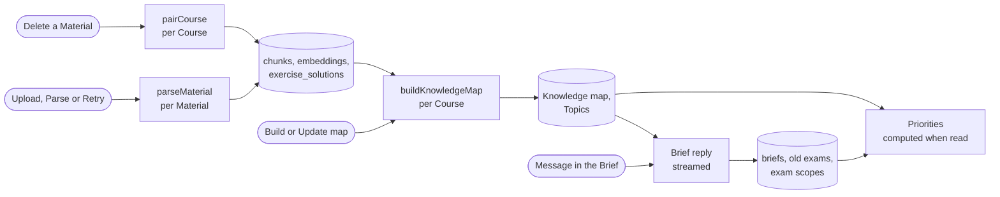

# Knowledge map pipeline

How a Course's Materials become its Knowledge map, with Topics and Reading sections, and how the Brief and the Priorities work on top of it: what starts each run, every model call it makes, and every row it writes. This is the pipeline v2 of #222: parse, Parts and pairing (#223), the Brief and what is computed when read (#224), and the map build from Parts (#225). Terms follow [GLOSSARY.md](../../GLOSSARY.md). The decisions are in [ADR 0007](../adr/0007-ingest-each-upload-once.md) (parse every upload once), [0008](../adr/0008-workflows-by-default.md) and [0009](../adr/0009-durable-background-jobs.md) (durable workflows), [0020](../adr/0020-topics.md) (stored Topics, Reading sections on read) and [0022](../adr/0022-knowledge-map-from-parts.md) (the map from Parts).

Seven prompts make the pipeline: the page read and the pairing leftovers (task `ingest`), the Part extraction, the merge and the Prerequisite check (task `map`), the exercise extraction (task `exercise`) and the Topic naming (task `topic`). Every call sees one page, one Part, one exercise Part or one shortlist, so no prompt grows with the Course. What reads the map afterwards, tutoring, is in [tutoring-process.md](tutoring-process.md).

## Overview

| Run                                   | Started by                                                         | Model calls (task)                                                                                                                                                          | Writes                                                                                     |
| ------------------------------------- | ------------------------------------------------------------------ | --------------------------------------------------------------------------------------------------------------------------------------------------------------------------- | ------------------------------------------------------------------------------------------ |
| Parse (`parseMaterial`, workflow)     | Upload (`registerMaterial`), Parse or Retry (`startMaterialParse`) | `ingest`: 1 per page, 1 per 10 leftover exercises; `embed`: 1 per 20 chunks                                                                                                 | `materials`, `material_pages`, `chunks`, `exercise_solutions`, `courses.pairing_requested` |
| Pairing (`pairCourse`, workflow)      | Deleting a Material (`deleteMaterial`)                             | 1 per 10 leftover exercises (`ingest`)                                                                                                                                      | `exercise_solutions`, `courses.pairing_requested`                                          |
| Build (`buildKnowledgeMap`, workflow) | Build or Update map on the Course map (`startKnowledgeMapBuild`)   | `map`: 1 per changed teaching Part, 1 per 15 clusters, 1 per 25 assumed names; `exercise`: 1 per changed exercise Part; `topic`: 1 per 10 new Topics of a Big idea; `embed` | `part_extractions`, the map, Exercises, Topics, `knowledge_map_builds`                     |
| Brief (route handler, streamed)       | The Student sends a message on the Brief page                      | 1 streamed reply of ≤ 5 steps (`brief`)                                                                                                                                     | `briefs`, `brief_excluded_materials`, `brief_messages`, `exam_scopes`, `materials.is_exam` |

Every model call checks the Student's Daily limit first and records its tokens and cost in `ai_usage` under its task (see [Daily limit, retries and failures](#daily-limit-retries-and-failures)).

## Starting a run, once

Each run has a status (on the Material, or a row per Course), and a database function moves it to its running state only when no run is going, so a double click or two tabs start one workflow. The functions are `security definer`, check that the caller owns the Course or Material, and return whether they queued. The Server Action then calls `start()` of the workflow; if that throws, a second function records it, so the page offers the button again.

| Run   | Queue function and its condition                                                                                                                                                                                                                                                                                                                                 | When `start()` fails                                                                                   |
| ----- | ---------------------------------------------------------------------------------------------------------------------------------------------------------------------------------------------------------------------------------------------------------------------------------------------------------------------------------------------------------------- | ------------------------------------------------------------------------------------------------------ |
| Parse | A new Material is inserted `queued` (column default). `queue_material_parse` moves it to `queued` from `not_parsed`, `failed`, `queued` with `parse_start_failed`, or `queued` or `parsing` with a `heartbeat_at` older than 30 minutes; it clears `parse_failure` and `parse_start_failed` and sets the heartbeat.                                              | `record_parse_start_failure` sets `parse_start_failed`: the page shows "Not started" and offers Parse. |
| Build | `queue_knowledge_map_build` upserts `knowledge_map_builds` to `building` (clearing `failure_reason`, setting `started_at`) when the Course has a `parsed` Material, none `queued` or `parsing`, and no build is `building`; a `queued` or `parsing` Material without a heartbeat for 30 minutes is first marked `failed` with "The parse stopped. Parse again.". | `record_knowledge_map_build_start_failure` sets `failed` with "The build could not start. Try again."  |

Pairing has no status row: its passes are ordered by `courses.pairing_requested` (see [Pairing](#pairing)).

Workflow steps run without a signed-in Student, on the admin client, and scope every query to the Course or Material and its owner themselves. Each step first checks its run is still current (the Material exists, the build is `building`, the run is `running`) and does nothing otherwise, so a deleted Course or Material stops a run quietly. The pages poll while a run is going: the Materials page while a Material is waiting or parsing, the Course map while the build is `building`.

## 1. Parse

`parseMaterial(materialId)` in `src/features/ingestion/workflows/parse-material.ts`. A Material is a PDF or an image in the private Storage bucket `course-files` at `<owner>/<course>/<material>`, uploaded by the browser before `registerMaterial` checks its size and type and inserts the row. The steps run in order; a retried parse resumes at the first unfinished one, because each step skips what is stored.

Every step starts by setting `materials.heartbeat_at` (`loadMaterial`).

1. **Prepare pages** (`preparePages`). Sets `parse_status = 'parsing'`, `parse_failure = null`. Opens the PDF (unpdf with the installed pdfjs-dist, [notes](../agents/notes/pdf-page-rendering.md)) to count its pages and read each page's text layer; an image is one page. A page whose text, without whitespace, is non-empty and starts the next page's is a slide overlay: it is stored `skipped = 'overlay'` without a call. Writes `pages_total` and `pages_done` (pages already in `material_pages`), and returns the pages without a stored result. A missing file or one that is no PDF fails the parse with "The file could not be opened".
2. **Read pages** (`readPages`, steps of up to 8 pages). Opens the PDF once and reads its pages with at most `AI_CONCURRENCY` calls at a time (default 4; 1 on the gateway's free credit). Each page is rendered to JPEG with a 2,000-pixel long edge, never stored; a render with under 0.05% dark pixels is stored `skipped = 'blank'` without a call. **Call:** task `ingest`, trace `parse-page`, structured output, no reasoning, `maxOutputTokens` 8,000; the message is the image and, when the page has a text layer, its text as a hint. It returns the page's `language` (BCP 47) and its units in reading order: Markdown (LaTeX; a figure as a `**Figure:**` blockquote), a label (`content`, `exercise`, `solution`, `admin`), the exercise number exactly as printed, and whether it continues from the previous page or onto the next. Running headers, footers, page numbers, logos, title pages, tables of contents, indexes and reference lists are not transcribed, so a page may have no units. **Writes** one `material_pages` row per page as it finishes (`units`, `language`) and `materials.pages_done`. A call that still fails after its retries, or answers no page result, stores the page `skipped = 'unreadable'` with no units, and the parse goes on. No call starts 150 seconds after the step began; the pages left go to the next step.
3. **Chunks and Parts** (`chunkMaterial`, all in code). Skipped when the Material already has chunks, so a parse restarted after a failed embedding keeps them and their vectors.
   - **Joining** (`joinUnits`). In reading order, a non-admin unit joins the previous non-admin unit's chunk when that unit is on the page before, a continuation flag says so, and the text agrees: the earlier unit does not end with `.`, `!`, `?`, `:` or a display formula, or the later one starts in lower case or with a subtask label such as `b)` or `(ii)`. Units on one page never join; admin units never join and never break a join. A join stops before the chunk passes 6,000 characters or spans more than 3 pages. A joined chunk takes its first unit's label and first exercise number.
   - **Keys** (`exerciseKeys`). An exercise number is normalized: text before the first digit goes, the rest splits into numbers and letters, so "Aufgabe 7.2 b)" and "7.2b" are both `7.2.b`. One without a digit such as `b)` is keyed under the root of the nearest preceding chunk with the same label whose number has one (`b)` after `Aufgabe 7.2` or `7.2a` is `7.2.b`), else null. The root of a key is its leading numbers.
   - **Chapters** (`chunkChapters`). The chapter level is the shallowest PDF outline level with at least 3 entries, or else the level with the most (the shallower on a tie). A chunk's chapter is the entry at that level that covers its first page, else the deepest entry above it that does, else the last level-1 Markdown heading up to the chunk, else the Material's name.
   - **Parts** (`buildParts`). Teaching Parts hold `content` chunks: a chunk that starts with a heading, or opens a new chapter, starts a candidate titled by it; chunks before the first are titled by the Material's name. A candidate under 400 words joins the next one in its chapter, or the previous one at the chapter's end; one over 4,000 words splits at its next heading, else at a page boundary. Exercise Parts hold a run of consecutive `exercise` or `solution` chunks of one label with one root key; a chunk without a key is its own Part. Admin chunks are in no Part.
   - **Writes** through `replace_material_chunks`, one transaction: deletes the Material's chunks and Parts and inserts the new ones: `parts` (`position`, `kind`, `title`, `chapter_title`, `page_from`, `page_to`, `content_hash` of its chunks' Markdown) and `chunks` (`position`, `page_from`, `page_to`, `label`, `markdown`, `exercise_number`, `part_id`).
4. **Embed** (`embedChunks`). The non-admin chunks with no `embedding`, in batches of 20. **Call:** task `embed` (`embedMany`, Cohere's `search_document` input type), trace `parse-embed`, each chunk's Markdown. The AI SDK does not retry (`maxRetries: 0`); the step does, after the delay the provider names or 60 seconds, and not at all for an error that cannot succeed later. **Writes** each batch through `set_chunk_embeddings` before its usage is recorded, so a retry never pays twice. The vectors serve `match_chunks` (the tutor's `searchMaterials`).
5. **Pair exercises** (`pairMaterialCourse`): the pairing pass below, for the Material's Course. At the Daily limit it stores nothing and the parse fails.
6. **Done** (`markParsed`): `parse_status = 'parsed'` and `materials.language`, the most common language of its pages. The Materials page lists a parsed Material's unreadable pages.

A step that fails for good, or a reached Daily limit, runs `failParse`: `parse_status = 'failed'` and `parse_failure` = "Daily limit reached", "The file could not be opened" or, for anything else, "The material could not be parsed. Please try again.". Retry queues the Material again and the parse resumes at the first page without a row. If the Material is deleted mid-parse, the page insert hits a foreign key and the parse stops quietly. A parse whose workflow died leaves its heartbeat behind: after 30 minutes the Materials page shows it failed with "The parse stopped. Parse again.", and the queue functions treat it so.

### Pairing

Every exercise subtask of the Course gets one `exercise_solutions` row: its solution chunk, possibly from another Material, or `no_solution`. It is recomputed for the whole Course at the end of every parse and, through the `pairCourse` workflow, after a Material is deleted, so upload order does not matter (`src/features/ingestion/workflows/pair-exercises.ts`).

A pass takes a number from `request_exercise_pairing` (increments `courses.pairing_requested`), then:

1. **Keys and subtasks** (`src/features/ingestion/domain/exercise-pairing.ts`). Each Material's `exercise` and `solution` chunks are keyed in reading order (`exerciseKeys`, above). The subtasks are the `exercise` chunks without a shared statement: an exercise whose Material's next exercise has a key under its key (`7.2` followed by `7.2a`).
2. **Same Material** (code). An exercise takes the solution with its key, or else its nearest ancestor key (`3a` takes `3`), that comes after it and before the next exercise with its key or an ancestor key, when exactly one does. So the Final's and the Resit's Problem 3 in one PDF each take their own solution.
3. **Partner Materials** (code). Two Materials are partners when their names match after lower-casing and removing punctuation and the words lösung, loesung, lsg, musterlösung, solution, solutions and sol ("Exercises" and "Exercises Solutions"). A Material with solutions, no exercises and no partner by name is the partner of the one other Material whose subtask keys its solution keys cover (the key or an ancestor) for at least 80%, when exactly one does. An exercise left whose key is unique among its Material's exercises takes the only solution in its partners with its key, or else its nearest ancestor key.
4. **By content.** The subtasks left get a shortlist from the solutions no pair took: up to 3 with the exercise's key or an ancestor, nearest first, then the nearest others, 6 at most, each at cosine 0.5 or more between the stored chunk embeddings (no embedding call). A solution whose key differs from the exercise's is left out when both are in one Material or in partners, since those share a numbering. An exercise with an empty shortlist gets `no_solution` without a call; one whose shortlist hashes to its stored row's `candidates_hash` (SHA-256 of the sorted candidate ids) keeps that row's result without a call. The rest go in reading order (Materials by upload) in batches of 10: before each batch the pass checks it is still the latest request and stops otherwise; **call** task `ingest`, trace `pair-exercises`, the exercises (ids `e1…`, each with its candidates' ids) and the union of their shortlists (`s1…`) as JSON. Code takes the first candidate the call names per exercise and stores the batch's shortlist hashes.
5. **Write** through `replace_exercise_solutions`, which locks the Course row and writes only if the pass is still the latest request: it deletes all the Course's pairs and inserts one row per subtask, `paired` or `no_solution`, with the `candidates_hash` of the call that decided it (null when code did).

A step runs passes until every subtask has a row, at most 3, then throws and retries, so overlapping parses store what running them one after the other would. At the Daily limit, a parse's pass fails the parse; `pairCourse` stores what it paired and leaves the rest `no_solution` until the next pass. `pnpm smoke pair` checks pairing on the recorded gold exercise pages.

## 2. Build

`buildKnowledgeMap(courseId)` in `src/features/knowledge-map/workflows/build-knowledge-map.ts` ([ADR 0022](../adr/0022-knowledge-map-from-parts.md)). The workflow passes only the Course's id; each step reads and writes tables, sets `knowledge_map_builds.heartbeat_at` (`touchBuild`) and does nothing once the build is no longer `building`. A step handles up to 8 Parts (or 8 Big ideas), runs at most `AI_CONCURRENCY` calls at a time, starts no call after 150 seconds, and stores what finished before it ends; the workflow runs a step again while it leaves work. A build silent for 30 minutes counts as failed with "The build stopped. Update the map again.", and the next Update map resumes where it stopped.

**Course order** is Materials by `materials.position` (set on upload by the numbers in the name in natural order, then unnumbered Materials by upload; the Materials page moves a Material up or down), then chunks by position. The **Course language** is the most common `materials.language`; every prompt writes names, descriptions and questions in it.

1. **Prepare** (`prepareBuild`). Fails the build with "nothing to map" when the Course has no Parts. Retires the KCs whose sources are all gone (`retire_unsourced_kcs`): a retired KC (`kcs.retired_at`) leaves its Topic, the plan and Priority, and keeps its Attempts.
2. **Extract Parts** (`extractParts`, `workflows/extract-steps.ts`). Each teaching Part whose `content_hash` differs from its stored extraction's. **Call:** task `map`, trace `extract-part`, no reasoning: the Part's title, chapter, the language, its KC budget (one KC per 150 words, from 1 to 12) and its chunks with local ids. It returns KCs (`name`, a one-line `description`, `type` fact, concept, procedure or decision, `chunkIds`, up to 3 `assumes`) and Prerequisites among them by name. Code drops a KC without a known chunk id, keeps the first valid KCs up to the budget, and drops a Prerequisite with an unknown end. **Writes** `part_extractions` (`output` with the budget, `kc_ids` null) per Part as it finishes.
3. **Consolidate** (`consolidateKcs`, `workflows/consolidate-steps.ts`). For the extractions not stored as KCs, in Course order: one `embed` call for their KCs' "name: description", stored in the extraction first. A KC within cosine 0.9 of a retired KC revives it; one within 0.85 of another KC (`match_kcs`, an exact scan) forms a cluster (at most 8 KCs). **Call:** task `map`, trace `merge-kcs`, per 15 clusters: which KCs are the same. The oldest KC of a group keeps its id and gains the others' sources; a merged new KC is never stored. **Writes** through `store_part_kcs` in one transaction: new KCs with their vector and Big idea, sources, the Part's Prerequisites without cycles, and `part_extractions.kc_ids`.
4. **Extract Exercises** (`extractExercises`, `workflows/exercise-steps.ts`). Each exercise Part with an `exercise` chunk whose content or pairs changed. **Call:** task `exercise`, trace `extract-exercises`: its subtasks with their paired solutions (`exercise_solutions`) and the 30 KCs nearest to its chunks. Per subtask: 1 to 6 KC ids, new KCs only when none fits, final answers exactly as printed in the statement or its paired solution (label, value, mathjs unit), or `notAnExercise`. No solving. Parts of solutions alone make no call. The new KCs go through step 3 again (origin `exercise`); `store_part_kcs` stores one Exercise per question chunk with `solution_chunk_id`, the final answers and a difficulty from code (3 with 3 or more KCs or a printed solution of 12 or more lines; 1 with one KC and a printed solution of 4 lines or fewer, or none; 2 otherwise). An Exercise extracted again keeps its id, so its Attempts, Questions and Problems stay.
5. **Prerequisite check** (`matchAssumptions`, `workflows/prerequisite-steps.ts`). For stored extractions not matched yet (`part_extractions.assumes_matched`): one `embed` call for the names their KCs assume, each matched with `match_kcs` to the 5 nearest KCs whose first source comes earlier in Course order. **Call:** task `map`, trace `check-prerequisites`, per 25 names with candidates: the candidate each name means, or none; that KC becomes a Prerequisite of the assuming KC. A name without candidates makes no call. **Writes** through `store_assumed_prerequisites`, after dropping the newest link of each cycle, and marks the extractions matched.
6. **Name Topics** (`nameTopics`, `workflows/topic-steps.ts`). Code plans the map (`planMap`, `domain/map-plan.ts`): a KC belongs to the Part of its first source in Course order; a KC first sourced in an exercise Part whose Exercises test KCs of teaching Parts joins the Topic holding most of those, else it stays with its exercise Part. A Part with 3 or more KCs is a Topic; a smaller one joins the previous Topic of its chapter, else the next, else forms one with the chapter's other small Parts; a Part with more than 10 KCs splits in two by source order. One Big idea per `chapter_title`, named by it. A planned Topic whose sorted Part hashes (`topics.part_hashes`; a split half is `<hash>/1` or `/2`) match a stored Topic keeps it. **Call:** task `topic`, trace `name-topics`, per Big idea with new Topics, up to 10 Topics a call: each Topic's Part titles and KC names; it returns each Topic's name (close to its Part titles, at most 80 characters) and central question. **Writes** the named Topics through `store_named_topics`.
7. **Arrange** (`arrangeKnowledgeMap`). Plans the map again and stores it through `arrange_knowledge_map` in one transaction: Big ideas in Course order (a Big idea keeps its id while its name stays), KCs by first source, Topics in Course order (Prerequisites between their KCs first, then the earliest first source) with their KCs in teaching order, stored Topics left out deleted, redundant Prerequisites dropped (transitive reduction), Exercises by their question chunks, the check report, and the build `built`. A planned Topic not named yet waits for the next Update map.

A reached Daily limit fails the build with "Daily limit reached"; a step that fails for good fails it with "The knowledge map could not be built. Please try again."; either way, what earlier steps stored stays.

**Check report** (`knowledge_map_builds.check_report`): each teaching Part's extracted KCs against its budget, teaching Parts no live KC cites, the labels of Exercises without KCs, and pairs of live KCs still at cosine 0.85 or more (`alike_kcs`, at most 100). The Course map marks a KC of a remaining pair "Possible duplicate of …".

**Map Findings** come from tutoring: the tutor's `flagMap` tool files a `missing_link`, `wrong_link` or `wrong_description` (with `proposedDescription`) in `map_findings` with a quote that code checks is in the cited chunk, and the Student accepts or dismisses it on the Course map (`answerMapFinding`). Accepting runs `accept_map_finding`, which in one transaction adds the Prerequisite (`linkedKcId` is the KC that `kcId` builds on), deletes the link in either direction, or sets the KC's description, and marks the Finding `applied` with an outcome written by the function. A new Prerequisite that would close a cycle is refused with "This link would make a cycle." and the Finding stays open.

**Read:** `loadCourseTopics(courseId)` returns the Topics in Course order with their KCs in teaching order, their anchors (Prerequisites of their KCs from outside the Topic, in map order, derived on each read) and their Reading sections, cut on each read from the chunks their KCs cite, with UUID v5 ids of Topic, Material and pages. An Exercise's label is built when read from its question chunk: "<number as printed> · <Material> p. N", or "<Material> p. N" without a number; its solution is the chunk `solution_chunk_id` names, or "No solution in the Materials".

## 3. Brief

The Brief is a conversation, not a workflow (`src/features/brief/`, route `/api/brief`).

- **Opening the page** (`openBrief`) creates the `briefs` row and a static opening message in `brief_messages` if needed, with no model call. Once intake is done (below), it posts one static message (`model_id = 'static'`, id derived from the Materials', so it is stored once) for the parsed Materials not asked yet (`materials.exam_asked`): "Are any of these old exams? <Materials>", naming the likely ones.
- **Each Student message** (`handleBriefRequest`): checks the Daily limit (429 at the limit), stores the message, and streams one reply, task `brief`, trace `brief-reply`, no reasoning, at most 5 steps. The instructions are written by code on every reply: the role, the intake order, every answer stored so far, the Course's Materials with their ids, each marked excluded, old exam, not an old exam, or likely an old exam by its name (Klausur, Altklausur, Exam, Prüfung or Resit), the Course's Big ideas and Topics with their ids and exam scopes, its distinct admin texts, the reserved-exam question and today's date. Admin chunks are compared with whitespace collapsed and digits removed; each distinct text appears once with its first "<Material> p. N", in Course order, up to 4,000 tokens. On end, the reply's usage goes into `ai_usage` (estimated from the text when the provider reports none), and the reply is stored unless it failed, was cut off or is empty.
- **Intake order:** exam date, goal (`pass`, `good_grade`, `master_everything`), hours per week, format (question style, open book, formula sheet, calculator), scope (excluded Materials, old exams, exam scope, then `scope_confirmed`). Intake is done when every field is answered and the scope confirmed. Then, with an old exam in the Course, the reserved-exam question.
- **Tools**, each one transaction:

| Tool           | Writes                                                                                                                                                                                                                                                                                                                                                                                                                                                                                                                                                                                                               |
| -------------- | -------------------------------------------------------------------------------------------------------------------------------------------------------------------------------------------------------------------------------------------------------------------------------------------------------------------------------------------------------------------------------------------------------------------------------------------------------------------------------------------------------------------------------------------------------------------------------------------------------------------- |
| `saveBrief`    | The given fields of `briefs` through `save_brief`, and `brief_excluded_materials` when `excludedMaterialIds` is sent (unknown ids are dropped). `examMaterialIds` replaces the old exams: `materials.is_exam` on every Material of the Course, `exam_asked` on the parsed ones the Student was asked about (those the static question's `data-old-exams` part lists, and during intake every Material of the AI's context), and a Reserved exam that is no longer an old exam loses its reservation. `reserved_exam_material_id` and `reserved_exam_answered`, unless a submitted mock already used the reservation. |
| `addNote`      | Appends the Student's words to `briefs.notes` (at most 20,000 characters) through `add_brief_note`, which sets `notes_updated_at`.                                                                                                                                                                                                                                                                                                                                                                                                                                                                                   |
| `setExamScope` | One `exam_scopes` row per Big idea or Topic through `set_exam_scope` (`scope: null` removes it), which bumps `briefs.updated_at`. Refused unless the id is the Course's and, for a scope, `words` quotes a Student message of the Brief.                                                                                                                                                                                                                                                                                                                                                                             |

## 4. Priorities

Computed on every read, with no model call and nothing stored: `loadKcPriorities(supabase, courseId)` for the plan, reviews, readiness and the mock and stock steps, and `getPriorities(courseId)` for the map pages, both in `src/features/priorities/server/priorities.ts`. They read the stored map and Topics, every chunk's Material, the Materials' `is_exam`, the Brief's excluded Materials and the exam scopes (`loadExamScopes`). Per KC (code, `domain/priority.ts`):

- **Priority** = scope × (0.25 + 0.5 × oldExamShare + 0.25 × exerciseShare).
- **oldExamShare:** the KC's Exercises whose question chunk is in an `is_exam` Material, divided by the most any KC of the Course has (0 when that is 0). The Reserved exam counts. **exerciseShare:** the same over all the KC's Exercises.
- **scope:** 0 when every source chunk of the KC is in a Material the Brief excludes, or the KC's Topic, or else its Big idea, is `excluded`; 2 when that Topic, or else Big idea, is `emphasized`; 1 otherwise. A Topic's scope wins over its Big idea's.
- **Reasons:** "Tested in N old-exam Exercises", "Tested in N Exercises", "Excluded in the Brief: <words>", "Emphasized in the Brief: <words>", or "Excluded: you skip <Materials>".

Without old exams, Exercises and exam scopes every KC gets 0.25, so course order decides. The Course map shows each KC's level: `excluded` at 0, otherwise `high`, `medium` or `low` by tertiles. The study plan and the due reviews weigh Topics and KCs by Priority ([tutoring-process.md](tutoring-process.md)). Not built: neither the Brief's goal nor a KC's attempts affect Priorities, and the diagnostic (#51, step 5) has no code yet.

## Daily limit, retries and failures

- **Daily limit.** `AI_DAILY_LIMIT_USD` per Student per UTC day; without it nothing is limited. Workflow calls go through `meteredGenerate` and `meteredEmbed` (`src/features/usage/server/metered-call.ts`): check the limit for the Material's or Course's owner, run the traced call, record the usage in `ai_usage` under its task with the answering model. A reached limit, or the provider's used-up daily quota, returns null, which each step turns into its outcome: a parse or a build fails with "Daily limit reached" and keeps what it stored, pairing after a delete leaves pairs `no_solution`.
- **Retries.** The AI SDK retries a call up to 3 times on retryable errors (embeddings in a parse excepted), and Vercel Workflow retries a failed step up to 3 times. A step whose output fails its schema or a code check throws, so the whole call is made again.
- **Tracing.** Every call carries the Student as user and its trace name (`parse-page`, `brief-reply`, …) for Langfuse ([ADR 0012](../adr/0012-ai-observability-and-evals.md)).

## Tables

Every table has an `owner` and Row Level Security; Students read their own rows, and workflows write through the admin client and the `service_role`-only functions named above.

| Table                                                  | Written by                                              | Holds                                                                                                                           |
| ------------------------------------------------------ | ------------------------------------------------------- | ------------------------------------------------------------------------------------------------------------------------------- |
| `materials`                                            | `registerMaterial`, the queue functions, the parse      | File, `parse_status`, `parse_failure`, `parse_start_failed`, `pages_total`, `pages_done`, `language`, `heartbeat_at`, `is_exam` |
| `material_pages`                                       | Parse step 2                                            | One page call's units; internal, never shown                                                                                    |
| `parts`                                                | Parse step 3                                            | The Material's Parts: kind, title, chapter, pages and `content_hash`                                                            |
| `chunks`                                               | Parse steps 3 and 4                                     | The Material's chunks with label, pages, Markdown, exercise number, `part_id` and `embedding`                                   |
| `exercise_solutions`                                   | Pairing                                                 | One row per exercise subtask: `paired` with its solution chunk, or `no_solution`                                                |
| `courses.pairing_requested`                            | Pairing                                                 | The latest pairing pass's number                                                                                                |
| `knowledge_map_builds`                                 | The queue functions, the build                          | One row per Course: `status`, `failure_reason`, `check_report`, `started_at`, `finished_at`, `heartbeat_at`                     |
| `part_extractions`                                     | The build                                               | Per Part: its `content_hash`, the checked extraction, the stored KC of each extracted one, `assumes_matched`                    |
| `big_ideas`, `kcs`, `kc_sources`, `prerequisite_links` | The build                                               | The map: one Big idea per chapter; KCs with `embedding`, `retired_at` and their sources                                         |
| `exercises`, `exercise_kcs`                            | The build                                               | Exercises by question chunk with `solution_chunk_id`, difficulty and `final_answers`, and their KCs                             |
| `map_findings`                                         | The tutor (`flagMap`), the Student (`answerMapFinding`) | The tutor's map Findings                                                                                                        |
| `topics`, `topic_kcs`                                  | The build                                               | Topics in Course order with central question and `part_hashes`, their KCs in teaching order                                     |
| `briefs`, `brief_excluded_materials`, `brief_messages` | The Brief                                               | Exam facts, notes, reservation, excluded Materials, the conversation                                                            |
| `exam_scopes`                                          | The Brief (`set_exam_scope`)                            | One exam scope per Big idea or Topic, `excluded` or `emphasized`, in the Student's words                                        |
| `materials.is_exam`, `materials.exam_asked`            | The Brief (`save_brief`)                                | Which Materials are old exams, and which the Brief has asked about                                                              |
| `ai_usage`                                             | Every model call                                        | Task, model, tokens and cost per call                                                                                           |

Deleting a Material cascades its pages, chunks, Parts, extractions, pairs and sources; the map itself changes at the next Update map, which retires the KCs left without sources. Deleting a Course cascades everything.

## Where to change things

- **Code:** the workflows and their steps in `src/features/ingestion/workflows/`, and `knowledge-map/workflows/`, Priority in `priorities/domain/priority.ts`; the Brief handler and tools in `brief/server/`. Prompts and output schemas sit in each feature's `ai/`, pure rules in `domain/` with tests beside them.
- **Models:** each task's model is in `AI_TASKS` in `src/lib/ai/models.ts`, overridable with its `AI_MODEL_*` variable; every model needs a price in `src/lib/ai/prices.ts`.
- **Database:** the functions named here are in `supabase/migrations/`; the newest definition of each wins.

## Checks

- `pnpm test:run` runs the workflows in-process against `fakeSupabase` and mock models, with the helpers in `parse-testing.ts`, `build-testing.ts` and `handler-testing.ts`: the parse (`parse-material*.test.ts`, `chunk-material`, `embed-chunks`, `pair-exercises`), the build (`build-knowledge-map.test.ts`, `build-exercises.test.ts`) and the Brief handler (`handler*.test.ts`). The pure rules have tests beside them in each `domain/`.
- `pnpm db:test` covers the policies and database functions in `supabase/tests/database/`: `material_parsing`, `queue_material_parse`, `replace_material_chunks`, `set_chunk_embeddings`, `exercise_solutions`, `build_kcs_from_parts`, `store_part_exercises`, `topics_from_parts`, `knowledge_map`, `exercises`, `topics`, `map_findings`, `brief_writes`, `exam_scopes` and others.
- `pnpm smoke <name>` runs a stage on a live model, so [live-ai.md](../agents/live-ai.md) applies. Those that need a built map seed the `linear-algebra-I` gold course ([evals/gold/README.md](../../evals/gold/README.md)), and stop until its snapshot exists:
  - `parse`: a PDF or image through the real parse; can write the chunks to a file.
  - `pair`: the recorded gold exercise pages (`evals/gold/linear-algebra-I/pages.json`) seeded as one Material and as the partners "Exercises" and "Exercises Solutions" pair in code without a call; with the solutions' numbers removed, the content step pairs them in at most 2 calls. Exercises 8, 9, 10, 14 and 15 get their printed solutions, the others none.
  - `map`: Update map from the recorded Vector Spaces pages and Exercises 7–10, on MiMo (`AI_SMOKE_MAX_MINUTES=10`): every KC cites a chunk of its Part, no Part exceeds its KC budget, the Big idea is "Vector Spaces", Exercise 7's final answer is the printed 8 and Exercise 10's the printed dim U = 2, Exercises 8 and 9 have none, at most 14 build calls, and a second Update map makes no call.
  - `map-findings`: the gold course with a reversed Prerequisite; the Student disputes it in a Chat and the AI files a Finding.
  - `brief`: a small Course seeded in code with the admin chunk "Chapter 2 is not examined"; scripted messages answer the Brief, mark the old exam and confirm the exam scope, then the reserved exam. Checks the `exam_scopes` row and that Chapter 2's KCs read Priority 0.
