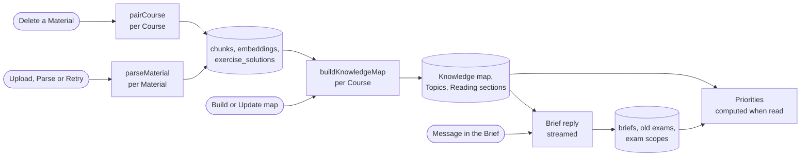

# Knowledge map pipeline

How a Course's Materials become its Knowledge map, with Topics and Reading sections, and how the Brief and the Priorities work on top of it: what starts each run, every model call it makes, and every row it writes. It was specified in #51 and built in #52–#59, #69–#70 and #83–#86, with final answers (#173), Topics (#175), Reading sections (#178) and map corrections (#181) added later; #222 replaces the build (see [2. Build](#2-build)). Terms follow [GLOSSARY.md](../../GLOSSARY.md). The decisions are in [ADR 0007](../adr/0007-ingest-each-upload-once.md) (parse every upload once), [0008](../adr/0008-workflows-by-default.md) and [0009](../adr/0009-durable-background-jobs.md) (durable workflows) and [0020](../adr/0020-topics.md) (Topics and Reading sections). What reads the map afterwards, tutoring, is in [tutoring-process.md](tutoring-process.md).

## Overview

| Run                                   | Started by                                                         | Model calls (task)                                                          | Writes                                                                                     |
| ------------------------------------- | ------------------------------------------------------------------ | --------------------------------------------------------------------------- | ------------------------------------------------------------------------------------------ |
| Parse (`parseMaterial`, workflow)     | Upload (`registerMaterial`), Parse or Retry (`startMaterialParse`) | `ingest`: 1 per page, 1 per Material, ≤ 1 pairing; `embed`: 1 per 20 chunks | `materials`, `material_pages`, `chunks`, `exercise_solutions`, `courses.pairing_requested` |
| Pairing (`pairCourse`, workflow)      | Deleting a Material (`deleteMaterial`)                             | ≤ 1 (`ingest`)                                                              | `exercise_solutions`, `courses.pairing_requested`                                          |
| Build (`buildKnowledgeMap`, workflow) | Build or Update map on the Course map (`startKnowledgeMapBuild`)   | None while #222 rebuilds it                                                 | `knowledge_map_builds`                                                                     |
| Brief (route handler, streamed)       | The Student sends a message on the Brief page                      | 1 streamed reply of ≤ 5 steps (`brief`)                                     | `briefs`, `brief_excluded_materials`, `brief_messages`, `exam_scopes`, `materials.is_exam` |

Every model call checks the Student's Daily limit first and records its tokens and cost in `ai_usage` under its task (see [Daily limit, retries and failures](#daily-limit-retries-and-failures)).

## Starting a run, once

Each run has a status (on the Material, or a row per Course), and a database function moves it to its running state only when no run is going, so a double click or two tabs start one workflow. The functions are `security definer`, check that the caller owns the Course or Material, and return whether they queued. The Server Action then calls `start()` of the workflow; if that throws, a second function records it, so the page offers the button again.

| Run   | Queue function and its condition                                                                                                                                                                                            | When `start()` fails                                                                                   |
| ----- | --------------------------------------------------------------------------------------------------------------------------------------------------------------------------------------------------------------------------- | ------------------------------------------------------------------------------------------------------ |
| Parse | A new Material is inserted `queued` (column default). `queue_material_parse` moves it to `queued` from `not_parsed`, `failed`, or `queued` with `parse_start_failed`, and clears `parse_failure` and `parse_start_failed`.  | `record_parse_start_failure` sets `parse_start_failed`: the page shows "Not started" and offers Parse. |
| Build | `queue_knowledge_map_build` upserts `knowledge_map_builds` to `building` (clearing `failure_reason`, setting `started_at`) when the Course has a `parsed` Material, none `queued` or `parsing`, and no build is `building`. | `record_knowledge_map_build_start_failure` sets `failed` with "The build could not start. Try again."  |

Pairing has no status row: its passes are ordered by `courses.pairing_requested` (see [Pairing](#pairing)).

Workflow steps run without a signed-in Student, on the admin client, and scope every query to the Course or Material and its owner themselves. Each step first checks its run is still current (the Material exists, the build is `building`, the run is `running`) and does nothing otherwise, so a deleted Course or Material stops a run quietly. The pages poll while a run is going: the Materials page while a Material is waiting or parsing, the Course map while the build is `building`.

## 1. Parse

`parseMaterial(materialId)` in `src/features/ingestion/workflows/parse-material.ts`. A Material is a PDF or an image in the private Storage bucket `course-files` at `<owner>/<course>/<material>`, uploaded by the browser before `registerMaterial` checks its size and type and inserts the row. The steps run in order; a retried parse resumes at the first unfinished one, because each step skips what is stored.

1. **Prepare pages** (`preparePages`). Sets `parse_status = 'parsing'`, `parse_failure = null`. Opens the PDF (unpdf with the installed pdfjs-dist, [notes](../agents/notes/pdf-page-rendering.md)) to count its pages; an image is one page. Writes `pages_total` and `pages_done` (pages already in `material_pages`), and returns the pages without a stored result. A missing file or one that is no PDF fails the parse with "The file could not be opened".
2. **Read each page** (`readPage`, one step per page, in order). Renders the page to PNG at scale 2 (a US Letter page is 1224×1584), afresh on every attempt and never stored. **Call:** task `ingest`, trace `parse-page`, structured output, no reasoning, the image as the only message. It returns the page's units in reading order, each with Markdown (LaTeX, Mermaid for diagrams), a label (`content`, `definition`, `example`, `exercise`, `solution`, `figure`, `admin`), the exercise number and points as printed, a figure with a description and a box, and whether it continues from the previous page or onto the next. Code pads each figure box by 2% and widens it to at least 25% of the page; an invalid box becomes null, meaning the whole page. **Writes** one `material_pages` row (`units` as JSON) and `materials.pages_done`. A call that still fails after its retries, or answers no units, fails the parse with "The AI could not read page N".
3. **Group into chunks** (`chunkMaterial`). Skipped when the Material already has chunks, so a parse restarted after a failed embedding keeps them and their vectors. Every unit gets an id such as `p2u1`; a page without units gets one `admin` unit "This page has no content.". **Call:** task `ingest`, trace `parse-file`, every unit as JSON. It returns chunks (unit ids as an enum, label, exercise number with subtask such as `7.2a`, points) and, for an old exam, its year and total points. A shared exercise statement is its own chunk with the exercise's number (`7.2`). Code checks that every chunk joins neighbouring units, every unit is in exactly one chunk and every page lies in a chunk; otherwise the step throws and retries. A chunk's Markdown is its units' Markdown joined, never rewritten; its pages and figure come from its units (the first figure's place, every figure's description). **Writes** through `replace_material_chunks`, one transaction: deletes the Material's chunks, inserts the new ones (`position`, `page_from`, `page_to`, `label`, `markdown`, `figure`, `exercise_number`, `points`) and sets `materials.is_exam`, `exam_year`, `exam_total_points`.
4. **Embed** (`embedChunks`). The chunks with no `embedding`, in batches of 20. **Call:** task `embed` (`embedMany`, no input type), trace `parse-embed`, each chunk's Markdown. The AI SDK does not retry (`maxRetries: 0`); the step does, after the delay the provider names or 60 seconds, and not at all for an error that cannot succeed later. **Writes** each batch through `set_chunk_embeddings` before its usage is recorded, so a retry never pays twice. The vectors serve `match_chunks` (the tutor's `searchMaterials`).
5. **Pair exercises** (`pairMaterialCourse`): the pairing pass below, for the Material's Course. At the Daily limit it stores nothing and the parse fails.
6. **Done** (`markParsed`): `parse_status = 'parsed'`.

A step that fails for good, or a reached Daily limit, runs `failParse`: `parse_status = 'failed'` and `parse_failure` = "Daily limit reached", "The file could not be opened", "The AI could not read page N" or, for anything else, "The material could not be parsed. Please try again.". Retry queues the Material again and the parse resumes. If the Material is deleted mid-parse, the page insert hits a foreign key and the parse stops quietly.

### Pairing

Every exercise subtask of the Course gets one `exercise_solutions` row: its solution chunk, possibly from another Material, or `no_solution`. It is recomputed for the whole Course at the end of every parse and, through the `pairCourse` workflow, after a Material is deleted, so upload order does not matter (`src/features/ingestion/workflows/pair-exercises.ts`).

A pass takes a number from `request_exercise_pairing` (increments `courses.pairing_requested`), then:

1. **Subtasks.** The Course's `exercise` chunks, without a shared statement (`7.2` when the same Material has `7.2a`).
2. **By number** (code). Numbers are normalized: text before the first digit goes, the rest splits into numbers and letters, so "Aufgabe 7.2 b)" and "7.2b" are both `7.2.b`. An exercise whose number is unique among exercises gets the only solution of that number, or else of its nearest whole exercise (`3a` takes the solution to `3`). Numbers several chunks share, such as "1" on every sheet, are left for the next step.
3. **By content.** With exercises and solutions left on both sides, and the pass still the latest request: **call** task `ingest`, trace `pair-exercises`, both lists as JSON with ids `e1…`, `s1…`. It returns pairs; code takes the first solution named per exercise.
4. **Write** through `replace_exercise_solutions`, which locks the Course row and writes only if the pass is still the latest request: it deletes all the Course's pairs and inserts one row per subtask, `paired` or `no_solution`.

A step runs passes until every subtask has a row, at most 3, then throws and retries, so overlapping parses store what running them one after the other would. At the Daily limit, a parse's pass fails the parse; `pairCourse` stores the number pairs and leaves the rest `no_solution` until the next pass.

## 2. Build

`buildKnowledgeMap(courseId)` in `src/features/knowledge-map/workflows/build-knowledge-map.ts`. The pipeline v2 (#222) replaces the old build stage by stage. Until its build lands, the workflow makes no model call: it marks the build `built` (`finished_at` now, `failure_reason` cleared), or `failed` with "The knowledge map could not be built. Please try again." when that write fails. The Course map keeps showing what is stored.

**Map Findings** come from tutoring: the tutor's `flagMap` tool files a `missing_link`, `wrong_link` or `wrong_description` in `map_findings` with a quote that code checks is in the cited chunk, and the Student accepts or dismisses it on the Course map (`answerMapFinding`).

**Read:** `loadCourseTopics(courseId)` returns the Topics in Course order with their KCs in teaching order, their anchors (Prerequisites of their KCs from outside the Topic, in map order, derived on each read) and their stored Reading sections. An Exercise's label is "<Material> p. N" of its question chunk, and its solution is the paired solution chunk's Markdown, or none.

## 3. Brief

The Brief is a conversation, not a workflow (`src/features/brief/`, route `/api/brief`).

- **Opening the page** (`openBrief`) creates the `briefs` row and a static opening message in `brief_messages` if needed, with no model call. Once intake is done (below), it posts one static message (`model_id = 'static'`, id derived from the Materials', so it is stored once) for the parsed Materials not asked yet (`materials.exam_asked`): "Are any of these old exams? <Materials>", naming the likely ones.
- **Each Student message** (`handleBriefRequest`): checks the Daily limit (429 at the limit), stores the message, and streams one reply, task `brief`, trace `brief-reply`, no reasoning, at most 5 steps. The instructions are written by code on every reply: the role, the intake order, every answer stored so far, the Course's Materials with their ids, each marked excluded, old exam, not an old exam, or likely an old exam by its name (Klausur, Altklausur, Exam, Prüfung or Resit), the Course's Big ideas and Topics with their ids and exam scopes, its distinct admin texts, the reserved-exam question and today's date. Admin chunks are compared with whitespace collapsed and digits removed; each distinct text appears once with its first "<Material> p. N", in Course order, up to 4,000 tokens. On end, the reply's usage goes into `ai_usage` (estimated from the text when the provider reports none), and the reply is stored unless it failed, was cut off or is empty.
- **Intake order:** exam date, goal (`pass`, `good_grade`, `master_everything`), hours per week, format (question style, open book, formula sheet, calculator), scope (excluded Materials, old exams, exam scope, then `scope_confirmed`). Intake is done when every field is answered and the scope confirmed. Then, with an old exam in the Course, the reserved-exam question.
- **Tools**, each one transaction:

| Tool           | Writes                                                                                                                                                                                                                                                                                                                                                                                                                                                                    |
| -------------- | ------------------------------------------------------------------------------------------------------------------------------------------------------------------------------------------------------------------------------------------------------------------------------------------------------------------------------------------------------------------------------------------------------------------------------------------------------------------------- |
| `saveBrief`    | The given fields of `briefs` through `save_brief`, and `brief_excluded_materials` when `excludedMaterialIds` is sent (unknown ids are dropped). `examMaterialIds` replaces the old exams: `materials.is_exam` on every Material of the Course, `exam_asked` on every parsed one, and a Reserved exam that is no longer an old exam loses its reservation. `reserved_exam_material_id` and `reserved_exam_answered`, unless a submitted mock already used the reservation. |
| `addNote`      | Appends the Student's words to `briefs.notes` (at most 20,000 characters) through `add_brief_note`, which sets `notes_updated_at`.                                                                                                                                                                                                                                                                                                                                        |
| `setExamScope` | One `exam_scopes` row per Big idea or Topic through `set_exam_scope` (`scope: null` removes it), which bumps `briefs.updated_at`. Refused unless the id is the Course's and, for a scope, `words` quotes a Student message of the Brief.                                                                                                                                                                                                                                  |

## 4. Priorities

Computed on every read, with no model call and nothing stored: `loadKcPriorities(supabase, courseId)` for the plan, reviews, readiness and the mock and stock steps, and `getPriorities(courseId)` for the map pages, both in `src/features/priorities/server/priorities.ts`. They read the stored map and Topics, every chunk's Material, the Materials' `is_exam`, the Brief's excluded Materials and the exam scopes (`loadExamScopes`). Per KC (code, `domain/priority.ts`):

- **Priority** = scope × (0.25 + 0.5 × oldExamShare + 0.25 × exerciseShare).
- **oldExamShare:** the KC's Exercises whose question chunk is in an `is_exam` Material, divided by the most any KC of the Course has (0 when that is 0). The Reserved exam counts. **exerciseShare:** the same over all the KC's Exercises.
- **scope:** 0 when every source chunk of the KC is in a Material the Brief excludes, or the KC's Topic, or else its Big idea, is `excluded`; 2 when that Topic, or else Big idea, is `emphasized`; 1 otherwise. A Topic's scope wins over its Big idea's.
- **Reasons:** "Tested in N old-exam Exercises", "Tested in N Exercises", "Excluded in the Brief: <words>", "Emphasized in the Brief: <words>", or "Excluded: you skip <Materials>".

Without old exams, Exercises and exam scopes every KC gets 0.25, so course order decides. The Course map shows each KC's level: `excluded` at 0, otherwise `high`, `medium` or `low` by tertiles. The study plan and the due reviews weigh Topics and KCs by Priority ([tutoring-process.md](tutoring-process.md)). Not built: neither the Brief's goal nor a KC's attempts affect Priorities, and the diagnostic (#51, step 5) has no code yet.

## Daily limit, retries and failures

- **Daily limit.** `AI_DAILY_LIMIT_USD` per Student per UTC day; without it nothing is limited. Workflow calls go through `meteredGenerate` and `meteredEmbed` (`src/features/usage/server/metered-call.ts`): check the limit for the Material's or Course's owner, run the traced call, record the usage in `ai_usage` under its task with the answering model. A reached limit, or the provider's used-up daily quota, returns null, which each step turns into its outcome: a parse fails with "Daily limit reached", pairing after a delete leaves pairs `no_solution`.
- **Retries.** The AI SDK retries a call up to 3 times on retryable errors (embeddings in a parse excepted), and Vercel Workflow retries a failed step up to 3 times. A step whose output fails its schema or a code check throws, so the whole call is made again.
- **Tracing.** Every call carries the Student as user and its trace name (`parse-page`, `brief-reply`, …) for Langfuse ([ADR 0012](../adr/0012-ai-observability-and-evals.md)).

## Tables

Every table has an `owner` and Row Level Security; Students read their own rows, and workflows write through the admin client and the `service_role`-only functions named above.

| Table                                                  | Written by                                              | Holds                                                                                                                                 |
| ------------------------------------------------------ | ------------------------------------------------------- | ------------------------------------------------------------------------------------------------------------------------------------- |
| `materials`                                            | `registerMaterial`, the queue functions, the parse      | File, `parse_status`, `parse_failure`, `parse_start_failed`, `pages_total`, `pages_done`, `is_exam`, `exam_year`, `exam_total_points` |
| `material_pages`                                       | Parse step 2                                            | One page call's units; internal, never shown                                                                                          |
| `chunks`                                               | Parse steps 3 and 4                                     | The Material's chunks with label, pages, Markdown, figure, exercise number, points and `embedding`                                    |
| `exercise_solutions`                                   | Pairing                                                 | One row per exercise subtask: `paired` with its solution chunk, or `no_solution`                                                      |
| `courses.pairing_requested`                            | Pairing                                                 | The latest pairing pass's number                                                                                                      |
| `knowledge_map_builds`                                 | The queue functions, the build                          | One row per Course: `status`, `failure_reason`, `check_report`, `started_at`, `finished_at`                                           |
| `knowledge_map_chunks`                                 | The build                                               | The chunks the map has processed                                                                                                      |
| `big_ideas`, `kcs`, `kc_sources`, `prerequisite_links` | The build                                               | The map: every KC sits in a big idea                                                                                                  |
| `exercises`, `exercise_kcs`                            | The build                                               | Exercises with difficulty and `final_answers`, and their KCs                                                                          |
| `map_findings`                                         | The tutor (`flagMap`), the Student (`answerMapFinding`) | The tutor's map Findings                                                                                                              |
| `topics`, `topic_kcs`                                  | The build                                               | Topics in Course order with central question, their KCs in teaching order                                                             |
| `reading_sections`                                     | The build                                               | Each Topic's sections: Material, pages, chunks, mode, reason, `annotations` or `study_text`                                           |
| `briefs`, `brief_excluded_materials`, `brief_messages` | The Brief                                               | Exam facts, notes, reservation, excluded Materials, the conversation                                                                  |
| `exam_scopes`                                          | The Brief (`set_exam_scope`)                            | One exam scope per Big idea or Topic, `excluded` or `emphasized`, in the Student's words                                              |
| `materials.is_exam`, `materials.exam_asked`            | The Brief (`save_brief`)                                | Which Materials are old exams, and which the Brief has asked about                                                                    |
| `ai_usage`                                             | Every model call                                        | Task, model, tokens and cost per call                                                                                                 |

Deleting a Material cascades its pages, chunks, their pairs, sources and processed marks, and its Reading sections; the map itself changes only at the next Update map. Deleting a Course cascades everything.

## Where to change things

- **Code:** the workflows and their steps in `src/features/ingestion/workflows/`, and `knowledge-map/workflows/`, Priority in `priorities/domain/priority.ts`; the Brief handler and tools in `brief/server/`. Prompts and output schemas sit in each feature's `ai/`, pure rules in `domain/` with tests beside them.
- **Models:** each task's model is in `AI_TASKS` in `src/lib/ai/models.ts`, overridable with its `AI_MODEL_*` variable; every model needs a price in `src/lib/ai/prices.ts`.
- **Database:** the functions named here are in `supabase/migrations/`; the newest definition of each wins.

## Checks

- `pnpm test:run` runs the workflows in-process against `fakeSupabase` and mock models, with the helpers in `parse-testing.ts` and `handler-testing.ts`: the parse (`parse-material*.test.ts`, `chunk-material`, `embed-chunks`, `pair-exercises`) and the Brief handler (`handler*.test.ts`). The pure rules have tests beside them in each `domain/`.
- `pnpm db:test` covers the policies and database functions in `supabase/tests/database/`: `material_parsing`, `queue_material_parse`, `replace_material_chunks`, `set_chunk_embeddings`, `exercise_solutions`, `knowledge_map`, `exercises`, `topics`, `reading_sections`, `map_findings`, `brief_writes`, `exam_scopes` and others.
- `pnpm smoke <name>` runs a stage on a live model, so [live-ai.md](../agents/live-ai.md) applies. Those that need a built map seed the `linear-algebra-I` gold course ([evals/gold/README.md](../../evals/gold/README.md)), and stop until its snapshot exists:
  - `parse`: a PDF or image through the real parse; can write the chunks to a file.
  - `map-findings`: the gold course with a reversed Prerequisite; the Student disputes it in a Chat and the AI files a Finding.
  - `brief`: a small Course seeded in code with the admin chunk "Chapter 2 is not examined"; scripted messages answer the Brief, mark the old exam and confirm the exam scope, then the reserved exam. Checks the `exam_scopes` row and that Chapter 2's KCs read Priority 0.
