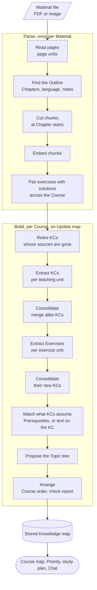
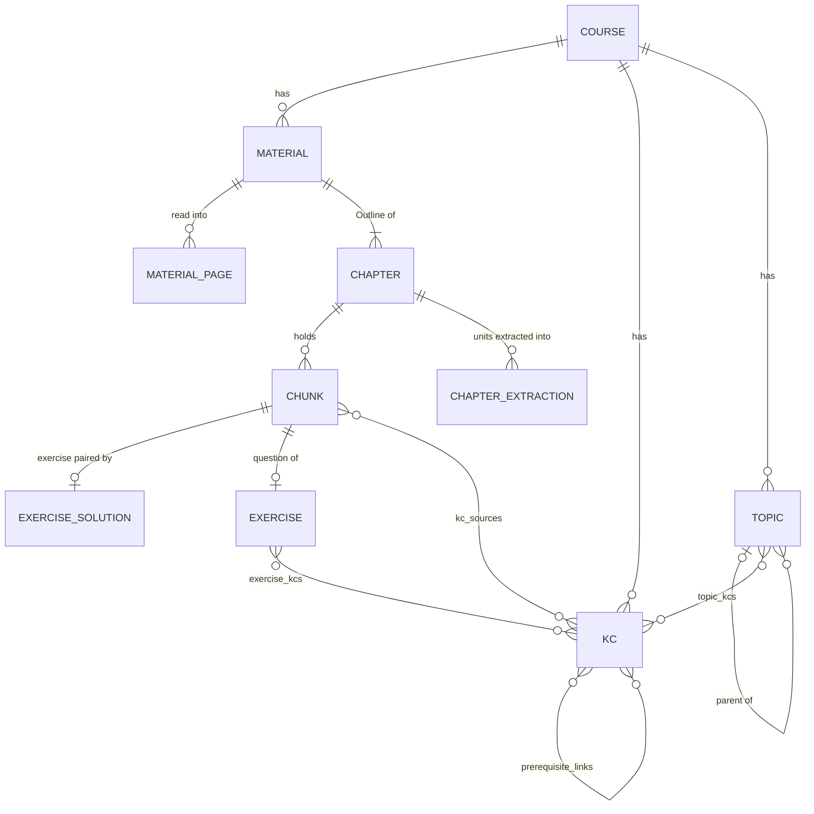

# The Knowledge map

How a Course's Materials become its Knowledge map: what data exists, how it flows, which model calls make it, and how their prompts get built.

The Knowledge map is half of one system. This document covers everything up to and including the stored map. [The tutoring process](tutoring.md) starts from the stored map and covers everything a Student does with it. [How the two connect](#how-the-two-connect) lists every point where they touch.

Domain words are defined in [GLOSSARY.md](../../GLOSSARY.md); the choices behind the design are in [ADR 0007](../adr/0007-ingest-each-upload-once.md), [0020](../adr/0020-topics.md), [0021](../adr/0021-problem-verification.md), [0023](../adr/0023-knowledge-map-from-chapters.md) and [0026](../adr/0026-assumptions-as-text.md).

## The short version

Two background jobs run one after the other:

1. **The parse** turns one uploaded Material into text: an Outline of Chapters, and chunks of Markdown. It runs once per upload, by itself.
2. **The build** turns all of a Course's chunks into the map: Knowledge components (KCs), the Prerequisites between them, Exercises and a Topic tree. It runs when the Student presses Build, then Update map.



Every step stores its result before it ends, so a stopped job resumes where it stopped and pays for no model call twice.

## The data



| What                  | Table                  | What it holds                                                                                                                                                                         | Written by                                       |
| --------------------- | ---------------------- | ------------------------------------------------------------------------------------------------------------------------------------------------------------------------------------- | ------------------------------------------------ |
| Material              | `materials`            | The file's name, place in Storage and Course order (`position`), parse progress, and the `language` and `notes` the Outline found                                                     | Upload, then the parse                           |
| Page result           | `material_pages`       | One row per page: the **page units** that start on it, or why it was `skipped` (`overlay`, `blank`, `unreadable`, `uncovered`). A working table for the parse                         | Parse                                            |
| Chapter               | `chapters`             | One node of a Material's Outline, with its title as printed. The root Chapter (depth 0) is titled by the Material. `exam_proposed` is the AI's guess                                  | Parse. The Brief sets `is_exam` and `exam_asked` |
| Chunk                 | `chunks`               | A passage of Markdown with its pages, Chapter, vector and `label`: `content`, `exercise`, `solution` or `admin`                                                                       | Parse                                            |
| Exercise pair         | `exercise_solutions`   | For each exercise chunk of the Course, its solution chunk or "no solution"                                                                                                            | Parse. Recomputed for the whole Course           |
| Unit extraction       | `chapter_extractions`  | The checked answer of one extraction call, keyed by Chapter, kind and unit, with the unit's content hash, `kc_ids` once stored and `assumes_matched` once matched                     | Build                                            |
| Knowledge component   | `kcs`                  | Name, description, vector, Course order (`position`), `origin` (`content` or `exercise`), `assumes` (what it assumes that no KC means, as text) and `retired_at` when it left the map | Build                                            |
| KC source             | `kc_sources`           | Which chunks teach a KC. Every live KC has one: a KC whose sources are all gone is retired                                                                                            | Build                                            |
| Prerequisite          | `prerequisite_links`   | `from_kc` must be learned before `to_kc`. They form no cycle                                                                                                                          | Build                                            |
| Exercise              | `exercises`            | Its question chunk, printed solution chunk if any, difficulty 1 to 3 and `final_answers` as printed: answer keys `{ label, value, anyOrder }`, values in mathjs                       | Build                                            |
| KCs an Exercise tests | `exercise_kcs`         | At most 6 per Exercise                                                                                                                                                                | Build                                            |
| Topic                 | `topics`               | Name, parent, tree order, `central_question`, and the `chapter_ids` it covers                                                                                                         | Build                                            |
| A Topic's own KCs     | `topic_kcs`            | Each KC in one Topic, in teaching order                                                                                                                                               | Build                                            |
| Build state           | `knowledge_map_builds` | One row per Course: status, failure reason, heartbeat, `check_report`, `topic_tree_hash`, and `needs_update`                                                                          | Build                                            |

**"Unit" means two things**, one in each job. A _page unit_ is a run of one label under one heading, as a page read returns it. A _Chapter unit_ is the piece of a Chapter one extraction call reads. They never meet: page units become chunks, and chunks are grouped into Chapter units.

**Stored or derived.** These are not stored, and are computed from the tables above on every read:

| Derived                  | From                                                                             | Code                                           |
| ------------------------ | -------------------------------------------------------------------------------- | ---------------------------------------------- |
| A Topic's anchors        | Prerequisites of its KCs that come from outside it                               | `topicAnchors` in `domain/topic-reading.ts`    |
| Reading sections         | The `content` chunks its KCs cite, cut to at most 3 pages in one Material        | `readingSections` in `domain/topic-reading.ts` |
| An Exercise's label      | Where its question is printed, as "Chapter · Material p. N"                      | `domain/exercise-label.ts`                     |
| Arrows on the Course map | Prerequisites between KCs of different Topics, transitively reduced              | `domain/topic-graph.ts`                        |
| Priority                 | The map and the Brief ([tutoring](tutoring.md#everything-derived-on-every-read)) | `priorities/domain/priority.ts`                |

Paths in this document are relative to `src/features/knowledge-map/` unless they name another feature.

## Step by step: the parse

The `parseMaterial` workflow in `ingestion/workflows/parse-material.ts` starts when a Material is registered. It moves the Material from `queued` through `parsing` to `parsed` or `failed`.

1. **Prepare pages.** Opens the PDF, records the page count and stores slide overlays (pages whose text the next page repeats) as `skipped`, without a call. An image is one page.
2. **Read pages.** Up to 20 pages per workflow step, 5 per call. A blank page needs no call. Each batch sends each page's image and text layer, plus the last unit before the batch as context, and gets back ordered page units. Each is stored on the page it starts on. A batch that fails for good is read again page by page, and a page that still fails is stored `unreadable`, so one bad page doesn't stop the parse. A page of an answered batch that no unit covers (by its pages) is read again alone once, and stored `uncovered` when still none does.
3. **Find the Outline.** One call sees the Material's name, page count, PDF outline, every heading and how each page starts. It answers the Chapters with their levels and where each starts, the Material's language and its unusual notation (`notes`). Code checks each Chapter against the units and drops one it can't place. A Chapter given by a page where no unit starts (a title page, say) starts at the first unit after that page, if that comes before the next Chapter's start. If the call fails for good, the Chapters come from the PDF outline; without one, there is only the root.
4. **Cut chunks.** Pure code (`chunksFromUnits`). Each page unit becomes a chunk, cut at every Chapter start. A unit cut off at a batch edge joins its continuation. A Chapter's heading becomes a Markdown heading at the start of the next chunk, and any other heading a bold line. A chunk over 6,000 characters splits between paragraphs. Chapters and chunks are written in one transaction (`replace_material_chunks`).
5. **Embed.** Every chunk except `admin` ones, 20 per call, as documents.
6. **Pair.** One call per up to 400 exercise and solution chunks of the _whole Course_, each shown as its Material, Chapter path and first 300 characters. The answer replaces the Course's pairs, so upload order doesn't matter. Deleting a Material runs this step again by itself.

The chunk labels decide where each chunk goes next:

| Label      | Used by                                                                                     |
| ---------- | ------------------------------------------------------------------------------------------- |
| `content`  | Teaching units of the build. Searchable by the AI                                           |
| `exercise` | Exercise units of the build. Its vector picks the KCs offered to the call. Searchable       |
| `solution` | Reaches the build only through its pair. Becomes an Exercise's printed solution. Searchable |
| `admin`    | Never embedded. The Brief reads it to propose exam scopes (`loadAdminChunks`)               |

## Step by step: the build

The `buildKnowledgeMap` workflow in `workflows/build-knowledge-map.ts` passes only the Course's id. Each step reads what it needs from tables, does a bounded amount of work and reports how much is left, and the workflow calls it again until nothing is.

The Student's button calls `startKnowledgeMapBuild`, which queues through `queue_knowledge_map_build`. It lets a build through only when none runs, a Material is parsed and none waits or parses, so two presses start one build.

### 0. Prepare

`prepareBuild` fails the build with a reason when the Course has no `content` or `exercise` chunks, and retires KCs whose sources are gone. First `retire_unsourced_kcs` takes the sources in the `content` chunks of old exams from the KCs, so a KC taught only there is retired too.

### 1. Extract the teaching units

`extractChapters` makes one call per teaching unit without a current extraction.

A **Chapter unit** comes from `chapterUnits` in `domain/chapter-units.ts`. A Chapter whose subtree holds at most 12,000 characters of chunks of one kind (`UNIT_CHARS`, about 15 KCs) is one unit. A bigger one makes units of its children. Its own chunks outside them join the unit of its first child (that unit's `chapterIds` include the parent), unless they alone pass the cap, when they split into units of their own. Consecutive sibling Chapters whose subtrees each fit are packed into one unit up to the cap: a packed unit is keyed by its first Chapter, lists all of them in `chapterIds`, and the Outline marks each (`<- this unit`). Packs are recomputed on every build, so a changed pack is a new unit (its hash changes) and is extracted again. A KC of a unit may cite any chunk of the unit, that is of its `chapterIds`' subtrees; the check report's Chapters without KCs and the map smoke check follow that rule. The same rule over `content` chunks gives teaching units, and over `exercise` chunks gives exercise units.

**Old exams teach nothing.** A Chapter the Student confirmed as an old exam (`is_exam`), and its whole subtree, form no teaching units. Their `exercise` chunks still form exercise units, so the exam's tasks become Exercises. A unit the build no longer forms loses its extraction when the next step loads the current ones. Confirming or withdrawing an old exam marks the map as needing Update map, as a changed Material does (see [The Course map](#the-course-map)).

A unit's hash covers its Chapter's title and its chunks' Markdown. A unit whose stored extraction has the same hash makes no call: this is why Update map is cheap.

The call answers KCs (name, description, the chunks that teach it, up to 3 things it `assumes`) and Prerequisites among them, by name. Its prompt keeps the KCs near the size of an exam task: headings, notation lists, repeated material and asides beyond the course are no KCs, an example or remark belongs to the KC it illustrates unless an exam task could test it alone, the Outline only places the unit (KCs come from the chunks), and a Prerequisite is listed where the second KC uses the first in its statement, proof or method. `checkExtraction` turns names and short ids into stored references. **Coverage** (`unitCoverage` in `domain/unit-coverage.ts`) is the share of the unit's characters in chunks some KC cites: below `MIN_UNIT_COVERAGE` (0.5) the call is made once more, and the answer that covers more is kept. An answer with no KCs (a notation list, say) is kept as it is, without that retry; the check report lists its Chapter under Chapters without KCs. The result goes into `chapter_extractions`, not yet into `kcs`.

### 2. Consolidate

`consolidateKcs` turns pending extractions into stored KCs, and is where KCs get their identity. For each new KC, in order:

1. **Embed** it as "name: description".
2. **Revive:** a retired KC at cosine similarity 0.90 or more comes back instead of a new one.
3. **Find alike ones:** live KCs and other new KCs at 0.85 or more form clusters of 2 to 8.
4. **Ask the merge call** which KCs of each cluster are the same, 15 clusters per call. Its prompt counts two KCs that state the same definition, theorem or method as the same, also when one adds detail, examples or how to check it.
5. **Apply the answer in code** (`mergeTargets`). A group keeps its oldest stored KC, or else its first new one. A merged new KC is never stored, and the KC it merges into gains its sources. Two stored KCs never merge.
6. **Store** with `store_chapter_kcs` in one transaction. Prerequisites go through `acyclicLinks`, where a link that would close a cycle is dropped, so each cycle loses its newest link.

### 3. Extract the exercise units

`extractExercises` makes one call per exercise unit that has no current extraction, or whose paired solutions changed. The call sees each exercise chunk's statement and paired solution, and the live KCs nearest to the unit's statements: each exercise chunk adds its 8 nearest, merged by rank (every chunk's first, then every second) without repeats, up to 40 per unit. That's why it runs after step 2.

It answers, per exercise chunk (the call's prompt says "subtask"): the listed KCs its solution uses as a step (usually 1 to 4, at most 6), new KCs only when no listed one teaches what it needs, mathematical final results copied as printed and written as mathjs (code drops a key mathjs cannot parse; the prompt leaves out a result that depends on the Student's own choice, such as a representative, an order, a parametrisation or an example), and whether it is no exercise at all. Code then computes the difficulty from the number of KCs and the solution's length (`exerciseDifficulty`).

**One exercise chunk gives one Exercise**, and the page read keeps an exercise with all its printed subtasks in one unit, so "Ex. 7.2" with parts a to c is one Exercise. A new KC's source is the exercise chunk that needed it, with `origin` `exercise`.

### 4. Consolidate again

The same step as 2 over the exercise extractions, which also stores their Exercises, keyed by question chunk so each keeps its id. A chunk marked as no exercise is dropped.

### 5. Match what KCs assume

`matchAssumptions` decides what each `assumes` entry means. It embeds the entry and offers it the 5 nearest live KCs other than the assuming KC. One call per 25 entries picks a candidate or answers null. A unit whose call failed waits a step, and its entries are then asked in calls half as large per failure (12, 6, 3). When its fourth try fails too, its unanswered entries stay as text, as if no KC meant them, so matching never fails the build.

| The call answers                      | Result                                                                     |
| ------------------------------------- | -------------------------------------------------------------------------- |
| A KC that comes earlier in the Course | A Prerequisite                                                             |
| A KC that comes later                 | Nothing: a forward link could make the cycle check drop real Prerequisites |
| Null, or there were no candidates     | The entry stays on the assuming KC as text, in `kcs.assumes`               |

`kcs.assumes` holds each name once: entries from KCs merged into one are joined by name. `store_assumed_prerequisites` writes the links, the text and the matched marks in one transaction.

**Matching again.** Before that, `rematchAssumptions` takes the text entries of live KCs whose 5 nearest live KCs now include one this build stored (created since the build started). It embeds them again, since their vectors aren't stored, and asks the same call. A match removes the entry, and an earlier KC also becomes a Prerequisite. It handles 100 entries per step, in key order, and the workflow passes the last key it handled to the next run.

### 6. Propose the Topic tree

`proposeTopicTree` makes one call for the whole Course, and only when the Outlines, the KC names on them or the language changed (`topic_tree_hash`).

The call sees every Material's Outline with its KC names under each Chapter, plus the stored tree. Only KCs from the teaching units are listed there: a KC from an exercise call is placed by code (rules below), so a Chapter that holds only such KCs shows no names and the hash ignores them. It answers a flat list in tree order, where `level` gives the nesting: a Topic's parent is the nearest earlier Topic with a lower level. Each Topic names the Chapters it holds, its central question and which stored Topic it `continues`.

### 7. Arrange

`arrangeKnowledgeMap` makes no model call. It:

- retires KCs whose sources went meanwhile;
- orders the KCs by first source;
- turns the proposal into Topics (`planTopicTree`, rules below), with each Topic's KCs in teaching order (Prerequisites first);
- drops redundant Prerequisites (transitive reduction);
- stores the check report: Chapters with content that no KC cites, Exercises without KCs, KC pairs still alike, teaching units below the coverage bar, pages read without units (`unreadable` or `uncovered`) and units given up on (`unitsNotExtracted`). The Course map shows the Student one line when pages went unread or Chapters were covered only in part, which includes units given up on (`checkReportLine`), and the full lists outside production;
- marks the build `built`.

`planTopicTree` gives the model's proposal the guarantees the tutoring relies on:

- Each Chapter with KCs goes to the first Topic that names it. One that no Topic names becomes a top-level Topic titled by the Chapter.
- A KC from a teaching unit joins its first source's Chapter's Topic.
- A KC from an exercise call joins the first of: the Topic holding most of the KCs tested alongside it (the earlier on a tie, repeated until no KC moves, so a KC tested only with exercise KCs follows them); the Topic of its nearest placed KC by vector; its own Chapter's Topic, which a Chapter no Topic names gets as a top-level Topic. Its vector is read in the arrange step (`loadKcVectors`), since the tree call never sees it.
- A Topic left with no KCs and no children is dropped.
- **Continuity.** A Topic keeps the stored id it `continues` when that id is stored and no earlier Topic took it. A stored Topic that no Topic continues is then continued by the free Topic holding most of its `chapter_ids`, when that Topic continues no other, so a tree call that forgets a Topic does not lose its exam scopes, Topic choices and notes. A stored Topic with no Chapter in common with a free Topic goes.
- A Topic with KCs of its own always has a central question, its name if the call gave none. A Topic with only child Topics has none, and the study plan skips it.

### One Chapter through the build

An illustration with made-up content:

```text
Chapter "4.2 Subspaces", three content chunks
  │ extract
  ▼ chapter_extractions.output
  kcs: [{ name: "Subspace criterion", description: "A subset is a subspace when ...",
          chunkIds: [<chunk 2>], assumes: [{ name: "Vector space axioms", ... },
                                           { name: "Set notation", ... }] }, ...]
  │ consolidate: "Subspace criterion" is like no stored KC
  ▼ kcs + kc_sources
  a new KC with one source chunk
  │ exercises: "Ex. 4.3a" tests it, final answer "dim W = 3"
  ▼ exercises + exercise_kcs
  │ match assumptions: "Vector space axioms" means a KC of Chapter 3.1;
  │                    "Set notation" means no KC of the Course
  ▼ prerequisite_links + kcs
  Prerequisite from the Chapter 3.1 KC; "Set notation" stays in its assumes
  │ Topic tree: the Chapter goes to the Topic "Subspaces"
  ▼ topics + topic_kcs
  Topic "Subspaces": "Subspace criterion", ...
  Its anchors, the Chapter 3.1 KC, and its Reading sections are computed on read.
```

## How the prompts get built

All eight calls follow one pattern, so the prompts stay small and the answers checkable:

- **The instructions are a static string** in the feature's `ai/` folder. Nothing about the Course goes in them.
- **The user message is the input as JSON** (or, for a page read, images and text). All Course data goes here.
- **The model sees short ids**, such as `c1`, `k1` or `h3`, never database ids. Code maps each back and drops any it doesn't know.
- **A wrong id doesn't fail the call** (`offeredId` in `ai/offered-id.ts`). The JSON schema lists the ids as an enum to guide the model, but any string validates, so the check in code decides what to keep.
- **The answer is structured**, through `Output.object` with a Zod schema, whose `.describe()` texts are part of the prompt.
- **Calls fit a Vercel function.** A build call ends after `BUILD_CALL_TIMEOUT_MS` (260 s), and a step starts no call that could run past 290 s (`callFits` in `src/lib/ai/call-timeout.ts`), so each step makes one round of at most `AI_CONCURRENCY` calls. A retry within a step (the coverage retry, the second tree call) gets what is left of the step, when that is at least 60 s (`retryTimeoutMs`). The parse's calls keep `CALL_TIMEOUT_MS` (170 s). A timed-out call is a failed answer: its usage is recorded as estimated and its trace marked as an error.
- **A failed unit waits a step, then splits.** A unit whose build call times out or gives no valid answer (`buildCall` answers "failed") is left to the next step; the workflow passes the key of a unit once per failure. An extraction unit (teaching or exercise) that failed goes after the others; from its second failure it is called in pieces, each attempt halving every piece again by characters, between chunks (`domain/unit-pieces.ts`). Answered pieces are stored as a partial extraction (its `content_hash` is `partialHash` of the unit's, and `readChunkIds` names what they read), so only failed pieces are called again, and the unit is stored whole once every piece is answered. Once its split into single chunks failed twice, the unit is given up: its partial extraction is consolidated, and the check report lists it. A match call gets four tries in halving calls (step 5). A merge call that fails twice fails the build with "A model call kept failing for <Chapter>", without a throw. The tree call is made twice; when both fail, each Chapter with KCs becomes a Topic of its own.
- **A rate limit is a wait, not a failure.** Build calls send no SDK retries (`maxRetries: 0`). A call the Gateway's per-minute rate limit turns away (`buildCall` answers `RateLimited`) starts no further call in its step; the extraction, exercise, merge and match steps store every unit answered so far and leave the rest pending, without counting it failed or splitting it. The step's outcome carries the wait the error names, at least `MIN_RATE_LIMIT_WAIT_MS` (60 s), and the workflow sleeps that long before the next step calls the pending units. The tree call, the only call of its step, retries the step after the wait.
- **Every call is metered** (`meteredStream`), so it counts against the Student's Daily limit and stops the job there.

| Call (trace name)               | Job and task      | Reasoning | User message                                                                                               | Answer                                                                    | Prompt in                          |
| ------------------------------- | ----------------- | --------- | ---------------------------------------------------------------------------------------------------------- | ------------------------------------------------------------------------- | ---------------------------------- |
| Page read                       | Parse, `ingest`   | none      | Last unit before the batch, then per page: number, image, text layer                                       | Units: Markdown, label, pages, heading style, continuation flags          | `ingestion/ai/page-units.ts`       |
| Outline (`parse-outline`)       | Parse, `ingest`   | high      | Name, page count, PDF outline, headings (`h1…`), page starts (80 characters)                               | Language, notes, Chapters: title, level, heading or page, `exam`          | `ingestion/ai/outline.ts`          |
| Pairing                         | Parse, `ingest`   | high      | Exercises (`e1…`) and solutions (`s1…`): Material, Chapter path, first 300 characters                      | Pairs it is sure of                                                       | `ingestion/ai/exercise-pairing.ts` |
| Extraction (`extract-chapter`)  | Build, `map`      | medium    | Material name, Outline with `<- this unit` marked, Course language, chunks (`c1…`)                         | KCs with `chunkIds` and `assumes`, Prerequisites by name                  | `ai/chapter-extraction.ts`         |
| Merge (`merge-kcs`)             | Build, `map`      | medium    | Clusters of KCs (`k1…`): name, description                                                                 | Groups that are the same KC                                               | `ai/kc-merge.ts`                   |
| Exercises (`extract-exercises`) | Build, `exercise` | medium    | Material name, Outline, Course language, subtasks (`s1…`) with statement and solution, nearest KCs (`k1…`) | Per subtask: KCs, new KCs, final answers, `notAnExercise`                 | `ai/exercise-extraction.ts`        |
| Check (`check-prerequisites`)   | Build, `map`      | medium    | Names (`n1…`): name, description, the KC using it, up to 5 candidates                                      | For each name, the candidate it means or null                             | `ai/prerequisite-check.ts`         |
| Tree (`topic-tree`)             | Build, `topic`    | medium    | Course language, Outlines (`c1…`) with KC names, stored Topics (`t1…`)                                     | Flat Topic list: level, name, `chapterIds`, central question, `continues` | `ai/topic-tree.ts`                 |

The vectors come from task `embed`: chunks as their Markdown, KCs and assumed names as "name: description". Which model serves each task is set in `src/lib/ai/models.ts`.

**Course language.** KC names, descriptions and Topics are written in the language from `loadCourseLanguage`: the Student's choice in the Brief, otherwise the most common language of the Materials, otherwise English. The Materials themselves are transcribed untranslated.

## Updates and identity

A build always _updates_ the stored map. The tutoring keys everything on KC, Exercise and Topic ids, so those survive updates wherever the content does.

| Thing           | Keeps its id because                                                                       | Loses it when                                                                    |
| --------------- | ------------------------------------------------------------------------------------------ | -------------------------------------------------------------------------------- |
| KC              | A new KC merges into it or revives it instead of being stored as new                       | Never deleted: it is only retired, and it keeps its Attempts                     |
| Exercise        | It is stored by its question chunk                                                         | Its question chunk is deleted                                                    |
| Topic           | The tree call names it under `continues`, or code continues it by the Chapters it covers   | No new Topic holds a Chapter of it, which also loses its notes and Topic choices |
| Reading section | Its id is a UUID v5 of Topic, Material and pages, so a Done mark holds while the cut stays | The cut changes                                                                  |

What happens to the map when the Student changes the Materials and presses Update map:

- **A Material is added.** Its units are new, so they are extracted. Other units keep their hash and make no call. Its KCs merge into alike ones, which gain sources, and text that KCs assume is matched again against its new KCs. The tree call runs again because the Outlines changed.
- **A Material is deleted.** Its chunks go, and with them their `kc_sources` and the Exercises they pose. Pairing runs again at once. The next build retires each KC with no sources left.
- **An old exam is confirmed or withdrawn.** Its content chunks stop or start forming teaching units. The KCs taught only there are retired, or extracted.
- **Nothing changed.** No model calls: every hash matches, and the stored tree is arranged again.

A parse never changes a Material's chunks once it has stored them, so a unit's hash only changes when its chunks go.

## When things go wrong

| Situation                  | What happens                                                                                                                                                           |
| -------------------------- | ---------------------------------------------------------------------------------------------------------------------------------------------------------------------- |
| A step fails after retries | The build is `failed` with a plain reason. What is stored stays, and the next Update map resumes                                                                       |
| The Daily limit is reached | The same, with the reason "Daily limit reached"                                                                                                                        |
| The process dies           | Each step sets `heartbeat_at`. After 30 minutes without one, the page shows the build as failed and `queue_knowledge_map_build` lets a new one through                 |
| A step would run too long  | A step takes at most 8 units, each build call ends after 260 seconds, and a step starts no call that could end after 290 seconds. What it leaves goes to the next step |
| A unit keeps failing       | It is called in ever smaller pieces, and given up with what its pieces gave; the check report lists it, and the next Update map tries it whole again                   |
| A model call answers badly | Code drops unknown ids and unusable items. The check report shows what ended up uncovered                                                                              |
| The parse fails            | The Material is `failed`, and Retry resumes at the first page without a result. Chunks already stored are kept with their vectors                                      |

## The Course map

The Course map (`/courses/[courseId]/map`, where the Course's home redirects) polls while a build is `building`. It draws the Topics as nested boxes of Topic cards with arrows between Topics ([ADR 0017](../adr/0017-react-flow-and-elk-for-the-knowledge-map-graph.md)): `domain/` computes the graph, and ELK lays it out in a web worker only when it changes.

A card opens the Topic page (`map/[topicId]`): its detail, anchors, KCs, Reading sections and neighbours in Course order, above a KC graph of the Topic's KCs, its anchors and the Exercises that test them. Clicking a KC opens a panel with every stat about it.

**What changes the map.** A Material that finished parsing or was deleted, and an old exam the Student confirmed or withdrew, set `knowledge_map_builds.needs_update` (database triggers, `mark_map_needs_update`). While it is set and no build runs, the Course map shows "Your Materials changed since the map was last built." with Update map. `prepareBuild` clears it before the build reads the Course, so a change during a build marks the map again.

## How the two connect

The map is the tutoring's only source of what there is to learn. The tutoring reads it through `knowledge-map/server.ts` and never writes to it.

| The tutoring needs                              | It reads                                                   | Used for                                                                                                                   |
| ----------------------------------------------- | ---------------------------------------------------------- | -------------------------------------------------------------------------------------------------------------------------- |
| KCs, Prerequisites, Exercises, sources          | `loadStoredMap`: live KCs only, and links between live KCs | Every Attempt and FSRS card is per KC. Priority, due reviews and `getTopic`                                                |
| Topics with KCs of their own, in teaching order | `loadStoredTopics`                                         | The plan scope, the Ranking and the Today card                                                                             |
| The whole Topic tree                            | `loadTopicTree`                                            | Exam scopes inherited down the tree, the Course map                                                                        |
| Anchors                                         | `topicAnchors`                                             | `getTopic`: what a Topic builds on                                                                                         |
| Reading sections                                | `loadReadingSections`                                      | `getTopic` and the `showReading` tool                                                                                      |
| Chunks, through `ingestion/server.ts`           | `loadChunkSources`, `match_chunks`                         | `getTopic` sources and `searchMaterials`: what the AI cites                                                                |
| Exercises with `final_answers`                  | `loadStoredMap`                                            | `findProblems`, the answer check in `grade`, variants, Mock exams                                                          |
| What each KC assumes (`kcs.assumes`)            | `loadKcAssumes`                                            | The tutor context's proposed Topic and `getTopic`: texts the AI checks and teaches briefly, marked as beyond the Materials |
| `materials.notes`                               | `loadMaterialNotes` in `study`                             | The tutor context gives the AI each Material's notation                                                                    |

**Rebuilding while a Student studies.** Tutoring reads the map fresh on every reply, so an update takes effect on the next one. Attempts stay valid because KC ids hold.

**Dependency direction.** `study` and `priorities` import `knowledge-map`. `knowledge-map` never imports either, so the Course map's pages pass each Topic's learned count and Readiness, Priorities and KC learning (recall bands) in as props.

## Where the code is

| To change                           | Look in                                                                                                                                                                                                                   |
| ----------------------------------- | ------------------------------------------------------------------------------------------------------------------------------------------------------------------------------------------------------------------------- |
| What a model is asked               | `ai/*.ts`, `ingestion/ai/*.ts`                                                                                                                                                                                            |
| How an answer is checked            | `domain/chapter-extraction.ts`, `domain/exercise-extraction.ts`, `ingestion/domain/outline.ts`, `ingestion/domain/exercise-pairing.ts`                                                                                    |
| Order and bounds of the steps       | `workflows/build-knowledge-map.ts`, `workflows/*-steps.ts`, `ingestion/workflows/parse-material.ts`                                                                                                                       |
| Limits                              | `UNIT_CHARS`, `UNITS_PER_STEP`, `CALL_TIMEOUT_MS`, `MIN_UNIT_COVERAGE`, `CANDIDATE_KCS`, `NAMES_PER_CALL`, `CLUSTERS_PER_CALL`, `PAGES_PER_BATCH`, `MAX_PAIRING_CHUNKS`, `MAX_CHUNK_CHARS`, each in the file that uses it |
| Thresholds for same and revived KCs | `SAME_KC_SIMILARITY`, `REVIVE_SIMILARITY` in `domain/kc-clusters.ts`                                                                                                                                                      |
| Tree rules                          | `domain/topic-tree.ts`                                                                                                                                                                                                    |
| Anchors and Reading sections        | `domain/topic-reading.ts`                                                                                                                                                                                                 |
| What is written in one transaction  | The `store_*`, `arrange_*` and `replace_*` functions in `supabase/migrations/`, newest definition                                                                                                                         |

To see it run: `pnpm smoke parse`, `pnpm smoke pair` and `pnpm smoke map` call real models, so read [docs/agents/live-ai.md](../agents/live-ai.md) first. `pnpm gold` loads the [gold course](../../evals/gold/README.md)'s stored output instead of running the pipeline.

Change this document in the same PR as the behaviour it describes.
