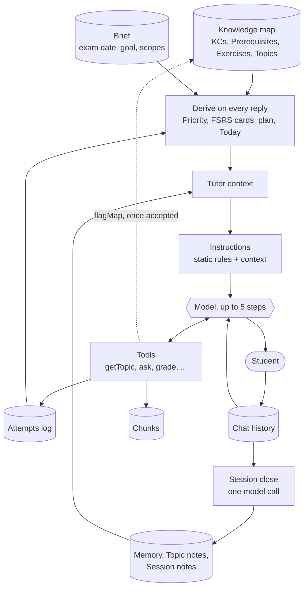
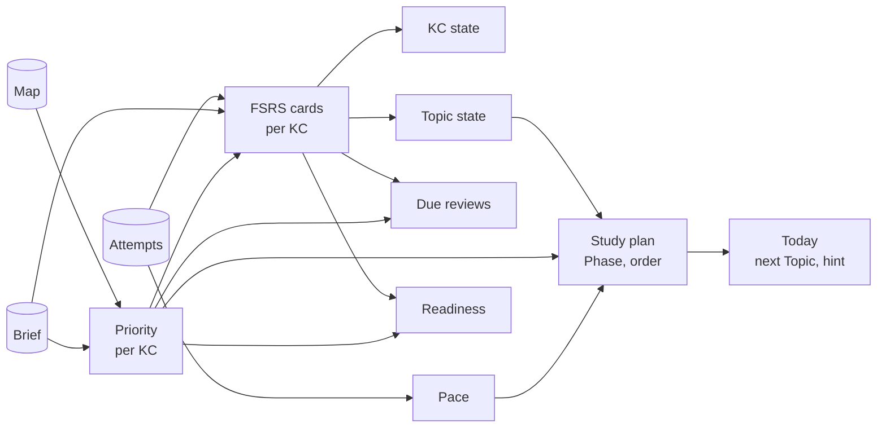
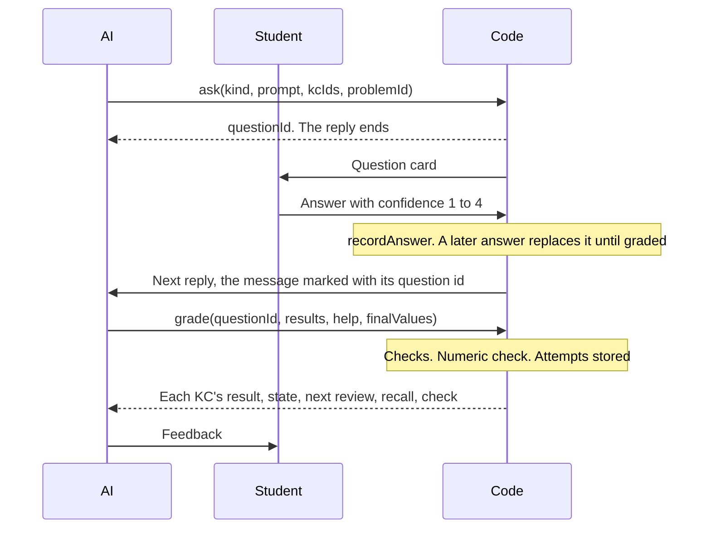

# The tutoring process

How a Chat tutors a Student from the Course's Knowledge map: what is stored, what code derives on every reply, how the AI's prompt gets built, what the AI can do with its tools, and what happens when a session ends.

This is the second half of one system. [The Knowledge map](knowledge-map.md) covers how the map is made, and [how the two connect](knowledge-map.md#how-the-two-connect) lists every point where they touch. Read it first if KCs, Topics or anchors are new to you.

Domain words are defined in [GLOSSARY.md](../../GLOSSARY.md); the choices behind the design are in [ADR 0018](../adr/0018-questions-as-first-class-objects.md), [0019](../adr/0019-fsrs-replay.md), [0021](../adr/0021-problem-verification.md) and [0026](../adr/0026-assumptions-as-text.md). In code, "tutor" names what the AI is given to tutor with, such as `TutorContext` and `tutorTools`. In the product it is always "the AI".

## The short version

Three ideas explain most of the design:

1. **The attempts log is the only stored learning state.** No table says what a Student knows. Each graded answer adds one `attempts` row per KC, and everything else (FSRS cards, KC states, Topic states, the study plan, Readiness) is recomputed from it on every read. A changed exam date or goal applies on the next read.
2. **Code decides what to do; the AI decides how to teach it.** Code picks the Topic, the due reviews, the Phase and the order. It hands these over as a **tutor context**, written into the AI's instructions, and it is rebuilt for every single reply.
3. **The AI acts through tools.** A question that shows what the Student knows goes through `ask` and is graded through `grade`. A question written as plain text grades nothing.



## The data

| What                  | Table                       | What it holds                                                                                                                                                                 | Written by                                      |
| --------------------- | --------------------------- | ----------------------------------------------------------------------------------------------------------------------------------------------------------------------------- | ----------------------------------------------- |
| Chat and its messages | `chats`, `chat_messages`    | The history. Each AI reply also stores the `tutor_context` it was given, its parts (with tool calls) and its model. A Done on a reading card sets `reading_section_id`        | Chat handler                                    |
| Study session         | `study_sessions`            | One per Chat, created by a database trigger. `mode`, `topic_id`, `stage`, `ended_at`, `session_note`, `rating`, `mock_id`                                                     | Trigger, then security-definer functions        |
| Question              | `questions`, `question_kcs` | One graded ask: `kind`, `prompt`, the KCs it tests, the Student's `answer_text` and `confidence` (1 to 4), timestamps, and the Exercise or generated Problem it poses, if any | `ask`, then the answer, then `grade`            |
| Attempt               | `attempts`                  | One KC of one Question: `result` (`full`, `partial`, `wrong`), `help` (`none`, `some`, `solution_shown`), `kind` and the numeric `check`. **The only stored learning state**  | `grade`, or Mock exam grading                   |
| Memory                | `memories`                  | One text per Course, at most 4,000 characters, about the Student and never mastery. A line starting with `!` is pinned                                                        | `remember`, the close call, the Student         |
| Topic note            | `topic_notes`               | What clicked and what kept going wrong on one Topic. Replaced at each learn session's close                                                                                   | Close call                                      |
| Topic choice          | `topic_choices`             | A pin or skip of a Topic                                                                                                                                                      | The Student, on the Topic page                  |
| Map Finding           | `map_findings`              | A claim that the map is wrong, with a quote from a chunk                                                                                                                      | `flagMap`, then the Student's accept or dismiss |
| Generated Problem     | `problems`, `problem_kcs`   | A variant of an Exercise or a new Problem: `statement`, `solution`, `program`, `final_answers`, `status` and the Student's `flag`                                             | Generation workflow                             |
| Mock exam             | `mock_exams`, `mock_items`  | A timed exam with items, answers through `question_id`, points and steps                                                                                                      | Assembly and grading workflows                  |

From the Knowledge map side, the tutoring reads KCs, Prerequisites, Exercises, Topics and chunks. From the Brief it reads the exam date, goal, excluded Materials, exam scopes, old exams (`chapters.is_exam`) and the Reserved exam.

## Everything derived on every read

Nothing here is stored. Each layer feeds the next, and the code in `study/domain/` is pure.



**Priority** (`priorities/domain/priority.ts`): how much a KC matters for this exam.

```text
Priority = scope × (0.25 + 0.5 × oldExamShare + 0.25 × exerciseShare)
```

The shares are the KC's old-exam Exercises and all its Exercises, over the Course's most. `scope` is 0 when every source is in an excluded Material; otherwise it comes from the exam scope of the KC's Topic or the nearest Topic above it, 0 for `excluded`, 2 for `emphasized`, else 1. A KC is then lifted to the highest Priority of anything that builds on it, unless it is excluded. Without old exams, Exercises or exam scopes, every KC is equal.

**FSRS cards** (`study/domain/replay.ts`): each KC's attempts replayed through `ts-fsrs`.

- `pre` (prequestion) and `retry` (Results session) attempts never schedule. `learn` and `mock` attempts do.
- The **first session** with a scheduling attempt on a KC teaches it: the card is created once that session has ended, rated by its _last_ attempt there. Until then the KC is `learning` with no card.
- In **each later session**, only the KC's _first_ attempt is a review.
- A session counts as ended at `ended_at`, or at its newest message once it has been idle for 2 hours.

| Attempt                                                                | FSRS rating |
| ---------------------------------------------------------------------- | ----------- |
| `wrong`, or `solution_shown`                                           | Again       |
| `partial`, or `some` help                                              | Hard        |
| `full` without help                                                    | Good        |
| `full` without help, confidence 4 and faster than the Student's median | Easy        |

Three exam rules bend the schedule:

- **Retention** follows the goal: 0.85 for pass, 0.90 for a good grade or no goal, 0.93 for master everything.
- **The exam cap:** a review's next due date is at most half the days left to the exam.
- **The final-week sweep:** the sweep day is 3 days before the exam. The top half of cards by Priority come due on it, unless they were last reviewed within 7 days of it or are due by then anyway.

**KC state:** `new` (no attempts other than prequestions), `due` (its card is due today or earlier), `learning` (its first session is open, or stability is under 7 days), `known` (anything else).

**Topic state,** the first that holds: `needs_work` (a card has 3 or more lapses), `solid` (every KC's projected recall reaches the retention), `learned` (every KC taught), `in_progress` (some KC taught), `new`. "Taught" means the KC has a schedule.

**Study plan** (`study/domain/plan.ts`):

- **Which Topics:** _to pass_ takes the highest-Priority Topics up to 80% of the total, _a good grade_ every Topic above 0, _master everything_ all of them. A pin always adds one, a skip always removes one, and the rest are _if time allows_.
- **Phase:** `final_week` on the exam day and the 7 days before it, `deepen` once every in-plan Topic is taught, otherwise `build`. None without a future exam date.
- **Progress** (`planProgress`): the in-plan Topics' KCs, and how many are `known` with a card of `reps >= 2`, so a KC taught once never counts and a due one leaves the count. Days in count UTC days since the Course's first Attempt, the first as 1; days left run to the exam date. `getPlan` adds it on every read; nothing is stored.
- **Order of untaught work:** pinned first, then in progress, then Priority per estimated minute, never before a Topic it builds on.
- **Pace** (`study/domain/pace.ts`) starts at 30 minutes per KC and 2 per review, then is measured from the Student's own sessions: active time from the gaps between a teaching session's messages, and minutes per review from its Questions' `asked_at` and `answered_at`.

**Today** (`study/domain/today.ts`) picks the next Topic: in build, the first of the order; in deepen, the in-plan Topic that needs work, then a learned one, then a solid one, lowest recall first; in the final week, the taught Topic with the highest Priority × (1 − projected recall), never a new one.

**Due reviews** (`study/domain/reviews.ts`) rank due KCs by Priority × (1 − today's recall) and list the top 8 with a count of the rest. **Readiness** is the Priority-weighted mean of each KC's projected recall on the exam date, with 0 for an untaught KC.

## One reply, step by step

`handleChatRequest` in `chat/server/handler.ts` handles each Student message. `useChat` posts to `/api/chat`.

1. **Refuse early.** Not signed in, a Chat that isn't theirs, an ended session (a message to one idle for 2 hours ends it now), a Daily limit already reached, or a Material of another Course. Refusals are plain text, and no model is called.
2. **Create the Chat** on its first message. The trigger starts a `learn` session, and the first request can switch it to `review`, `practice` or `results` (`start_study_session_mode`), which works only while it has no Topic and no question.
3. **Store the Student's message.** An answer from a question card also goes on its Question (`recordAnswer`).
4. **On the session's first reply,** end the Course's other idle sessions, which closes them too.
5. **Build the tutor context and tools** (`startTutoring`). On a learn session's first reply, this fixes the session's Topic to the plan's next Topic and sets the start stage, and it queues Problem generation for that Topic.
6. **Stream the reply** with the instructions, the history and the tools, at most 5 steps. It also stops at a call to `ask` or `showReading`, which wait for the Student.
7. **On end,** record usage in `ai_usage`, store the reply with its `tutor_context`, and name the Chat if it has no title.

A stopped reply with nothing to show is dropped. One with a finished tool call is kept, because the call's rows are already stored.

## How the prompt gets built

A reply's prompt has three parts: **instructions**, **messages** and **tools**.

### Instructions

`tutorInstructions(context)` in `study/ai/instructions.ts` joins these blocks, in this order. The static rules come first, and everything specific to this Student and this moment comes after them.

| #   | Block               | Content                                                                                                                                       | Depends on                   |
| --- | ------------------- | --------------------------------------------------------------------------------------------------------------------------------------------- | ---------------------------- |
| 1   | `ROLE`, `RULES`     | Who the AI is. Attempt before help, the Student produces, cite the course                                                                     | Static                       |
| 2   | How you tutor       | See the next table                                                                                                                            | Mode, whether it has a Topic |
| 3   | `QUESTIONS`         | How to use `ask` and `grade`, and how strictly to grade                                                                                       | Static                       |
| 4   | `READING`           | How to use `showReading`                                                                                                                      | Static                       |
| 5   | `MAP_DISAGREEMENTS` | Order of trust and when to `flagMap`                                                                                                          | Static                       |
| 6   | `MEMORY`, `NOTES`   | What to remember, and that notes are hints only                                                                                               | Static                       |
| 7   | `SCOPE`, `FORMAT`   | What it helps with; reply language, Markdown and LaTeX                                                                                        | Static                       |
| 8   | Dates               | Today and the exam date                                                                                                                       | Context                      |
| 9   | Memory              | The Memory in full, when it isn't empty                                                                                                       | Context                      |
| 10  | Notes               | The 3 newest Session notes of other sessions. In a learn session with a Topic, its Topic note and the notes of the Topics holding its anchors | Context                      |
| 11  | Material notes      | Each Material's notation, from the parse                                                                                                      | Context                      |
| 12  | Plan                | The goal, the guidance of `deepen` or `final_week` (`build` has none, and no line names the Phase) and today's hint; left out when empty      | Context                      |
| 13  | The work            | See the next table                                                                                                                            | Mode                         |
| 14  | Session             | The current stage, minutes since the start and where to go after the reviews                                                                  | Learn session with a Topic   |

Block 9a, after the Memory, holds the Brief's notes when there are any (`briefNotes`): the last 4,000 characters, as hints that the Student's answers override. The Brief's AI stores each note as a neutral third-person paraphrase that keeps every concrete fact, in the Student's language; notes stored before that stay as the Student wrote them. Every mode reads them.

Blocks 2 and 13 are what make the modes different:

| Session                | Block 2: how you tutor                                                        | Block 13: the work                                                             |
| ---------------------- | ----------------------------------------------------------------------------- | ------------------------------------------------------------------------------ |
| Learn, with a Topic    | `GUIDANCE_START`, `GUIDANCE_END`, then the `STAGED` block with all the Stages | Due reviews, then the Topic: KCs in order, anchors, Reading sections           |
| Learn, without a Topic | `UNSTAGED`, `GUIDANCE_START`, `UNSTAGED_SHAPE`, `GUIDANCE_END`                | Due reviews, or that the Course has no map, or that the plan has no next Topic |
| Review                 | `REVIEW`, `GUIDANCE_END`                                                      | The review queue with each group's status and what's left                      |
| Practice               | `PRACTICE`, `GUIDANCE_END`                                                    | The practice KCs                                                               |
| Results                | `RESULTS`, `GUIDANCE_END`                                                     | The graded Mock exam's tasks, the most points lost first                       |

For a learn session with a Topic, the end of the prompt reads roughly like this (made-up content):

```text
Today is 2026-11-04. The exam date: 2027-02-10.

What you know about this Student from earlier Chats:
2026-10-30: prefers a worked example before the definition.

Session notes of the Student's latest sessions in this Course, newest first:
- 2026-11-02, learn session:
  Worked through linear maps, mixed up kernel and image twice.
  Next: subspaces.

The Student's goal is a good grade: weigh breadth against depth by it.

Due reviews, most urgent first (recall today is the chance the Student still remembers the KC):
- Kernel of a linear map (id ..., Topic id ...; recall today 71%)

Next Topic: Subspaces (id ...). Central question: When is a subset itself a vector space?
Its KCs in teaching order:
- Subspace criterion (id ...; not taught yet)
Anchors (the KCs of other Topics it docks onto):
- Vector space axioms (id ...)
Its Reading sections, the course's pages on it in order:
- Lecture notes, pp. 41–43 (section id ...)

Session stage: orient. The session started 0 minutes ago.
```

### The tutor context

`startTutoring` in `study/server/tutoring.ts` builds the `TutorContext` (typed in `study/types.ts`). It reads as the Student, so Row Level Security applies.

| Field                                         | Source                                                                                                        |
| --------------------------------------------- | ------------------------------------------------------------------------------------------------------------- |
| `today`, `examDate`, `goal`                   | The clock, `getExamFacts`                                                                                     |
| `hasMap`                                      | Whether the stored map has KCs                                                                                |
| `phase`                                       | `planStudy`                                                                                                   |
| `memory`                                      | `memories`                                                                                                    |
| `briefNotes`                                  | `getBriefNotes`: the last 4,000 characters of the Brief's notes, null without notes                           |
| `dueReviews`                                  | `selectDueReviews`: in a staged session, the Topic's anchors come first                                       |
| `todayPlan`                                   | `tutorToday`: the session's Topic or the plan's next one, with KCs, anchors and Reading sections and the hint |
| `session`                                     | `sessionStage`: stage, stage after reviews, minutes. Null without a Topic                                     |
| `reviewQueue`                                 | `planReviewQueue`, in review sessions                                                                         |
| `practiceKcs`                                 | `selectPracticeKcs`, in practice sessions                                                                     |
| `mockResults`                                 | `loadMockReview`, in results sessions                                                                         |
| `sessionNotes`, `topicNotes`, `materialNotes` | `study/server/notes.ts`                                                                                       |

**The Reserved exam stays out of everything.** Before the context is built, `withoutReserved` removes its Exercises from the map and `withoutReservedSections` its Reading sections, and `getTopic` and `searchMaterials` filter its chunks.

**The context is stored** with each reply in `chat_messages.tutor_context` and sent on the stream's `start` part. A reply's Context sheet shows it, with the instructions re-rendered by today's code. Old rows stay readable, so a new `TutorContext` field must be optional.

### Messages

The model gets the full stored history on every reply (`toModelMessages`), with two additions:

- An answer on a card starts with `[My answer on the card of question <id>:]`, so the AI can grade it.
- A Done on a reading card starts with `[Done reading section <id>.]`.

A Material the Student attached in the Chat is sent as its file, up to 20 MB per request.

### Tools

`tutorTools` in `study/ai/tools.ts` defines the same tools for every mode, and each tool's `description` is part of the prompt. A refused call throws a `TutorToolError` whose message tells the model what to fix, and the model can try again in the next step.

| Tool              | What it does                                                                                                                                                     | Code enforces                                                                                                        |
| ----------------- | ---------------------------------------------------------------------------------------------------------------------------------------------------------------- | -------------------------------------------------------------------------------------------------------------------- |
| `getTopic`        | A Topic's central question, KCs with states, anchors, Reading sections with done marks and open Findings, with up to 3 source chunks per KC. Or KCs alone, by id | KCs must be of the Topic, or of the Course; no reserved chunks                                                       |
| `searchMaterials` | Up to 4 chunks of the whole Course nearest to a one-line query (`match_chunks`, which scans the Course's vectors without an index; metered embedding)            | No reserved chunks; refused at the Daily limit                                                                       |
| `findProblems`    | Up to 3 Problems for up to 8 KCs, with their solutions                                                                                                           | Unseen ones, in a review session also ones asked over 14 days ago; [ranking](#problems) is code                      |
| `ask`             | Stores a Question and shows its card. **Ends the reply**                                                                                                         | KCs must be of the Course; `problemId` must be an Exercise or a ready Problem                                        |
| `grade`           | Stores one Attempt per KC and returns each KC's new state                                                                                                        | One result per KC of an answered, ungraded Question of a running session; the [answer check](#questions-and-grading) |
| `showReading`     | Opens a Reading section beside the Chat, and returns its Markdown to the AI. **Ends the reply**                                                                  | The section must exist                                                                                               |
| `setStage`        | Moves the learn session's Stage                                                                                                                                  | [The rules below](#learn-session-stages)                                                                             |
| `compute`         | Runs a mathjs program in its own process                                                                                                                         | The math runner's limits                                                                                             |
| `remember`        | Appends one dated line to the Memory                                                                                                                             | One line of at most 300 characters; refused when full                                                                |
| `flagMap`         | Files a Map Finding                                                                                                                                              | The quote must be in the chunk's Markdown; the fields must fit the kind                                              |

## The session modes

A Study session is one Chat with one mode. The Today card's buttons open a new Chat with `?mode=`, and a graded Mock exam's page opens `results`.

| Mode       | Starts from               | What it works through                                                | Attempts count as                    |
| ---------- | ------------------------- | -------------------------------------------------------------------- | ------------------------------------ |
| `learn`    | Today card, Learn         | One Topic, in Stages. Without a Topic, a looser shape with no Stages | `pre` for prequestions, else `learn` |
| `review`   | Today card, Review        | The review queue                                                     | `learn`, first per KC schedules      |
| `practice` | Today card, Practice      | Exam-style Problems on the practice KCs                              | `learn`, first per KC schedules      |
| `results`  | A graded Mock exam's page | The mock's tasks, the most points lost first                         | `retry`, which never schedules       |

### Learn session stages

The first reply fixes the Topic and the start stage. It starts at `review` when reviews are due, otherwise where the Topic's last session stopped (before `close`), otherwise at `orient`.

| Stage     | Job                                                                                                                                         | Skipped when                                        |
| --------- | ------------------------------------------------------------------------------------------------------------------------------------------- | --------------------------------------------------- |
| `review`  | The due reviews, the Topic's anchors first, for at most 10 minutes                                                                          | Nothing is due, so it isn't the start stage         |
| `orient`  | One wide question over the anchors. A KC answered in full needs no teaching                                                                 | No anchor is taught                                 |
| `prime`   | 1 or 2 prequestions the reading will answer                                                                                                 | The Topic has no Reading section                    |
| `read`    | `showReading` on the next section without a Done, with a purpose question                                                                   | No Reading section, or the Student already knows it |
| `work`    | The Student explains it, then questions spanning at least 2 KCs. Back to `read` while sections are left                                     |                                                     |
| `apply`   | 1 to 3 Problems, the Course's own first                                                                                                     |                                                     |
| `rebuild` | One `ask` of kind `rebuild` over all the Topic's KCs: how they connect, from memory. Then the source pane shows the Topic's part of the map |                                                     |
| `close`   | A short wrap-up, then the app shows the close card, with a summary and the Session rating                                                   |                                                     |

`setStage` allows the next stage, `review` to the stage named for after it, and `work` back to `read` while a section is left. Any other forward move needs a one-line reason. Nothing else moves backwards, and `close` is final (`stageMoveRefusal` in `study/domain/stages.ts`).

### Review sessions

`planReviewQueue` in `study/domain/review-queue.ts` rebuilds the queue on every reply, and it is never stored:

1. Takes the KCs due at the session's start, ranked by Priority × (1 − recall), cut to 20 minutes at the Student's pace.
2. Groups up to 3 KCs that share a Topic or a Prerequisite. Each group gets one question.
3. Interleaves the groups, so no two in a row share a Topic while another is left.
4. Marks each group `open`, `done` or `retry` from the session's questions and attempts. A retry asks a KC again after a first attempt below `full`, at most once.

The schedules for this come from a replay without the session's own attempts, so an answered KC stays in the queue.

### Practice sessions

`selectPracticeKcs` takes the taught KCs of in-plan Topics that are learned, solid or need work, ranks them by the same Priority × (1 − recall) and keeps the top 8. The AI poses Problems on them, helps only when asked or after a wrong answer, and teaches nothing new.

### Results sessions

The AI goes through a graded Mock exam from the biggest loss down. It asks how the Student approached a task before showing the reference solution, corrects, and later asks a fresh question on each corrected KC. These `retry` attempts never schedule.

## Questions and grading



**The answer check.** A Question that poses an Exercise or generated Problem with `final_answers` has answer keys `{ label, value, anyOrder }`, each value a mathjs expression. `grade` takes the Student's `finalValues` as `[{ label, value }]`, the label optional with one key, and `checkAnswer` in `knowledge-map/domain/answer-keys.ts` checks each key: `match`, `mismatch` or `unchecked`. Numbers, units and complex numbers match within 1% (plus 1e-9 for zero) in the key's unit; vectors and matrices element by element; `anyOrder` lists as multisets; expressions with free symbols at 5 fixed points, of which 3 must evaluate. Any other value is `unchecked`, and one mathjs cannot parse is refused. A mismatch turns every `full` into `partial`, and a `full` while a key has no value is refused. The worst check (`mismatch`, then `unchecked`, then `match`) goes on each Attempt as `check`; it is null without keys.

**The `kind` of an Attempt** follows the Question and the session: a prequestion gives `pre`, a results session gives `retry`, anything else `learn`. Mock exam grading writes `mock`.

## Problems

A **Problem** is an Exercise from the Materials, or a generated variant or new Problem.

**Finding.** `findProblems` in `study/server/find-problems.ts` offers the unseen Exercises and the ready, unflagged generated Problems not yet asked in the Course. In a review session, those last asked more than 14 days ago follow. `rankProblems` picks 3, by: most of the given KCs tested, then source (old exam, Exercise, variant, new), then a first KC unlike the last Problem's, then difficulty nearest one above the last unassisted success. An Exercise comes with its printed solution or the note to solve it with the Student, and a generated one with how far its solution is checked.

**Generating.** Two triggers queue a run through `queue_problem_run`, which lets one run per Course through:

| Trigger                       | Stock                                                                             |
| ----------------------------- | --------------------------------------------------------------------------------- |
| A learn session's first reply | Each Topic KC with fewer than 2 unseen Problems gets up to 2, at most 4 per Topic |
| Any Study session's end       | Each KC due within 3 days with no unseen Problem gets one, at most 6              |

A queued Problem is a variant of an Exercise that tests the KC and has no variant yet, or else a new Problem. The model never does the arithmetic: it writes every number, vector or matrix as a `{{variable}}` of a mathjs program, code runs the program and fills in the values at 4 significant figures. Each declared final answer's value, a number in its declared unit or a vector, matrix or complex number, becomes the Problem's answer key. A failing draft goes back once with its error. A second failure or a model error marks the Problem `failed`, and a reached Daily limit leaves the rest `queued` for the next run. A trigger during a run is dropped.

## Mock exams

A Mock exam is a timed session without the AI: the Student answers on the mock page, not in a Chat.

1. **Assemble** (`assembleMock`). A 90-minute blueprint shares its time among in-plan Topics by Priority, split 30/50/20 by difficulty. Unseen Exercises and Problems fill the slots, and at most 6 empty ones are generated. The final mock is the Reserved exam itself.
2. **Submit.** `submit_mock_exam`, then the `gradeMock` workflow.
3. **Grade.** One step per item. A blank answer scores 0 with every KC `wrong` and no call. An answer gets one `grade_exam` call, whose final values, by the labels of the item's keys, go through the answer check: a mismatch also caps the points one below full. Each item stores its points and steps, and a `mock` Attempt per KC, which does schedule. An item that still fails after retries is left out of the score.
4. **Finish.** The mock stores its score and its Brier score (the mean squared gap between each item's predicted success and its share of points), and the result page offers a `results` session.

## When a session ends

A session ends through End session, a Session rating, or when it has been idle for 2 hours. An idle end is written the next time something notices: a message or action on that Chat, or the first reply of another session in the Course. `endSession` then starts two things:

1. **`closeStudySession`** claims the session (`close_started_at`, so a duplicate start stops) and makes one `close` call. Its result is stored by `store_session_close` in one transaction.
2. **Problem generation** for the review stock.

| The close call writes | Rule                                                                                                                                                  |
| --------------------- | ----------------------------------------------------------------------------------------------------------------------------------------------------- |
| Session note          | Two lines: what happened and what is next                                                                                                             |
| Topic note            | At most 1,500 characters, replacing the old one. Learn sessions with a Topic only                                                                     |
| Memory lines          | 0 to 3, preferences and context only                                                                                                                  |
| Condensed Memory      | Once the Memory passes 3,000 characters. Dropped unless code finds every pinned line in it word for word and the Memory hasn't changed since the read |

A session without a Student message gets no call and stays claimed with no note. Notes never set a KC's state: the instructions call them hints, and the Student's answers win.

## All the prompts

| Call (task)           | When                        | Instructions in                             | User message                                                                                        | Answer                                                      |
| --------------------- | --------------------------- | ------------------------------------------- | --------------------------------------------------------------------------------------------------- | ----------------------------------------------------------- |
| Reply (`chat`)        | Each Student message        | `study/ai/instructions.ts`, built per reply | The Chat's history                                                                                  | Text and tool calls, streamed                               |
| Title (`title`)       | After a Chat's first reply  | `chat/ai/title.ts`                          | The first message                                                                                   | A short title                                               |
| Close (`close`)       | Once per ended session      | `study/ai/close-call.ts`                    | JSON: mode, Topic, transcript, Questions with Attempts, Topic note, Memory, what to write           | Two note lines, Topic note, Memory lines, condensed lines   |
| Generate (`generate`) | Once per queued Problem     | `study/ai/generate-call.ts`                 | JSON: an Exercise to vary, or KCs with up to 3 sources each, a difficulty and up to 2 style anchors | Statement, solution, program, final answers                 |
| Grade (`grade_exam`)  | Once per answered mock item | `study/ai/grade-exam-call.ts`               | JSON: task, points, reference solution, answer, KCs by label, the keys' labels                      | Points per step with reasons, a result per KC, final values |

`close` and `grade_exam` are metered but run past the Daily limit, so work the Student already did always gets finished. The Brief has its own call and tools in the `brief` feature, and reaches the tutoring only through what it stores.

## Map Findings

The AI's order of trust is: the Course's sources, then the map, then its own knowledge, then the Student's claim. When a Student and the map disagree, the AI checks the sources first:

| The sources show                       | The AI                                                                  |
| -------------------------------------- | ----------------------------------------------------------------------- |
| The Student is right, the map lacks it | Confirms with a citation and files a Finding                            |
| The map is right                       | Corrects the Student with a citation, and files nothing                 |
| The map contradicts them               | Teaches from the sources, says the map is off here, and files a Finding |
| Neither                                | Marks it "beyond the course", grades nothing on it, and files nothing   |

`flagMap` files a `missing_link`, `wrong_link` or `wrong_description` as `open`, with a quote that code checks is in the chunk. Nothing changes until the Student accepts it in the Map findings card on the Course map. `accept_map_finding` then applies it in one transaction and sets `applied` with an `outcome`. A link that would close a cycle is refused, and the Finding stays open. A Student's own write can only move a Finding from `open` to `dismissed`. `getTopic` lists a KC's open Findings, so the AI leans on the sources there. The Brief and Priority never read Findings.

## What the Student sees

| Where                  | What                                                                                                                                                                                   |
| ---------------------- | -------------------------------------------------------------------------------------------------------------------------------------------------------------------------------------- |
| Course map, new Chat   | The Today card, at the top of the Course map and in a new Chat's empty state. Progress and Readiness in the map header, Readiness on Topic cards, Progress in the Brief's panel        |
| Above the messages     | The stage bar in a learn session, read from the stored context and `setStage` results. The session bar: a review's groups done or a practice's Problems answered                       |
| In a reply             | Each tool call as a collapsed step card with a one-line summary written by code. A call that never returned shows as stopped once the reply is done                                    |
| Question card          | The answer and confidence. A generated Problem's card lets the Student flag it once, which takes it out of the pool                                                                    |
| After a graded rebuild | A Knowledge map card that opens the Topic's part of the map with its KC states (`getTopicKnowledgeMap`)                                                                                |
| Close card             | At `close` or once the session has ended: `getSessionSummary` gives the Topic's state and each KC's state and next review, and `rateStudySession` saves the Session rating             |
| Context sheet          | A reply's stored tutor context, with its instructions re-rendered by today's code, plus its model, tokens and cost (`ai_usage.reply_id`, no foreign key since usage is recorded first) |
| Mock exam result page  | Score per Topic, calibration on sure answers and each task's points ordered by points lost, without the reference solution                                                             |
| After the exam date    | The map asks "How did the exam go?", and `exam_results` stores the grade once per exam date                                                                                            |

The Student edits the whole Memory on the Brief page, whose own AI doesn't read it. A Topic page's pin or skip goes through `setTopicChoice`, and a skip's reason goes into the Memory.

## Where the code is

Paths are relative to `src/features/`.

| To change                                 | Look in                                                                                                           |
| ----------------------------------------- | ----------------------------------------------------------------------------------------------------------------- |
| What the AI is told                       | `study/ai/instructions.ts`                                                                                        |
| What goes into the context                | `study/server/tutoring.ts`, `study/types.ts`                                                                      |
| A tool's input, description or rules      | `study/ai/tools.ts`; what it does in `tutorToolActions` in `study/server/tutoring.ts`                             |
| The request itself and stored replies     | `chat/server/handler.ts`, `chat/server/chat-store.ts`                                                             |
| Scheduling                                | `study/domain/replay.ts`                                                                                          |
| The plan, Phases and Today                | `study/domain/plan.ts`, `study/domain/today.ts`                                                                   |
| Stages                                    | `study/domain/stages.ts`, `study/server/session-stage.ts`                                                         |
| Review and practice selection             | `study/domain/review-queue.ts`, `study/domain/practice.ts`                                                        |
| Priority                                  | `priorities/domain/priority.ts`                                                                                   |
| Session close                             | `study/workflows/close-*.ts`, `study/ai/close-call.ts`, `study/domain/close.ts`                                   |
| Problems and Mock exams                   | `study/server/find-problems.ts`, `study/domain/exercises.ts`, `study/domain/problem-stock.ts`, `study/workflows/` |
| Tool cards and step summaries in the Chat | `chat/components/`, `chat/domain/reply-steps.ts`                                                                  |

To see it run: `pnpm smoke tutor`, `close`, `generate`, `mock` and `grade-mock` call real models, so read [docs/agents/live-ai.md](../agents/live-ai.md) first, and [docs/agents/notes/tutor-smoke.md](../agents/notes/tutor-smoke.md) for how one run reads. A change to the instructions means running `pnpm smoke tutor`.

Change this document in the same PR as the behaviour it describes.
