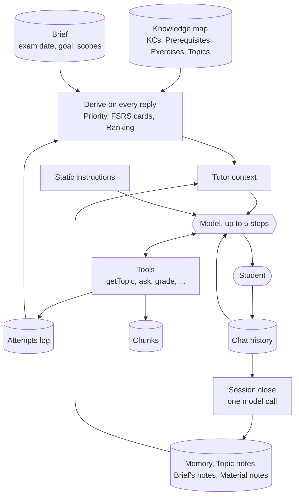
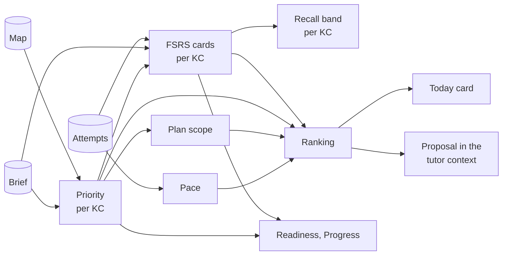
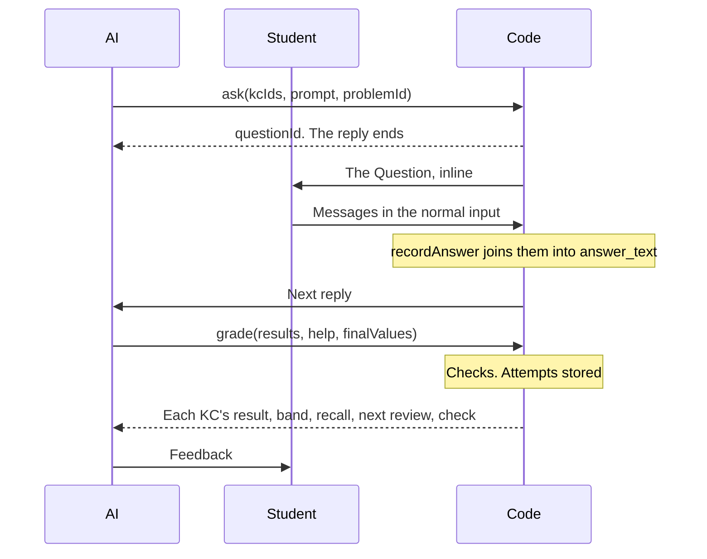

# The tutoring process

How a Chat tutors a Student from the Course's Knowledge map: what is stored, what code derives on every reply, what the AI is given, what it can do with its tools, and what happens when a session ends.

This is the second half of one system. [The Knowledge map](knowledge-map.md) covers how the map is made, and [how the two connect](knowledge-map.md#how-the-two-connect) lists every point where they touch. Read it first if KCs, Topics or anchors are new to you.

Domain words are defined in [GLOSSARY.md](../../GLOSSARY.md); the choices behind the design are in [ADR 0018](../adr/0018-questions-as-first-class-objects.md), [0021](../adr/0021-problem-verification.md), [0026](../adr/0026-assumptions-as-text.md), [0027](../adr/0027-per-day-scheduling-and-one-ranking.md) and [0028](../adr/0028-one-study-session.md). In code, "tutor" names what the AI is given to tutor with, such as `TutorContext` and `tutorTools`. In the product it is always "the AI".

## The short version

Three ideas explain most of the design:

1. **The attempts log is the only stored learning state.** No table says what a Student knows. Each graded answer adds one `attempts` row per KC, and everything else (FSRS cards, recall bands, the Ranking, Progress, Readiness) is recomputed from it on every read. A changed exam date or goal applies on the next read.
2. **Code gives facts and a proposal; the AI teaches freely.** There is one kind of Study session, with no modes and no stages. On every reply code derives a **tutor context**: today's date, the session so far, the head of the Ranking as a proposal, every Topic and the notes. The AI decides what to do with it, and the Student can redirect at any time.
3. **The AI acts through tools.** A question that shows what the Student knows goes through `ask` and is graded through `grade`. A question written as plain text grades nothing.



## The data

| What                  | Table                       | What it holds                                                                                                                                                                                                                                                                           | Written by                               |
| --------------------- | --------------------------- | --------------------------------------------------------------------------------------------------------------------------------------------------------------------------------------------------------------------------------------------------------------------------------------- | ---------------------------------------- |
| Chat and its messages | `chats`, `chat_messages`    | The history. Each AI reply also stores the `tutor_context` it was given, its parts (with tool calls) and its model                                                                                                                                                                      | Chat handler                             |
| Study session         | `study_sessions`            | One per Chat, created by a database trigger: `started_at`, `ended_at`, `close_started_at`, `closed_at`, `rating`, `rating_note` and `mock_id` for a Chat that goes through a graded Mock exam                                                                                           | Trigger, then security-definer functions |
| Question              | `questions`, `question_kcs` | One graded ask: `prompt`, the KCs it tests, the Student's `answer_text` (every message between its `ask` and its `grade`, joined) and `answer_message_id` (the first), timestamps, and the Exercise or generated Problem it poses, if any. `confidence` (1 to 4) is for Mock exams only | `ask`, then the answer, then `grade`     |
| Attempt               | `attempts`                  | One KC of one Question: `result` (`full`, `partial`, `wrong`), `help` (`none`, `some`, `solution_shown`) and the answer `check`. **The only stored learning state**                                                                                                                     | `grade`, or Mock exam grading            |
| Memory                | `memories`                  | One text per Course, at most 4,000 characters, about the Student and never mastery                                                                                                                                                                                                      | `remember`, the close call, the Student  |
| Topic note            | `topic_notes`               | What clicked and what kept going wrong on one Topic, at most 1,500 characters                                                                                                                                                                                                           | Close call                               |
| Topic choice          | `topic_choices`             | A pin or skip of a Topic                                                                                                                                                                                                                                                                | The Student, on the Topic page           |
| Generated Problem     | `problems`, `problem_kcs`   | A variant of an Exercise or a new Problem: `statement`, `solution`, `program`, `final_answers`, `status` and the Student's `flag`                                                                                                                                                       | Generation workflow                      |
| Mock exam             | `mock_exams`, `mock_items`  | A timed exam with items, answers through `question_id`, points and steps                                                                                                                                                                                                                | Assembly and grading workflows           |

There are four kinds of notes:

| Note           | Holds                                                                  | Written by                                                            |
| -------------- | ---------------------------------------------------------------------- | --------------------------------------------------------------------- |
| Brief's notes  | What the Student said in the Brief, paraphrased; a Topic skip's reason | The Brief, and `setTopicChoice`. The close call never rewrites them   |
| Memory         | The AI's lines                                                         | `remember` and the close call; the Student edits it on the Brief page |
| Topic notes    | What clicked and what kept going wrong, per Topic                      | The close call                                                        |
| Material notes | Each Material's notation                                               | The parse                                                             |

From the Knowledge map side, the tutoring reads KCs (with the `assumes` texts), Prerequisites, Exercises, Topics and chunks. From the Brief it reads the exam date, goal, excluded Materials, exam scopes, old exams (`chapters.is_exam`) and the Reserved exam.

## Everything derived on every read

Nothing here is stored. Each layer feeds the next, and the code in `study/domain/` is pure.



**Priority** (`priorities/domain/priority.ts`): how much a KC matters for this exam.

```text
Priority = scope × (0.25 + 0.5 × oldExamShare + 0.25 × exerciseShare)
```

The shares are the KC's old-exam Exercises and all its Exercises, over the Course's most. `scope` is 0 when every source is in an excluded Material; otherwise it comes from the exam scope of the KC's Topic or the nearest Topic above it, 0 for `excluded`, 2 for `emphasized`, else 1. A KC is then lifted to the highest Priority of anything that builds on it, unless it is excluded. Without old exams, Exercises or exam scopes, every KC is equal.

**FSRS cards** (`study/domain/replay.ts`): each KC's attempts replayed through `ts-fsrs` by the per-day rule ([ADR 0027](../adr/0027-per-day-scheduling-and-one-ranking.md)), on UTC days. Every Attempt counts, from a Chat or a Mock exam, and sessions play no part.

- A KC's **first day** with an Attempt teaches it: its card is created from that day's _newest_ Attempt so far, dated at it, so it changes until the day ends.
- On **each later day**, only the KC's _first_ Attempt is a Review. Its other Attempts that day don't schedule.
- **Retention** follows the goal: 0.85 for pass, 0.90 for a good grade or no goal, 0.93 for master everything. Nothing else bends the schedule.

| Attempt                               | FSRS rating |
| ------------------------------------- | ----------- |
| `wrong`, or `solution_shown`          | Again       |
| `partial`, or `full` with `some` help | Hard        |
| `full` without help                   | Good        |

Replay gives each KC `taught` (it has a card), `learned` (a `full` Attempt without help), `recallToday` (at the end of today's UTC day, so an answer just given counts; just under retention at most when the newest Attempt is today and rated Again, so a KC answered wrong is not `strong` that day), `recallOnExamDay` (today's without a future exam date), `due` (its due day is today or earlier) and `nextReview`.

**Recall band** (`study/domain/recall-band.ts`), what the Student sees of a KC, on `recallToday`: `new` (untaught), `strong` (at or above the goal's retention), `fading` (0.7 or more), `weak`.

**Plan scope** (`study/domain/plan.ts`): _to pass_ takes the highest-Priority Topics up to 80% of the total, _a good grade_ every Topic above 0, _master everything_ all of them. A pin always adds one, a skip always removes one, and the rest are _if time allows_.

**Pace** (`study/domain/pace.ts`) starts at 30 minutes per KC and 2 per review, then is measured from the Student's own Attempts. Minutes per KC: the active time of each session that holds a KC's first Attempt, from the gaps between its messages, less its Reviews, over the KCs it taught. Minutes per review: the time to answer each Review (a KC's first Attempt on a later day), from its Question's `asked_at` and `answered_at`.

**Ranking** (`rankNext` in `study/domain/ranking.ts`, [ADR 0027](../adr/0027-per-day-scheduling-and-one-ranking.md)): one list of what is worth doing next, over the Topics in the plan or _if time allows_. Each candidate's value is Priority × (1 − recall), with minutes from pace:

| Candidate                               | Recall            | Minutes                   |
| --------------------------------------- | ----------------- | ------------------------- |
| A due KC (a Review)                     | `recallToday`     | Per Review                |
| A Topic with untaught KCs               | 0, summed         | Per KC × the untaught KCs |
| A taught KC that is not due (a refresh) | `recallOnExamDay` | Per Review                |

Value 0 drops a candidate, except a due Review; ties go in Course order. Normally: due Reviews by value, then in-plan Topics (a started one, then pinned ones by pin time, then by value per minute), then refreshes once no in-plan Topic has untaught KCs, then _if time allows_ Topics. In the final stretch (the exam day and the 7 days before it) everything ranks by value per minute. A Topic never comes before an untaught Topic it builds on; that anchor moves just before it.

**Study state** (`getStudyState` in `study/server/study-state.ts`): the Ranking with names and minutes, the plan scope, each Topic's learned count and Readiness, Progress (in-plan KCs that are `learned`; days in since the first Attempt, days left to the exam), Course Readiness and the latest graded mock score. The Course map, the Topic page, the Brief panel and the new Chat read it; `loadStudy` in the same file is the shared read behind it and the tutor context. Nothing is stored.

**Readiness** is the Priority-weighted mean of each KC's recall on the exam day, with 0 for an untaught KC.

## One reply, step by step

`handleChatRequest` in `chat/server/handler.ts` handles each Student message. `useChat` posts to `/api/chat`.

1. **Refuse early.** Not signed in, a Chat that isn't theirs, an ended session (a message to one idle for 2 hours ends it now), a Daily limit already reached, or a Material of another Course. Refusals are plain text, and no model is called.
2. **Create the Chat** on its first message. The trigger starts the Study session. A request with a `mockId` (the link "Go through it with the tutor" on a graded Mock exam's page opens `/chat?mock=<id>`, which sends `MOCK_REVIEW_MESSAGE`) sets `mock_id` through `set_session_mock`, which accepts only the caller's own graded mock of the same Course, and only while the session has no Question.
3. **Store the Student's message.** Every message between an open Question's `ask` and its `grade` is part of its answer, and `recordAnswer` joins them in order (`joinAnswer`). A message sent again is not recorded twice.
4. **On the session's first reply,** end the Course's other idle sessions, which closes them too.
5. **Build the tutor context and tools** (`startTutoring`). On the first reply this also tops up the Problem stock of the Ranking's next Topic.
6. **Stream the reply** with the static instructions, the history, the tutor context in front of the newest Student message and the tools, at most 5 steps. It also stops at a call to `ask` or `showReading`, which wait for the Student.
7. **On end,** record usage in `ai_usage`, store the reply with its `tutor_context`, and name the Chat if it has no title.

A stopped reply with nothing to show is dropped. One with a finished tool call is kept, because the call's rows are already stored.

## What the AI is given

A reply's prompt has four parts: **instructions**, **messages**, the **tutor context** and **tools**.

### Instructions

`TUTOR_INSTRUCTIONS` in `study/ai/instructions.ts` is one static text, the same on every reply, so it stays cached. It holds principles and no steps, in four blocks:

| Block                 | Content                                                                                                                                                                                                                                                                                                                                                                                                                                                                                                                                                                                                                                                                                                                                                |
| --------------------- | ------------------------------------------------------------------------------------------------------------------------------------------------------------------------------------------------------------------------------------------------------------------------------------------------------------------------------------------------------------------------------------------------------------------------------------------------------------------------------------------------------------------------------------------------------------------------------------------------------------------------------------------------------------------------------------------------------------------------------------------------------ |
| Role and how to tutor | Find out before you teach, and teach only the gap. The Student does the thinking, and every explanation ends in something for them to do. Read a KC with `getTopic` before teaching it. Once the basics stand, move to exam-like problems, the course's own first. Offer the course's pages. Mix in earlier KCs. Give the smallest hint that unblocks; give a solution when asked and say it won't count. At a Topic's end, have them connect its KCs from memory. With few days left, teach through exam problems. When a KC's `assumes` text blocks the Student, check it and teach it briefly, marked as beyond the Materials. The proposal is a suggestion, and the Student's wish wins. `remember` what helps later; never show ids or tool names |
| Evidence              | A question that shows what the Student knows goes through `ask`, its answer through `grade`. `full` is correct and complete without help, `partial` the right approach with a gap or an error, `wrong` anything else. Record help as it happened. Check numbers with `compute`. Generous grading schedules Reviews too late                                                                                                                                                                                                                                                                                                                                                                                                                            |
| Grounding             | Cite the course by Material and page. Trust the course's sources first, then the map, then your own knowledge, then the Student's claim. Going beyond the course is welcome: say so, and grade nothing on it                                                                                                                                                                                                                                                                                                                                                                                                                                                                                                                                           |
| Scope and format      | This Course only, in the Student's language, with Markdown and LaTeX                                                                                                                                                                                                                                                                                                                                                                                                                                                                                                                                                                                                                                                                                   |

Changing the instructions means running `pnpm smoke tutor`.

### The tutor context

`loadTutorContext` in `study/server/tutor-context.ts` reads as the Student, so Row Level Security applies, and `tutorContext` in `study/domain/tutor-context.ts` derives the `TutorContext` (typed in `study/types.ts`) from it. It is rebuilt on every reply and stored with the reply, but never in the history. `renderTutorContext` in `study/ai/context.ts` turns it into a `<tutor-context>` block, and `withTutorContext` in `chat/ai/reply.ts` puts the block in front of the newest Student message, so the instructions and the earlier history stay cacheable.

| Section             | Holds                                                                                                                                                                                                                                                                                                |
| ------------------- | ---------------------------------------------------------------------------------------------------------------------------------------------------------------------------------------------------------------------------------------------------------------------------------------------------- |
| Dates               | Today, the exam date with days left, and the goal                                                                                                                                                                                                                                                    |
| This session        | Its minutes; the KCs checked today across the Course, with result and help; the open Question and whether it is answered; the minutes since the last graded Question; the Reading sections opened by this session's `showReading` calls                                                              |
| Proposal            | The head of the Ranking. Outside the final stretch: the first 10 due Reviews with their recall and how many are left, and the next Topic with its central question, KCs with bands, anchors, `assumes` texts, Reading sections and unseen Problems. In the final stretch: the first 10 items instead |
| Practice candidates | The first 8 refreshes of the Ranking                                                                                                                                                                                                                                                                 |
| Topics              | Every Topic, one line each: name, id, in plan, _if time allows_ or skipped, and n of m learned. So the AI can follow a Student anywhere                                                                                                                                                              |
| Notes               | The last session's line (date, Topics, KCs checked, how many below `full`, from its Attempts); the Topic notes of the proposed Topic and of the Topics touched today; the Memory; the Brief's notes (the last 4,000 characters, as hints the Student's answers override); the Material notes         |
| A mock session      | The graded mock's tasks with the Student's answers and the reasons for lost points, most points lost first (a graded final mock's tasks do appear)                                                                                                                                                   |

**The Reserved exam stays out of everything.** Before the context is built, `withoutReserved` removes its Exercises from the map and `withoutReservedSections` its Reading sections, and `getTopic` and `searchMaterials` filter its chunks.

**The context is stored** with each reply in `chat_messages.tutor_context` and sent on the stream's `start` part. Outside production, a reply's Context sheet shows it, rendered by today's code. The mock models read ids from the block and never echo it.

### Messages

The model gets the stored history on every reply (`toModelMessages`, then `modelHistory` in `chat/domain/model-history.ts`), with two cost cuts:

- A Material the Student attached in the Chat is sent as its file only with the message it is attached to, up to 20 MB per request; later turns carry "[Attached: <name>]", and the AI finds it through `searchMaterials` once it is parsed.
- A tool result older than the third-newest Student message is replaced by its one-line step summary. The stored messages are unchanged.

### Tools

`tutorTools` in `study/ai/tools.ts` defines the eight tools, and each tool's `description` is part of the prompt. A refused call throws a `TutorToolError` whose message tells the model what to fix, and the model can try again in the next step.

| Tool              | What it does                                                                                                                                                                                                                       | Code enforces                                                                                                                                        |
| ----------------- | ---------------------------------------------------------------------------------------------------------------------------------------------------------------------------------------------------------------------------------- | ---------------------------------------------------------------------------------------------------------------------------------------------------- |
| `getTopic`        | A Topic's central question, KCs with bands, recall today and `assumes`, anchors and Reading sections, with up to 3 source chunks per KC. Or KCs alone, by id                                                                       | KCs must be of the Course; no reserved chunks                                                                                                        |
| `searchMaterials` | Up to 4 chunks of the whole Course nearest to a one-line query (`match_chunks`, which scans the Course's vectors without an index; metered embedding)                                                                              | No reserved chunks; refused at the Daily limit                                                                                                       |
| `findProblems`    | Up to 3 Problems for up to 8 KCs, with their solutions                                                                                                                                                                             | One rule: unseen first, then those not asked in the last 14 days; [ranking](#problems) is code                                                       |
| `ask`             | Stores a Question for Course KCs, a Markdown prompt and an optional `problemId`, and shows it inline. **Ends the reply**                                                                                                           | KCs must be of the Course; `problemId` must be an Exercise or a ready Problem; refused while the newest Question is answered but ungraded            |
| `grade`           | Grades the session's newest Question: one result per KC, the help, and the Student's `finalValues`. Or `noAnswer: true` when they moved on, which closes it without Attempts. Returns each KC's band, recall today and next review | An answered, ungraded Question of a running session; results for KCs retired since the `ask` are dropped; the [answer check](#questions-and-grading) |
| `showReading`     | Opens a Reading section in the Source pane, and returns its Markdown to the AI. **Ends the reply**                                                                                                                                 | The section must exist                                                                                                                               |
| `compute`         | Runs a mathjs program in its own process                                                                                                                                                                                           | The math runner's limits                                                                                                                             |
| `remember`        | Appends one dated line to the Memory                                                                                                                                                                                               | One line of at most 300 characters; refused when full                                                                                                |

## Questions and grading

A **Question** is part of the conversation: it renders inline as the AI's question, with its prompt, or a Problem's statement with its page link and, for a generated Problem, the flag control. The Student answers in the normal input.



An older unanswered Question stays ungraded for good. `grade` always takes the newest Question, so it needs no id.

**The answer check.** A Question that poses an Exercise or generated Problem with `final_answers` has answer keys `{ label, value, anyOrder }`, each value a mathjs expression. `grade` takes the Student's `finalValues` as `[{ label, value }]`, the label optional with one key, and `checkAnswer` in `knowledge-map/domain/answer-keys.ts` checks each key: `match`, `mismatch` or `unchecked`. Numbers, units and complex numbers match within 1% (plus 1e-9 for zero) in the key's unit, so a number without a unit misses a key with one; vectors and matrices element by element; `anyOrder` lists as multisets; expressions with free symbols at 5 fixed points, of which 3 must evaluate. Any other value is `unchecked`, and one mathjs cannot parse is refused. A mismatch turns every `full` into `partial`, and a `full` while a key has no value is refused. The worst check (`mismatch`, then `unchecked`, then `match`) goes on each Attempt as `check`; it is null without keys.

## Problems

A **Problem** is an Exercise from the Materials, or a generated variant or new Problem.

**Finding.** `findProblems` in `study/server/find-problems.ts` offers the unseen Exercises and the ready, unflagged generated Problems not yet asked in the Course, then those last asked more than 14 days ago. `rankProblems` picks 3, by: most of the given KCs tested, then source (old exam, Exercise, variant, new), then a first KC unlike the last Problem's, then difficulty nearest one above the last unassisted success. An Exercise comes with its printed solution or the note to solve it with the Student, and a generated one with how far its solution is checked.

**Generating.** Two triggers queue a run through `queue_problem_run`, which lets one run per Course through:

| Trigger                 | Stock                                                                                                 |
| ----------------------- | ----------------------------------------------------------------------------------------------------- |
| A session's first reply | The Ranking's next Topic: each KC with fewer than 2 unseen Problems gets up to 2, at most 4 per Topic |
| Any Study session's end | Each KC due within 3 days with no unseen Problem gets one, at most 6                                  |

A queued Problem is a variant of an Exercise that tests the KC and has no variant yet, or else a new Problem. The model never does the arithmetic: it writes every number, vector or matrix as a `{{variable}}` of a mathjs program, code runs the program and fills in the values at 4 significant figures. Each declared final answer's value, a number in its declared unit or a vector, matrix or complex number, becomes the Problem's answer key. A failing draft goes back once with its error. A second failure or a model error marks the Problem `failed`, and a reached Daily limit leaves the rest `queued` for the next run. A trigger during a run is dropped.

## Mock exams

A Mock exam is a timed session without the AI: the Student answers on the mock page, not in a Chat.

1. **Assemble** (`assembleMock`). A 90-minute blueprint shares its time among in-plan Topics by Priority, split 30/50/20 by difficulty. Unseen Exercises and Problems fill the slots, and at most 6 empty ones are generated. The final mock is the Reserved exam itself.
2. **Submit.** `submit_mock_exam`, then the `gradeMock` workflow.
3. **Grade.** One step per item. A blank answer scores 0 with every KC `wrong` and no call. An answer gets one `grade_exam` call, whose final values, by the labels of the item's keys, go through the answer check, each key on its own (`checkEachAnswer`: a value it can't read is `unchecked` and hides no other key's mismatch): a mismatch also caps the points one below full. Each item stores its points and steps, and an Attempt per KC in the mock's session, which does schedule. An item that still fails after retries is left out of the score.
4. **Finish.** The mock stores its score and its Brier score (the mean squared gap between each item's predicted success and its share of points), and the result page links to a Chat that goes through it.

## When a session ends

A session ends through End session, a Session rating, or when it has been idle for 2 hours. An idle end is written the next time something notices: a message or action on that Chat, or the first reply of another session in the Course. `endSession` then starts two things:

1. **`closeStudySession`** claims the session (`close_started_at`, so a duplicate start stops) and makes one `close` call. Its result is stored by `store_session_close` in one transaction, which also sets `closed_at` and refuses to run twice.
2. **Problem generation** for the review stock.

The call reads the transcript, the session's Questions with their Attempts, the notes of the touched Topics (the Topics of its Attempts' KCs) and the Memory.

| The close call writes | Rule                                                                                                         |
| --------------------- | ------------------------------------------------------------------------------------------------------------ |
| Topic notes           | One per touched Topic, at most 1,500 characters, replacing the old one. A Topic of another Course is skipped |
| Memory lines          | 0 to 3, preferences and context only                                                                         |
| Condensed Memory      | Once the Memory passes 3,000 characters. Dropped if the Memory changed since the read                        |

A session without Attempts writes Memory lines only. One without a Student message gets no call. Notes never set a KC's state: the context gives them as hints, and the Student's answers win.

## All the prompts

| Call (task)           | When                        | Instructions in                    | User message                                                                                               | Answer                                                      |
| --------------------- | --------------------------- | ---------------------------------- | ---------------------------------------------------------------------------------------------------------- | ----------------------------------------------------------- |
| Reply (`chat`)        | Each Student message        | `study/ai/instructions.ts`, static | The Chat's history, with the tutor context before the newest message                                       | Text and tool calls, streamed                               |
| Title (`title`)       | After a Chat's first reply  | `chat/ai/title.ts`                 | The first message                                                                                          | A short title                                               |
| Close (`close`)       | Once per ended session      | `study/ai/close-call.ts`           | JSON: transcript, Questions with Attempts, touched Topics with their notes, Memory, whether to condense it | Topic notes by Topic id, Memory lines, condensed lines      |
| Generate (`generate`) | Once per queued Problem     | `study/ai/generate-call.ts`        | JSON: an Exercise to vary, or KCs with up to 3 sources each, a difficulty and up to 2 style anchors        | Statement, solution, program, final answers                 |
| Grade (`grade_exam`)  | Once per answered mock item | `study/ai/grade-exam-call.ts`      | JSON: task, points, reference solution, answer, KCs by label, the keys' labels                             | Points per step with reasons, a result per KC, final values |

`close` and `grade_exam` are metered but run past the Daily limit, so work the Student already did always gets finished. The Brief has its own call and tools in the `brief` feature, and reaches the tutoring only through what it stores.

## What the Student sees

| Where                 | What                                                                                                                                                                                                                                                                                                            |
| --------------------- | --------------------------------------------------------------------------------------------------------------------------------------------------------------------------------------------------------------------------------------------------------------------------------------------------------------- |
| Course map, new Chat  | The Today card, at the top of the Course map and in a new Chat's empty state; its buttons open a new Chat with `?say=` and send that first message. Progress, Readiness and the last mock score in the map header, learned counts and Readiness on Topic cards, Progress in the Brief's panel                   |
| Above the messages    | One line: "Checked today: 4 KCs", worked out in the browser from the newest reply's tutor context plus the KCs that reply graded                                                                                                                                                                                |
| In a reply            | The AI's text and its Questions inline. A reading card opens its section in the Source pane. Outside production, the other tools show as collapsed step cards with a one-line summary written by code, and a reply's Context sheet shows its stored tutor context, model, tokens and cost (`ai_usage.reply_id`) |
| Close card            | At the end of the session: the KCs checked, each with its latest result and next review, and `rateStudySession` saves the Session rating                                                                                                                                                                        |
| Mock exam result page | Score per Topic, calibration on sure answers and each task's points ordered by points lost, without the reference solution, and the link to a Chat that goes through it                                                                                                                                         |
| After the exam date   | The map asks "How did the exam go?", and `exam_results` stores the grade once per exam date                                                                                                                                                                                                                     |

The Student edits the whole Memory on the Brief page, whose own AI doesn't read it. A Topic page's pin or skip goes through `setTopicChoice`, and a skip's reason goes into the Brief's notes.

## Where the code is

Paths are relative to `src/features/`.

| To change                               | Look in                                                                                                              |
| --------------------------------------- | -------------------------------------------------------------------------------------------------------------------- |
| What the AI is told                     | `study/ai/instructions.ts`                                                                                           |
| What goes into the context              | `study/domain/tutor-context.ts`, `study/server/tutor-context.ts`, `study/types.ts`; as text in `study/ai/context.ts` |
| A tool's input, description or rules    | `study/ai/tools.ts`; what it does in `tutorToolActions` in `study/server/tutoring.ts`                                |
| The request itself and stored replies   | `chat/server/handler.ts`, `chat/server/chat-store.ts`, `chat/ai/reply.ts`, `chat/domain/model-history.ts`            |
| Answers and Questions                   | `study/server/questions.ts`, `study/domain/answers.ts`                                                               |
| Scheduling                              | `study/domain/replay.ts`                                                                                             |
| Plan scope, Ranking, bands, study state | `study/domain/plan.ts`, `study/domain/ranking.ts`, `study/domain/recall-band.ts`, `study/server/study-state.ts`      |
| Priority                                | `priorities/domain/priority.ts`                                                                                      |
| Session close                           | `study/workflows/close-*.ts`, `study/ai/close-call.ts`, `study/domain/close.ts`                                      |
| Problems and Mock exams                 | `study/server/find-problems.ts`, `study/domain/exercises.ts`, `study/domain/problem-stock.ts`, `study/workflows/`    |
| Questions and tool cards in the Chat    | `chat/components/`, `chat/domain/reply-steps.ts`, `chat/domain/checked-today.ts`                                     |

To see it run: `pnpm smoke tutor`, `close`, `generate`, `mock` and `grade-mock` call real models, so read [docs/agents/live-ai.md](../agents/live-ai.md) first, and [docs/agents/notes/tutor-smoke.md](../agents/notes/tutor-smoke.md) for how one run reads. A change to the instructions means running `pnpm smoke tutor`.

Change this document in the same PR as the behaviour it describes.
