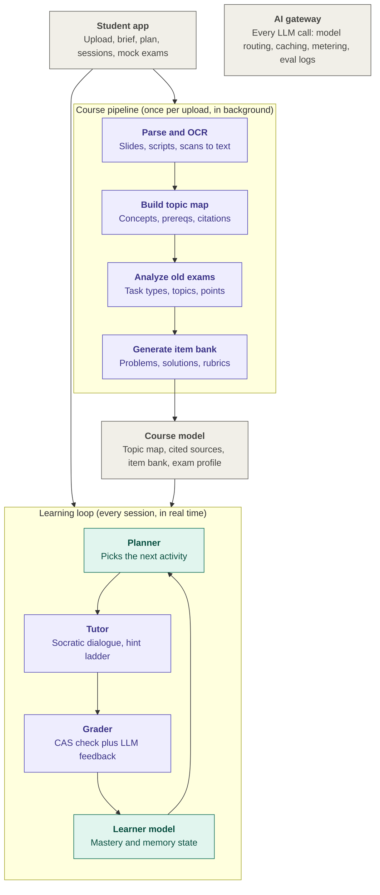

# Architecture Proposal

This is the first proposal of the architecture of the core learning loop/course pipeline and its subsystems. Many research questions will be based on this proposal to test if the proposal holds stand.

## Course pipeline (runs once per upload)

This turns a pile of PDFs into a structured course model that every later step relies on.

Parse: Math-heavy slides and scanned old exams need a vision model or a specialised OCR tool that outputs LaTeX, not plain text extraction. Every chunk keeps its provenance (file, page, slide), which is what makes “cited down to the slide” possible later.
Topic map: Extract concepts, definitions, theorems and methods into a graph with prerequisite edges. Each node links to its source chunks. This graph is the backbone: the planner schedules over it, the tutor retrieves through it, and readiness is reported per node.
Exam analysis: Split old exams into tasks and tag each with topic, task type (compute, prove, define), points and difficulty. Frequency × points gives a relevance weight per topic. The student’s brief (“he always asks about eigenvalues”, “skip chapter 7”) overrides it.
Item bank: Generate practice items per skill, each with a reference solution and a grading rubric. Anchor them on the course’s own exercises and old exam tasks rather than inventing from scratch. Verify before use: a computer algebra system (e.g. SymPy) checks anything computable, and a second model pass checks the rest.

This is where your “process once, reuse” principle pays off. It runs as background jobs, can use cheaper batch APIs, and the result is cached. If many students upload the same course, you could deduplicate by content hash, though that runs straight into your open copyright question.

## Learning loop (runs every session)

The learner model is the heart of the product, and it should be boring code. Store every attempt as an immutable event: item, answer, hints used, whether the solution was viewed, time taken, error type. From that log you derive two numbers per skill. One is mastery (Bayesian knowledge tracing or an Elo-style rating). The other is memory strength (an FSRS-style spaced-repetition model). Your honesty principle becomes a rule here: viewing the solution is logged but earns no mastery credit. Because the log is the source of truth, you can change the models later and recompute everything.

The planner is an optimizer, not an LLM. It takes the topic map, relevance weights, learner model, exam date and available time. It produces a priority score roughly like relevance × (1 − mastery) × prerequisites ready, plus whatever reviews are due. Your mode switch is just different weights. Weeks out favours coverage, spacing and interleaving. Days out is pure triage. The LLM’s only jobs here are turning “I only have 30 minutes and hate proofs” into constraints, and explaining the plan in plain words. When the student skips or reorders something, the planner simply recomputes.

The tutor is an LLM running inside a pedagogical state machine. The orchestrator decides the activity type: retrieval warm-up, worked example, faded example, independent problem, interleaved set. The LLM conducts the dialogue within that activity. Its context is small and precise: the current item, the reference solution and rubric, a few source chunks pulled through the topic map, and the student’s state on this skill. It works through a hint ladder: nudge, then strategy, then a partial step, then the full solution. Questions off the plan get answered too, grounded in citations or marked as going beyond the course. This structure is also what stops it from becoming the open-ended chatbot you listed as a non-goal.

The grader separates what can be checked from what needs judgment. Final answers and intermediate expressions go to the CAS, which is deterministic and free. The LLM gives feedback on the reasoning, comparing against the reference solution and rubric. It also classifies the error (conceptual, procedural or slip), and that classification feeds back into the learner model.

Mock exams and readiness fit on top of the same pieces. A mock exam is drawn from the item bank following the old exams’ blueprint. Readiness is a predicted score shown as a range per topic, not a single confident number. Asking for the real grade afterwards gives you the calibration loop your success criteria call for.
